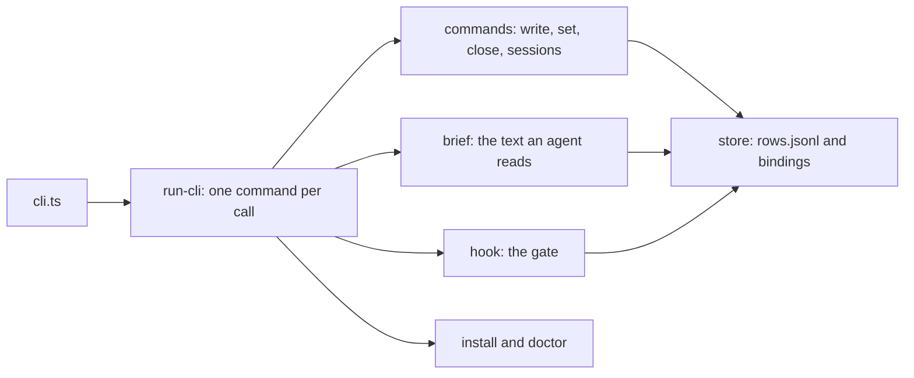

# Overview

`wherewerewe` keeps the notes of one long coding agent session as short labelled rows, and prints
them back as one brief when the agent runs `www`. Read this before you change the package, then read
[the design](../design/wherewerewe/README.md) for the contract of the part you change.

## The package

The `@wherewerewe/cli` package in `packages/cli/` installs two commands, `www` and `wherewerewe`,
that run the same file. Agents and people type `www`, because it is short. A hook entry runs
`wherewerewe`, because no other common tool uses that name. The package compiles to one binary per
platform, and each release builds them.

## One call

`cli.ts` reads the process's arguments, environment and stdin into one context value, and `runCLI`
turns that context into the text and the exit code. Nothing below `cli.ts` reads the process, so
each test calls `runCLI` with a temp home and a fixed clock.

A command that cannot go on throws a refusal, which holds the reason and the command that puts it
right. `runCLI` prints it and exits 2, or 4 when no session was found.

## The store

A session is a folder that holds `rows.jsonl`. Every write appends one line, and a read folds the
lines into the latest version of each row. No code path rewrites the file, so the store needs no
lock. The same folder of sessions holds `.bindings/`, one file per host session that names its notes
session, and `.gate/`, one file per host session for the gate.

A folder with a 0.1 `session` file and no `rows.jsonl` is an old store. The first read converts it
and writes `rows.jsonl`, and later reads never look at the old files.

## The brief and the rows

`www` prints the brief, a text view of the open rows grouped by label. `www rows` prints the same
rows as JSON lines. Both read the store the same way, and neither writes.

## The gate

Each hook entry runs `wherewerewe hook <host>` with the event on stdin. The hook reads the binding
of the host session in the payload, and keeps one small gate file for it. It prints a refusal for a
tool call made before the agent has run bare `www` since the last start or compaction. Every failure
inside the hook lets the call through.

## Install

`www install` plans each file it would write, compares the plan with what is on disk, and writes
only the files that differ, after a backup. `www doctor` makes the same plan and reports it without
writing. The `www` skill is text inside the binary, so the skill a machine has always matches its
binary.

## Verify

`bun verify` runs the real `www` in a run folder and drives each feature in
[the registry](../../scripts/verify/create-verify-registry.ts) through its journey. The
`verify / gate` check fails a pull request that changes a feature with no verdict in its
description.
