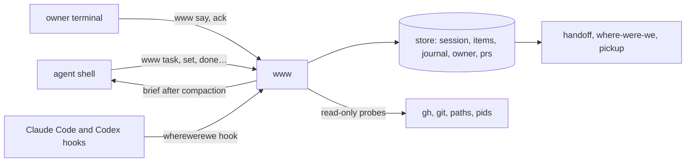

# wherewerewe

- **Status:** draft
- **Decision records:** [0001](../../decisions/0001-the-store-is-plain-tsv-files.md), [0002](../../decisions/0002-sessions-bind-by-agent-session-id.md), [0003](../../decisions/0003-checks-are-built-in-read-only-probes.md), [0004](../../decisions/0004-hooks-install-once-per-machine.md), [0005](../../decisions/0005-owner-notes-need-a-terminal-outside-any-agent.md), [0006](../../decisions/0006-ship-typescript-source-run-by-bun.md), [0007](../../decisions/0007-hooks-do-not-build-on-agent-hooks.md)

One coding agent session runs for about two weeks and is compacted many times. Its Markdown notes file rots: the agent appends below a stale top until the file is too long to read back, and by day 9 it stops keeping notes at all. `wherewerewe` (typed as `www`) replaces the file with a store that holds one short line per thing that is true now, prints the whole state in at most 52 lines with live checks of each pull request, branch, path and process the lines name, and puts that brief back in the agent's context after every compaction through a hook in Claude Code and in Codex.

The goal: after any compaction on any day, the agent reads one bounded brief whose stale claims are marked before it acts, and writing a note costs one short command.

The owner reads this set once and signs off the whole design. A build agent starts at [build-order.md](build-order.md), takes the next slice, and reads the part docs that slice names. When a slice changes a contract, it changes the part doc in the same pull request.

## Shape

## The docs

| Doc                                         | What it settles                                                                    |
| ------------------------------------------- | ---------------------------------------------------------------------------------- |
| [store.md](store.md)                        | where the store lives, each file's format and version, and the hand-store import  |
| [commands.md](commands.md)                  | every command, its output, and each refusal with its exact text                    |
| [brief.md](brief.md)                        | the brief's order and lines, the caps, the worst-case size, and a day-9 example    |
| [checks.md](checks.md)                      | the probes, their timeouts, and what a failed or offline check prints              |
| [sessions-and-hooks.md](sessions-and-hooks.md) | how a command and a hook find their session, the hooks, install and doctor     |
| [owner-notes.md](owner-notes.md)            | how the owner's notes stay apart from the agent's writes, and what that does not stop |
| [shipping.md](shipping.md)                  | the package, the built file, the runtime, and why the hooks don't use agent-hooks |
| [skills.md](skills.md)                      | what changes in the handoff, where-were-we and pickup skills                       |
| [build-order.md](build-order.md)            | the slices, each with what it delivers, its dependencies and its acceptance lines  |

## Decisions

These span parts. Each part doc lists its own.

- **The command is `www`; the package also installs `wherewerewe`.** Agents and the owner type the command dozens of times a day, and no common tool owns `www`. Hooks and install text use the long name, so a clash with another `www` can never break a hook.
- **One store per session, outside every repo.** One session works across several repos, so the store lives in the user's state folder. [0001](../../decisions/0001-the-store-is-plain-tsv-files.md)
- **A session opts in by `www init`, `www attach` or `www import`; nothing else turns the tool on.** The hooks are installed once per machine and stay silent for every agent session that has no binding. [0002](../../decisions/0002-sessions-bind-by-agent-session-id.md), [0004](../../decisions/0004-hooks-install-once-per-machine.md)
- **Every read runs the live checks, and a check never changes an item.** The brief marks what changed and prints the command that fixes it; the agent runs it. [0003](../../decisions/0003-checks-are-built-in-read-only-probes.md)
- **The tool works without hooks.** Hooks put the brief in context and record pull requests; every command works from a bare shell, so an agent with no hooks still reads and writes the same store.

## What the owner's sign-off authorises

Signing off this design authorises the build agent to take these steps when its slice reaches them, with no further question:

- Run `www install`, which adds hook entries to `~/.claude/settings.json` and `~/.codex/hooks.json` and keeps every other hook. [sessions-and-hooks.md](sessions-and-hooks.md)
- Add `hooks = true` and the store root to `writable_roots` in `~/.codex/config.toml`. [sessions-and-hooks.md](sessions-and-hooks.md)
- Run `www import build` on the build session's hand-kept store, after fixing the rows it names. [store.md](store.md)

Only the owner can do these, by hand:

- Trust the three new hook entries in Codex's `/hooks`.
- Publish the first version to npm, with the one command the npm-publish skill hands over.

## Builder decides

- Internal module names, file layout, and the argument parser.
- Test layout and fixture names.
- The wording of help text beyond the lines [commands.md](commands.md) fixes.

## Out of scope

- A store shared between machines. The store and its bindings live on one machine, as handoff docs do.
- Moving figure-it-out's decision log onto `www decide`. [skills.md](skills.md) says what that later change would take.
- Repo setup: the repo-standard skill covers it.
