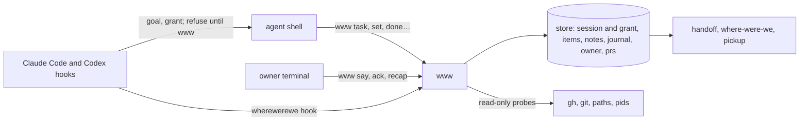

# wherewerewe

- **Status:** agreed
- **Decision records:** [0001](../../decisions/0001-the-store-is-plain-tsv-files.md), [0002](../../decisions/0002-sessions-bind-by-agent-session-id.md), [0003](../../decisions/0003-checks-are-built-in-read-only-probes.md), [0004](../../decisions/0004-hooks-install-once-per-machine.md), [0005](../../decisions/0005-owner-notes-need-a-terminal-outside-any-agent.md), [0006](../../decisions/0006-ship-typescript-source-run-by-bun.md), [0007](../../decisions/0007-hooks-do-not-build-on-agent-hooks.md), [0008](../../decisions/0008-notes-the-grant-and-no-caution-steering.md), [0009](../../decisions/0009-30-open-tasks-and-a-count-of-the-rest.md), [0013](../../decisions/0013-the-hooks-gate-until-the-agent-reads-the-brief.md), [0014](../../decisions/0014-the-gate-fails-open.md), [0015](../../decisions/0015-a-post-tool-hook-marks-the-brief-read.md), [0016](../../decisions/0016-the-brief-limit-is-20000-tokens-or-the-host-limit.md), [0017](../../decisions/0017-a-lesson-is-a-kind-of-its-own.md), [0018](../../decisions/0018-a-promise-is-a-kind-of-its-own.md), [0019](../../decisions/0019-the-owners-words-are-a-kind-of-their-own.md), [0020](../../decisions/0020-authority-comes-from-the-owners-own-acts.md)

One coding agent session runs for about two weeks and is compacted many times. Its Markdown notes file rots: the agent appends below a stale top until the file is too long to read back, and by day 9 it stops keeping notes at all. `wherewerewe` (typed as `www`) replaces the file with a store that holds one short line per thing that is true now, with an optional note of detail on each, and the owner's grant in the owner's words. It prints the state with live checks of each pull request, branch, path and process the lines name, within the limit of the agent that reads it, at most 20,000 estimated tokens and less where the host cuts shell output, with the open tasks that fit and a count of the rest. After every compaction, a hook in Claude Code and in Codex puts the goal and the grant back in context and refuses the agent's tool calls until it reads the brief whole with `www`.

The tool serves a single long-running orchestrator. One brief shared across machines or sessions is out of scope, because sharing would widen who can write the store ([0013](../../decisions/0013-the-hooks-gate-until-the-agent-reads-the-brief.md)).

The goal is that after any compaction on any day, the agent reads one bounded brief whose stale claims are marked before it acts, and writing a note costs one short command.

The owner reads this set once and signs off the whole design. A build agent starts at [build-order.md](build-order.md), takes the next slice, and reads each part doc linked from that slice. When a slice changes a contract, it changes the part doc in the same pull request.

## Shape

## The docs

| Doc                                         | What it settles                                                                    |
| ------------------------------------------- | ---------------------------------------------------------------------------------- |
| [store.md](store.md)                        | where the store lives, each file's format and version, the hand-store import and the format 2 upgrade |
| [commands.md](commands.md)                  | the help, each command's signature, limits and reply, `show`, `log` and the owner's recap, and each refusal with its exact text |
| [lists-and-json.md](lists-and-json.md)      | `www list`, `--json` on the read commands, and the `/goal` text of `www goal --paste` |
| [brief.md](brief.md)                        | the brief's order and lines, the caps, the limit and the cut order, the worst-case size, and a day-9 example    |
| [checks.md](checks.md)                      | the probes, their timeouts, and what a failed or offline check prints              |
| [sessions-and-hooks.md](sessions-and-hooks.md) | how a command and a hook find their session, the hooks, the gate, install and doctor     |
| [owner-notes.md](owner-notes.md)            | how the owner reads the session, corrects it, and keeps their notes apart from the agent's writes, and what that does not stop |
| [shipping.md](shipping.md)                  | the package, the built file, the runtime, and why the hooks don't use agent-hooks |
| [skills.md](skills.md)                      | what changes in the handoff, where-were-we and pickup skills                       |
| [build-order.md](build-order.md)            | the slices, each with what it delivers, its dependencies, its acceptance lines and its wringer feature |

## Decisions

These span parts. Each part doc lists its own.

- **The command is `www`; the package also installs `wherewerewe`.** Agents and the owner type the command dozens of times a day, and no common tool owns `www`. Hooks and install text use the long name, so a clash with another `www` can never break a hook.
- **One store per session, outside every repo.** One session works across several repos, so the store lives in the user's state folder. [0001](../../decisions/0001-the-store-is-plain-tsv-files.md)
- **A session opts in by `www init`, `www attach` or `www import`; nothing else turns the tool on.** The hooks are installed once per machine and stay silent for every agent session that has no binding. A bound session opts into the gate the same way. [0002](../../decisions/0002-sessions-bind-by-agent-session-id.md), [0004](../../decisions/0004-hooks-install-once-per-machine.md), [0013](../../decisions/0013-the-hooks-gate-until-the-agent-reads-the-brief.md)
- **Every read runs the live checks, and a check never changes an item.** The brief marks what changed and prints the command that fixes it; the agent runs it. [0003](../../decisions/0003-checks-are-built-in-read-only-probes.md)
- **Every slice in this repo is verified with wringer, and built with the build-feature workflow with Codex as its only review.** Each pull request carries the wringer report, and `verify / gate` fails it when a changed feature has no claim. [build-order.md](build-order.md)
- **The brief keeps what the agent may do fresh, and never steers it to hold back.** The owner's grant prints whole after the goal; the note of the item in focus prints under `NOW`, and an owed note stops its item's close. Write no heading, reply or refusal that tells the agent to ask or to act only inside a limit; a separate permission check polices actions. [0008](../../decisions/0008-notes-the-grant-and-no-caution-steering.md)
- **The tool works without hooks.** Hooks put the goal and the grant in context, refuse tool calls until the agent reads the brief after a compaction, and record pull requests; every command works from a bare shell, so an agent with no hooks still reads and writes the same store.

## What the owner's sign-off authorises

Signing off this design authorises the build agent to take these steps when its slice reaches them, with no further question:

- Run `www install`, which adds hook entries to `~/.claude/settings.json` and `~/.codex/hooks.json` and keeps every other hook. [sessions-and-hooks.md](sessions-and-hooks.md)
- Let `www install` write the two allow rules: `Bash(www *)` in `~/.claude/settings.json`, and a rule in `~/.codex/rules/wherewerewe.rules` that runs `www` outside the Codex sandbox. [sessions-and-hooks.md](sessions-and-hooks.md)
- Add `hooks = true` and the store root to `writable_roots` in `~/.codex/config.toml`. [sessions-and-hooks.md](sessions-and-hooks.md)
- Run `www import build` on the build session's hand-kept store, after fixing the rows it names. [store.md](store.md)
- Run `www import build` again in slice 2c to upgrade that store to format 2, with the owner's words that authorise the build as its grant, one `--may`, `--not` or `--never` bullet per permission, and the agent's reading of them. [store.md](store.md)
- Make `verify / gate` a required check on `main`, once the workflow has run. [build-order.md](build-order.md)

Only the owner can do these, by hand:

- Trust the five new hook entries in Codex's `/hooks`.
- Publish the first version to npm, with the one command the npm-publish skill hands over.

## Builder decides

- Internal module names, file layout, and the argument parser.
- Test layout and fixture names.
- The wording of help text beyond the lines fixed in [commands.md](commands.md).
- The name of any command or flag except `www goal --paste`, when the docs read better for it. The builder keeps the help block, the `Run:` lines and the tests in step.

## Out of scope

- A store shared between machines. The store and its bindings live on one machine, as handoff docs do.
- Moving figure-it-out's decision log onto `www decide`. [skills.md](skills.md) says what that later change would take.
- Repo setup: the repo-standard skill covers it.
