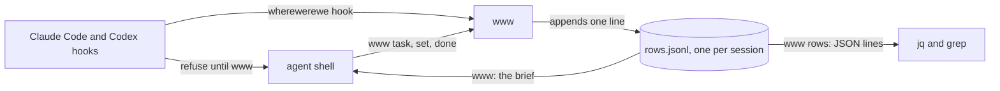

# wherewerewe

- **Status:** built
- **Decision records:** [0025](../../decisions/0025-one-table-of-labelled-rows.md)

A coding agent session runs for days and is compacted many times, and each compaction drops what the agent knew. `wherewerewe`, typed as `www`, keeps what is true in the session as short labelled rows, and prints them back as one brief. The agent writes a row with one short command, and reads the brief after each compaction. A hook holds the agent's other tool calls until it has.

The tool is a small aid for one agent and its owner. It keeps no task system, runs no checks, and never runs another program.

## Shape



## The row

Every note is one row. A goal, a task, a wait, a decision and the owner's grant differ only in their label.

```json
{
  "id": "wait-3",
  "label": "wait",
  "text": "Review of the tide feed PR",
  "note": "asked on 25 Nov",
  "who": "dana",
  "by": "agent",
  "at": "2026-11-26T02:10:00.000Z"
}
```

| Field      | Holds                                                                                  |
| ---------- | -------------------------------------------------------------------------------------- |
| `id`       | the id the agent gave with `--id`, or `<label>-<n>` from the tool                      |
| `label`    | any word of lower-case letters, digits and dashes, 24 characters at most               |
| `text`     | the one line, 300 characters at most                                                   |
| `note`     | optional detail, 1,500 characters at most                                              |
| `who`      | optional: who a wait is on                                                             |
| `by`, `at` | who wrote the row, and when                                                            |
| `closed`   | absent while the row is open; otherwise `at`, `how` (`done` or `dropped`) and evidence |

A label is data. The tool gives six labels a shape check on the way in, and treats every other label the same:

- `goal`, `pin` and `now` hold one row each, with the label as its id. A new one replaces the old.
- `grant` takes any text. The agent writes what the owner meant, in plain words it can act on.
- `wait` needs `--who`.
- `decision`, written with `www decide`, needs `--why`, which becomes the note.
- `pr` takes a number or a pull request URL.

A text over 300 characters is refused with the count and the limit. The limit keeps each row one fact, so the brief stays a list a reader can scan.

## The file

Each session keeps one file, `rows.jsonl`, in `$XDG_STATE_HOME/wherewerewe/<name>/`, or in `~/.local/state/wherewerewe/<name>/` when that variable is unset.

- A write appends one line. An edit appends the row again, and the last line for an id wins. A close appends the row with `closed` set.
- The tool never rewrites the file and takes no lock, so two writers at once both land.
- Before the tool makes an id, it creates an empty file named after that id in the session's `.ids/` folder. When two writers want the same id, only one can create its file, so the other gets the next id.
- The tool skips a line it cannot read, and the brief's first line counts the skipped lines.

The first read of a 0.1 store converts it: the tool writes `rows.jsonl` beside the old files, and leaves the old files as the backup.

## The commands

`www help` prints the list. Bare `www` prints the brief as text, because an agent reads it straight after a compaction. Every other command but `www help` prints JSON, and `--human` prints plain text in its place. A refusal exits 2 and prints its reason and the command to run, as JSON on stderr.

```text
$ www task "Write alerts-e2e against staging"
{"ok":true,"id":"task-1","label":"task"}
$ www wait "Review of the tide feed PR"
{"ok":false,"error":"a wait names who you wait on","run":"www wait \"<text>\" --who <who>"}
```

Any first word that is not a command is a label, so `www lesson "…"` writes a row labelled `lesson`. `www rows` prints every open row as JSON lines, and `www rows --all` prints every line of the file, closed rows and old versions included. The tool has no list, search or history command: `jq` and `grep` read the rows.

## The brief

```text
tide-alerts · 6 open rows · last write 2m ago
GOAL   Ship tide alerts behind the tide_alerts flag; done when alerts-e2e passes on staging
PIN    Keep the alert path boring: one queue, one retry rule
GRANT
       grant-1  merge the alert PRs once CI is green
       grant-2  never touch the prod push certificate
NOW    Write the first alert case
WAIT   wait-1  Review of the tide feed PR [dana]
TASK   task-1  Write alerts-e2e against staging
               note: Use the recorded tide fixtures
Everything: www rows | jq   ·   Write: www <label> "<text>"   ·   www help
```

- The brief prints `goal`, `pin`, `grant`, `now` and `wait` first and whole. Each other label follows in the order it first appeared.
- Each other label with more than 12 open rows prints its newest 12 and the count.
- A brief over 24,000 characters prints fewer rows of each long label: 5, then 2, then 1. Claude Code cuts shell output near 30,000 characters, so the brief stays under that.
- A note prints its first line, up to 160 characters. `www rows` prints the whole note.

## Sessions

A command finds its session from `--session`, then `WHEREWEREWE_SESSION`, then the binding of the host's session id: `CLAUDE_CODE_SESSION_ID`, or `CODEX_SESSION_ID`, or `CODEX_THREAD_ID`. `www init <name> --goal "<goal>"` starts a session and binds the shell, and `www attach <name>` binds the shell to a session that exists. With no session, a command exits 4 and never picks one for the agent.

A shell bound to one session keeps it: `init` and `attach` refuse to move it without `--switch`. A test that runs `www init` from a live agent shell would otherwise move that agent's notes.

## The gate

`www install` adds two hook entries per host, `SessionStart` and `PreToolUse`, that run `wherewerewe hook claude` or `wherewerewe hook codex`.

| Event                                   | What the hook does                                         |
| --------------------------------------- | ---------------------------------------------------------- |
| `SessionStart`, a start or a compaction | marks the session as not yet read, and prints one line     |
| `PreToolUse`, not yet read              | refuses the call, with the reason and `Run: www`           |
| `PreToolUse` of bare `www`              | lets it through, and marks the session read                |
| `PreToolUse`, read                      | lets it through                                            |
| the fourth refused call in a row        | lets it through, marks the session read, and says it did   |

- Only bare `www`, with at most `--session <name>`, opens the gate. `www rows` and `www help` do not, because neither prints the brief.
- A session with no binding, and a subagent's call, pass untouched.
- The gate fails open. A payload the hook cannot read, a missing file or any error lets the call through, so a broken setup never traps a session.

## Install and doctor

`www install` writes these, and backs up each file it changes as `<file>.www-backup`:

- the two hook entries and the allow rules `Bash(www *)` and `Bash(wherewerewe *)` in `~/.claude/settings.json`;
- the two hook entries in `~/.codex/hooks.json`, and allow rules for both names in `~/.codex/rules/wherewerewe.rules`;
- the `www` skill in `~/.claude/skills/www/` and `~/.agents/skills/www/`.

It removes the hook entries of an older version, and replaces a skill file only when the tool wrote that file. `www install --print` shows what it would write and writes nothing. `www doctor` checks the same files, that the shell can write the store, and that a Codex `config.toml` names the store among its writable roots. It exits 3 when something needs a fix, and each line says what to run.

## Shipping

The tool ships as one compiled binary per platform, for macOS and Linux on arm64 and x64, so the machine needs no runtime. Each release attaches the four binaries and a `SHA256SUMS` file to its GitHub release, and writes the formula in the owner's Homebrew tap. The formula and [install.sh](../../../install.sh) each install the binary as `wherewerewe`, with `www` as a link to it. The package is private and goes to no registry. See [Install wherewerewe](../../guides/install.md) and [Releasing](../../runbooks/releasing.md).

## Constraints

- The tool runs no other program. The brief and every write read and append files, and nothing else.
- A feature is added only after a real failure in use shows the need. Blocking, checks, approvals and a second view of the rows were each built once and removed, as [0025](../../decisions/0025-one-table-of-labelled-rows.md) records.
- Both hosts get the same hook entries and the same skill.
