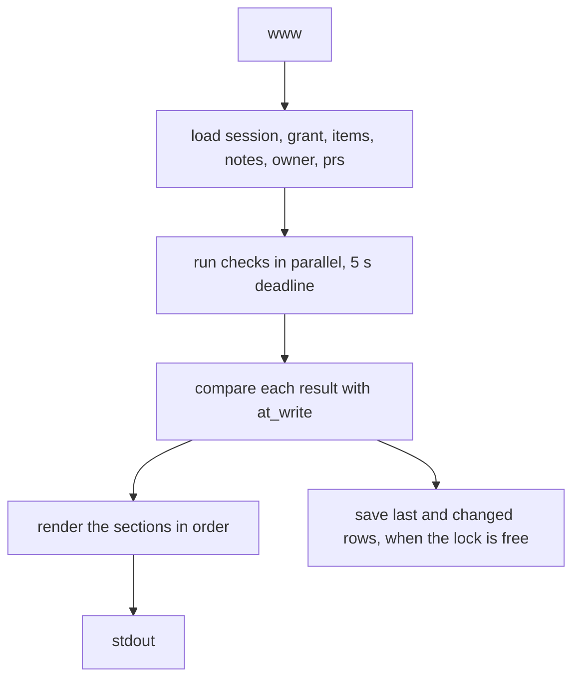

# The brief

- **Status:** agreed
- **Decision records:** [0008](../../decisions/0008-notes-the-grant-and-no-caution-steering.md)

`www` with no subcommand prints the brief: the whole state of the session in at most 63 lines and 7,000 characters on any day. It opens with the goal, the owner's grant, the owner's notes and the claims whose check results have changed, so the agent reads what it may do and which claims are stale before it acts. It ends with one line that teaches the write commands again. The same text is what the hooks put in context after a compaction. A build agent reads this doc to build the brief renderer and its size test, in its slice of [build-order.md](build-order.md).

## Shape



## Contracts

### Sections, in order

| Section                      | Shows                                                                                              | When empty  |
| ---------------------------- | -------------------------------------------------------------------------------------------------- | ----------- |
| header                       | session, day, time, age of the last write, how many checks ran and how long they took             | always      |
| `GOAL`                       | the goal                                                                                           | always      |
| `GRANT`                      | the owner's words whole, where and when they were given, and the agent's reading of what they cover and what the owner kept back | `GRANT  none. Run: www grant --quote "<the owner's words, whole>" --where <where> --reading "<what they cover; what the owner kept back>"` |
| `OWNER SAYS`                 | each owner note, oldest first                                                                      | left out    |
| `CHANGED SINCE WRITTEN`      | each item whose check result differs from `at_write`, at most 3 rows, with the command that fixes it | left out  |
| `NOW`                        | the item in focus, its next step or why the step is hidden, then the item's note                   | `NOW  none. Run: www now <id> "<next step>"` |
| `OPEN`                       | tasks; the item in focus first, then oldest first                                                  | left out    |
| `WAITING`                    | waits, oldest first                                                                                | left out    |
| `APPROVED ONCE`              | the one-time approval                                                                              | left out    |
| `RULES`                      | rules, oldest first                                                                                | left out    |
| `WHERE`                      | where items, oldest first                                                                          | left out    |
| `PULL REQUESTS THIS SESSION OPENED THAT NO ITEM NAMES` | open pull requests in `prs.tsv` ([store.md](store.md)) that no item's check names, at most 1 row | left out |
| footer                       | one fixed line that teaches the writes                                                             | always      |

### Line templates and their widths

The day is the number of UTC calendar days from the date of `started` to today, plus 1, so the day the session starts is day 1; `--since day-<n>` and "closed on day <n>" use the same count. An age is `<n>m` under an hour, `<n>h` under 48 hours, and `<n>d` after that, so it is at most 4 characters. An id is padded to 12 columns, and a longer id pushes the rest of the line. A tag is the bracketed text at the end of an item line.

A wrapped block breaks each line at the last space that leaves the line 85 to 100 characters long, and drops that space. When no space falls in that range, the line ends at 100 characters. The goal, the grant's words, the grant's reading and the note wrap this way.

| Line                     | Template                                                                                     | Widest |
| ------------------------ | -------------------------------------------------------------------------------------------- | ------ |
| header                   | `<name> · day <d> · <Ddd YYYY-MM-DD HH:MMZ> · last write <age> ago · <n> checks in <t>s[ · <n> unchecked: <reason>]`, or `no checks` in place of the check count when nothing has a check | 133 |
| header, second line      | `  results not saved: <the store is not writable here \| another write held the lock>`        | 51     |
| goal                     | `GOAL  <goal>`, wrapped, each further line indented 6                                         | 3 lines, 218 |
| grant heading            | `GRANT  from the owner in <where>, <age> ago`; the age is that of the words                   | 51     |
| grant words              | `  "<the owner's words>"`, wrapped, each further line indented 3                              | 9 lines, 728 |
| grant reading            | `  reading: <reading>`, wrapped, each further line indented 4                                 | 3 lines, 219 |
| owner note               | `  o-<n>  <text>  [<age>]`, or `[on <id> · <age>]` when it has `--on`                         | 198    |
| changed row              | `  <id>  was <at_write> (<age>) · now <result> · run: <fix command>`                          | 131    |
| changed overflow         | `  and <n> more; each shows its result in its section below`                                   | 57     |
| now                      | `NOW  <id> · set <age> ago`, then ` · note <age> ago` or ` · owed note <age> ago` when the item has a note | 57 |
| next step                | `  next: <next step>`, or `  next step hidden: <id> changed after it was set. Run: www now <id> "<next step>"` | 128 |
| note                     | `    <note>`, wrapped, every line indented 4                                                  | 5 lines, 420 |
| task                     | `  <id>  <claim>  [<tag>]`; tag is the result, `no check · <age>`, `not checked yet`, or `blocked by <id>` with ` · <result>` when it has a check; then ` · owed` when the item has an owed note | 196 |
| wait                     | `  <id>  <claim>  [<who> · <result or age>[ · owed]]`                                         | 185    |
| approval                 | `  <id>  "<quote>" · <scope>`, then `  [owed]` when it has an owed note                       | 193    |
| rule                     | `  <id>  <claim>`, then `  [owed]` when it has an owed note                                   | 148    |
| where                    | `  <id>  <claim>  [<result or no check · age>[ · owed]]`                                      | 166    |
| pull request             | `  <ref>  opened <age> ago  [<result>]`; a ref over 60 characters is cut to 59 and `…`        | 98     |
| pull request overflow    | `  and <n> more: www log --op pr`                                                             | 30     |
| pull request hint        | `  name each in an item: www task <id> "<claim>" --pr <owner>/<repo>#<n>`                     | 71     |

A check result is at most 15 characters; the list is in [checks.md](checks.md). The fix command in a changed row is at most 64 characters with a 16-character id, the longest an id can be, and the widest changed row pairs the 6-character `CLOSED` with that 64-character fix:

| The check now reads                        | Fix command                                                     |
| ------------------------------------------ | --------------------------------------------------------------- |
| `MERGED`                                   | `www done <id> --evidence "merged, seen by check"`              |
| `CLOSED`                                   | `www drop <id> --why "closed unmerged, seen by check"`          |
| `gone` for a pid                           | `www drop <id> --why "process gone, seen by check"`             |
| `gone` for a branch                        | `www drop <id> --why "branch gone, seen by check"`              |
| `missing` for a path                       | `www drop <id> --why "path missing, seen by check"`             |
| anything else                              | `www set <id> "<what is true now>"`                             |

The footer is this line, as written:

```text
Write as you go: www set <id> "<claim>" --note "<detail>" · www decide, done or drop · www help
```

### Caps and the worst case

| Kind               | Cap | Why this number                                                                 |
| ------------------ | --- | ------------------------------------------------------------------------------- |
| task               | 6   | the work a session can hold in mind at once                                     |
| wait               | 4   | each wait is a question someone else must answer                                |
| one-time approval  | 1   | it is spent soon, and lasting permission lives in the grant                     |
| rule               | 5   | rules beyond 5 belong in the repo's AGENTS.md                                   |
| where              | 4   | worktrees, processes and secret locations in use at once                        |
| owner note         | 2   | the owner clears one before adding a third                                      |
| note               | 1 per open item | a rewrite replaces it, and only the note of the item in focus prints |
| grant              | 1   | the owner's words whole, in one place                                           |

The worst case fills every cap with every text at its limit: every item has its widest tag and an owed note, the grant has 700 characters of words and a 200-character reading, the item in focus has a 400-character note, 3 changed rows and 1 pull request row each have an overflow line, those two headings each carry a two-digit count, and the header runs to two lines. The widths come from the renderer's line templates above.

A wrapped line holds at least 85 characters, so a line that carries a prefix of `p` characters carries at least `85 − p` characters of text. That gives each wrapped block its line count:

- Goal, 200 characters behind a 6-character prefix: 2 lines carry at least 2 × 79 = 158, so 3 lines.
- Grant words, 700 characters and the closing quote mark behind a 3-character prefix: 8 lines carry at least 8 × 82 = 656, so 9 lines.
- Grant reading, 200 characters behind `  reading: ` (11), then a 4-character indent: 2 lines carry at least 74 + 81 = 155, so 3 lines.
- Note, 400 characters behind a 4-character indent: 4 lines carry at least 4 × 81 = 324, so 5 lines.

A wrapped block's characters are its text plus each line's prefix; a dropped space only lowers the count.

| Block             | Lines  | Characters                                    |
| ----------------- | ------ | --------------------------------------------- |
| header            | 2      | 133 + 51 = 184                                |
| goal              | 3      | 200 + 3 × 6 = 218                             |
| grant             | 13     | 51 + (701 + 9 × 3) + (200 + 11 + 2 × 4) = 998 |
| owner notes       | 3      | 52 + 2 × 198 = 448                            |
| changed           | 5      | 60 + 3 × 131 + 57 = 510                       |
| now and its note  | 7      | 57 + 128 + (400 + 5 × 4) = 605               |
| open (6 tasks)    | 7      | 13 + 6 × 196 = 1,189                          |
| waiting (4)       | 5      | 16 + 4 × 185 = 756                            |
| approved once (1) | 2      | 22 + 193 = 215                                |
| rules (5)         | 6      | 14 + 5 × 148 = 754                            |
| where (4)         | 5      | 14 + 4 × 166 = 678                            |
| pull requests     | 4      | 57 + 98 + 30 + 71 = 256                       |
| footer            | 1      | 95                                            |
| newlines          |        | 63                                            |
| **Total**         | **63** | **6,969**                                     |

Codex puts at most about 2,500 tokens of hook output into context. Ids, paths and hashes tokenize at about 3 characters per token, and plain English at about 4. At the pessimistic rate, 6,969 characters is about 2,323 tokens, 7.1% under Codex's limit, and the 7,000-character cap is about 2,333 tokens, 6.7% under it. The cap is 30% under Claude Code's limit of 10,000 characters.

## Constraints

- The brief is at most 7,000 characters and 63 lines. A test renders the worst case above and checks both numbers.
- When a bug makes the brief longer than 7,000 characters, the renderer drops item lines from the bottom up, starting with pull request rows, then where, rules, the one-time approval, waits and tasks, and ends the last kept section with `  (<n> lines cut to fit; run www show <id>)`. It never drops or clips the header, goal, grant, owner notes, changed rows, now, the note, or footer.
- The grant prints whole on every brief, directly after `GOAL`.
- A changed item is one whose check result differs from its `at_write`. A result of `unchecked` never counts as changed, and an `at_write` of `-` takes the first result without counting it as changed.
- When the item in focus changed after `now_set`, or its check reads `MERGED`, `CLOSED`, `gone` or `missing`, the brief hides the next step and prints the `next step hidden` line. The step stays in the journal, and the note still prints.
- Only the note of the item in focus prints. Every item with an owed note shows ` · owed` in its tag, or `  [owed]` when its kind has no tag, the item in focus included.
- A changed row's fix command stays the same when the item has an owed note. Running it gets the owed-note refusal in [commands.md](commands.md), which prints the note whole.
- A tag shows `blocked by <id>` only while that id is open. Closing the blocker clears the tag on the next read.
- An item with no check shows its age since `written`, so the reader sees which lines nobody verified.
- Never use a heading, label, footer or tag to tell the agent to hold back, to ask, or to act only inside a limit. Make each heading say what the section holds. Two headings keep a suffix, `OWNER SAYS (<n>) · act on it; only the owner clears it` and `CHANGED SINCE WRITTEN (<n>) · these claims are no longer true`, because 0008 keeps each for stating or preventing a fact. [0008](../../decisions/0008-notes-the-grant-and-no-caution-steering.md)
- Once a session is found and its store is in format 2, the brief always exits 0 and prints, whatever the checks, the lock or the network do. Exits 4 and 5 are defined in [commands.md](commands.md).
- A write reply's first line ends with the brief's line count, except the `init`, `attach`, `detach` and `import` replies; the reply table in [commands.md](commands.md) is the authority. Take the count from the same renderer, with check results from `last`, and run no checks.

## The brief on day 9 of an invented session

The session `tide-alerts` adds low-water push alerts to a sailing app across `bosunhq/bosun-api`, `bosunhq/bosun-app` and an upstream library, `tidal-org/tidekit`. Day 1 was Monday 2026-03-02. This output is 45 lines and 3,310 characters.

```text
tide-alerts · day 9 · Tue 2026-03-10 11:43Z · last write 41m ago · 7 checks in 2.8s
GOAL  Ship tide alerts in bosun-api and bosun-app: a push alert 2 hours before low water at a saved
      harbour, behind the tide_alerts flag. Done when alerts-e2e passes on staging.
GRANT  from the owner in chat, 7d ago
  "Merge the alert PRs in bosun-api and bosun-app yourself once CI is green and every review finding
   is answered. Deploy either app to staging whenever you need to, and wipe or reseed the staging
   alerts table as often as you like. Open PRs on tidal-org/tidekit from our fork. Keep away from
   the prod push certificate and the prod database, and don't publish a tidekit release."
  reading: covers merges in both repos on green CI with findings answered, staging deploys, the
    staging alerts table, tidekit PRs; kept back: prod push certificate, prod database, tidekit
    releases
OWNER SAYS (1) · act on it; only the owner clears it
  o-3  Use the recorded tide fixtures for e2e, not the live feed  [on t-e2e · 2h]
CHANGED SINCE WRITTEN (3) · these claims are no longer true
  pr-app-61   was OPEN passing (27h) · now MERGED · run: www done pr-app-61 --evidence "merged, seen by check"
  pr-api-77   was OPEN pending (1h) · now OPEN failing · run: www set pr-api-77 "<what is true now>"
  p-sim       was alive (22h) · now gone · run: www drop p-sim --why "process gone, seen by check"
NOW  pr-api-77 · set 1h ago · note 1h ago
  next step hidden: pr-api-77 changed after it was set. Run: www now pr-api-77 "<next step>"
    The 503s come from the feed's hourly refresh, about 4 s long (d-23). Retry 3 times, 2 s apart: a
    longer backoff makes the alert miss its 2-hour window. The lint job fails on an unused import in
    the retry helper, not on the retry logic.
OPEN (5 of 6)
  pr-api-77   Alert job retries a 503 from the tide feed; pushed 3e1f0aa  [OPEN failing]
  pr-app-61   Alert settings screen: in review  [MERGED]
  pr-tk-19    tidekit: harmonic constants for harbours south of 60°S  [OPEN pending]
  t-flag      Turn on the tide_alerts flag in staging config  [blocked by w-apns · owed]
  t-e2e       Write alerts-e2e against staging  [no check · 3d]
WAITING (2 of 4)
  w-apns      upload the staging push key to the vault  [owner · 2d]
  w-tk        review tidal-org/tidekit#19  [tidekit team · OPEN pending]
APPROVED ONCE (1 of 1)
  ok-prod-index  "add the harbour_id index on the prod alerts table, once, after 22:00" · prod alerts table
RULES (3 of 5)
  r-api-tests Run the API tests from api/; from the repo root the queue tests are skipped
  r-tk-fork   tidekit is a fork here: pass -R tidal-org/tidekit to gh, or the PR opens on the fork
  r-sim-port  Start the app simulator with PORT=8091; 8090 belongs to another session
WHERE (3 of 4)
  wt-tz       bosun-api worktree for the time zone fix, branch tz-fix  [clean]
  p-sim       app simulator, pid 48211; stop it with kill 48211  [gone]
  s-staging   staging secrets live in the vault bosun-staging; never print a value  [no check · 8d]
PULL REQUESTS THIS SESSION OPENED THAT NO ITEM NAMES (1)
  bosunhq/bosun-app#64  opened 3h ago  [OPEN pending]
  name each in an item: www task <id> "<claim>" --pr <owner>/<repo>#<n>
Write as you go: www set <id> "<claim>" --note "<detail>" · www decide, done or drop · www help
```

The agent's next commands come from the brief alone: `www done pr-app-61 --evidence "merged, seen by check"`, `www drop p-sim --why "process gone, seen by check"`, then `www show pr-api-77` to read the failing job before it sets a new next step. Under the grant, the agent may merge `pr-api-77` itself once CI is green and the findings are answered.

## Decisions

- **The grant prints whole, directly after `GOAL`, and cut-to-fit never touches it.** After a compaction, the agent reads what it may do in the owner's own words before any claim. [0008](../../decisions/0008-notes-the-grant-and-no-caution-steering.md)
- **Only the note of the item in focus prints.** The brief stays the same size however many items carry a note. An owed note shows as a tag on its item, and `now`, each close and `www show` print a note whole. [0008](../../decisions/0008-notes-the-grant-and-no-caution-steering.md)
- **Row limits pay for the grant and the note, and the caps stay.** The brief shows at most 3 changed rows and 1 pull request row, each section with an overflow line, and a one-line footer. The task, wait, rule and where caps stay, so no store that fits them today is refused; the format 2 upgrade in [store.md](store.md) handles the approvals.
- **A claim is at most 120 characters.** At 160, the worst case passes 7,700 characters, over Codex's limit at 3 characters per token.
- **Caps count items, not characters.** The section heading shows the count (`4 of 6`), and every field's own limit bounds the characters.
- **The brief prints no journal rows.** `www log`, `www show` and `www recap` read the journal; the brief stays the same size however long the session runs.

## Builder decides

- Whether the brief colours anything when stdout is a terminal. It never colours output to a pipe or a hook.

## Open questions

- **Does Codex put the worst-case brief into context whole?** A measurement settles it: the hooks slice renders the worst case through a Codex `SessionStart` hook and looks for the temp-file preview. Until then, the 7,000-character cap stands.
