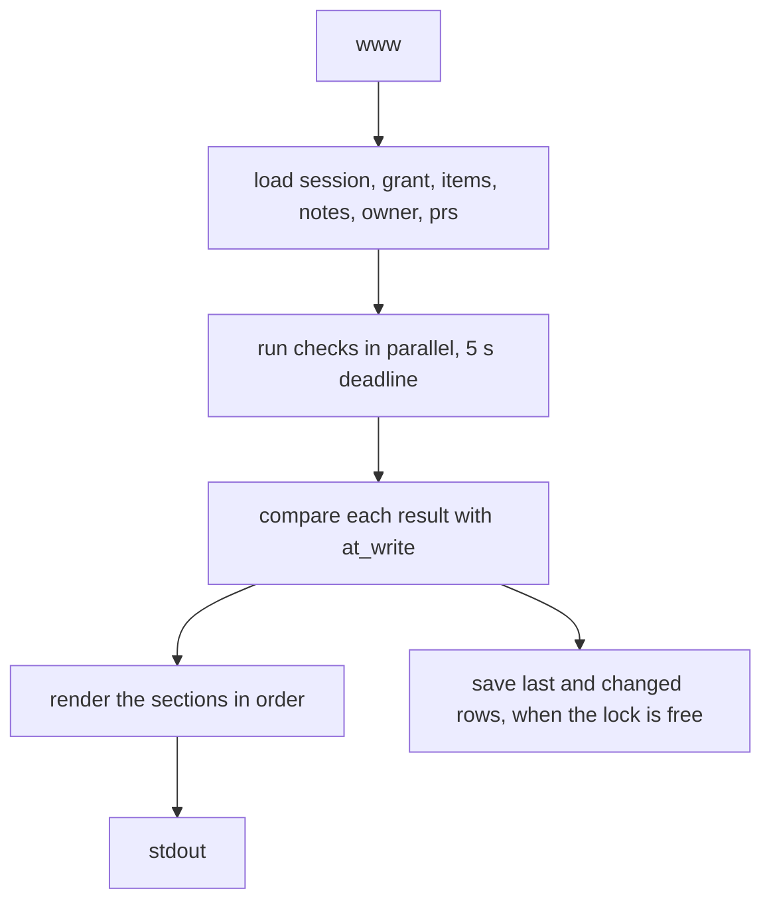

# The brief

- **Status:** agreed
- **Decision records:** [0008](../../decisions/0008-notes-the-grant-and-no-caution-steering.md), [0009](../../decisions/0009-30-open-tasks-and-a-count-of-the-rest.md), [0010](../../decisions/0010-the-brief-budget-follows-its-host.md), [0011](../../decisions/0011-a-grant-of-limits-and-its-lines.md), [0012](../../decisions/0012-a-capped-heading-names-its-max.md)

`www` with no subcommand prints the brief: the session's state, within the limits of [The brief's budget per host](#the-briefs-budget-per-host) on any day. It prints every section whole except three: `OPEN` prints the tasks that fit and a line that counts the rest, and the changed claims and the open pull requests each print up to their row limit and a line that counts the rest. It opens with the goal, the owner's grant, the owner's notes and the claims whose check results have changed, so the agent reads what it may do and which claims are stale before it acts. It ends with one line that repeats the write commands. The hooks put the same text in context after a compaction. To build the brief renderer and its size test, read this doc and your slice of [build-order.md](build-order.md).

## Shape



## Contracts

### Sections, in order

| Section                      | Shows                                                                                              | When empty  |
| ---------------------------- | -------------------------------------------------------------------------------------------------- | ----------- |
| header                       | session, day, time, age of the last write, how many checks ran and how long they took             | always      |
| `GOAL`                       | the goal                                                                                           | always      |
| `GRANT`                      | where and when the owner gave the grant, the owner's scope, the owner's words in bullets under `may`, `not` and `never`, at least one bullet in any of them, and the agent's reading of what they cover and what the owner kept back | `GRANT  none. Run: www grant --may "<what the owner allows, in their words>" --where <where> --reading "<what they cover; what the owner kept back>"` |
| `OWNER SAYS`                 | each owner note, oldest first                                                                      | left out    |
| `CHANGED SINCE WRITTEN`      | each item whose check result differs from `at_write`, at most 3 rows, with the command that fixes it | left out  |
| `NOW`                        | the item in focus, its next step or why the step is hidden, then the item's note                   | `NOW  none. Run: www now <id> "<next step>"` |
| `OPEN`                       | tasks, in the order the next paragraph gives, as many rows as fit in the host's budget with the item in focus always among them, then `  and <m> more open tasks: www show`, with `--session <name>` when the brief ran with it | left out    |
| `WAITING`                    | waits, oldest first                                                                                | left out    |
| `APPROVED ONCE`              | the one-time approval                                                                              | left out    |
| `RULES`                      | rules, oldest first                                                                                | left out    |
| `WHERE`                      | where items, oldest first                                                                          | left out    |
| `PULL REQUESTS THIS SESSION OPENED THAT NO ITEM NAMES` | open pull requests in `prs.tsv` ([store.md](store.md)) that no item's check names, at most 1 row | left out |
| footer                       | one fixed line with the write commands                                                             | always      |

The `OPEN` rows run in this order: the item in focus; then each task whose saved check result differs from its `at_write`; then each task that is blocked or has an owed note; then the rest. Within each group the newest `written` comes first, and on a tie the later row of `items.tsv`, because a new item is appended to it. `www show` with no id lists every open task in that order.

### Line templates and their widths

The day is the number of UTC calendar days from the date of `started` to today, plus 1, so the day the session starts is day 1; `--since day-<n>` and "closed on day <n>" use the same count. An age is `<n>m` under an hour, `<n>h` under 48 hours, and `<n>d` after that, so it is at most 4 characters. In a template, `<id>  ` stands for the id padded with spaces to 12 columns; an id of 12 or more characters takes two spaces after it, and pushes the rest of the line. A tag is the bracketed text at the end of an item line.

A wrapped block breaks each line at the last space that leaves the line 85 to 100 characters long, and drops that space. When no space falls in that range, the line ends at 100 characters. The goal, each grant bullet, the grant's reading and the note wrap this way.

| Line                     | Template                                                                                     | Widest |
| ------------------------ | -------------------------------------------------------------------------------------------- | ------ |
| header                   | `<name> · day <d> · <Ddd YYYY-MM-DD HH:MMZ> · last write <age> ago · <n> checks in <t>s[ · <n> unchecked: <reason>]`, or `no checks` in place of the check count when nothing has a check | 133 |
| header, second line      | `  results not saved: <the store is not writable here \| another write held the lock>`        | 51     |
| goal                     | `GOAL  <goal>`, wrapped, each further line indented 6                                         | 3 lines, 218 |
| grant heading            | `GRANT  from the owner in <where>, <age> ago`, then ` · <scope>` when the owner gave one; the age is that of the words | 94     |
| grant bullet             | `  may    • <bullet>`, `  not    • <bullet>` or `  never  • <bullet>` for a group's first bullet, `         • <bullet>` for each further one; wrapped, each further line indented 11 | 19 lines across all bullets, each at most 100 characters |
| grant reading            | `  reading: <reading>`, wrapped, each further line indented 4                                 | 3 lines, 219 |
| owner note               | `  o-<n>  <text>  [<age>]`, or `[on <id> · <age>]` when it has `--on`                         | 198    |
| changed row              | `  <id>  was <at_write> (<age>) · now <result> · run: <fix command>`                          | 131    |
| changed overflow         | `  and <n> more; each shows its result below, or in the list of open tasks`                    | 72     |
| now                      | `NOW  <id> · set <age> ago`, then ` · note <age> ago` or ` · owed note <age> ago` when the item has a note | 57 |
| next step                | `  next: <next step>`, or `  next step hidden: <id> changed after it was set. Run: www now <id> "<next step>"` | 128 |
| note                     | `    <note>`, wrapped, every line indented 4                                                  | 5 lines, 420 |
| task                     | `  <id>  <claim>  [<tag>]`; tag is the result, `no check · <age>`, `not checked yet`, or `blocked by <id>` with ` · <result>` when it has a check; then ` · owed` when the item has an owed note | 196 |
| wait                     | `  <id>  <claim>  [<who> · <result or age>[ · owed]]`                                         | 185    |
| approval                 | `  <id>  "<quote>" · <scope>`, then `  [owed]` when it has an owed note                       | 193    |
| rule                     | `  <id>  <claim>`, then `  [owed]` when it has an owed note                                   | 148    |
| where                    | `  <id>  <claim>  [<result or no check · age>[ · owed]]`                                      | 166    |
| open count line          | `  and <m> more open tasks: www show`, or `  and <m> more open tasks: www --session <name> show`; `<m>` is at most 25 | 69 |
| pull request             | `  <ref>  opened <age> ago  [<result>]`; a ref over 60 characters is cut to 59 and `…`        | 98     |
| pull request overflow    | `  and <n> more: www log --op pr`                                                             | 30     |
| pull request hint        | `  name each in an item: www task <id> "<claim>" --pr <owner>/<repo>#<n>`                     | 71     |

A group with no bullets is left out. A `never` bullet joins the line before, after two spaces, when that line holds only whole `never` bullets and the joined line stays within 100 characters. `www grant` refuses a `•` in a bullet, the scope, the reading and `--where`, so each `•` starts a bullet. A `may` or `not` bullet takes a line of its own, so each permission reads alone. The brief adds only the labels `may`, `not` and `never` to the owner's words, and prints the scope in the owner's words, with each line break as one space.

A check result is at most 15 characters; the list is in [checks.md](checks.md). The fix command in a changed row is at most 64 characters with a 16-character id, the longest an id can be, and the widest changed row pairs the 6-character `CLOSED` with that 64-character fix:

| The check now reads                        | Fix command                                                     |
| ------------------------------------------ | --------------------------------------------------------------- |
| `MERGED`                                   | `www done <id> --evidence "merged, seen by check"`              |
| `CLOSED`                                   | `www drop <id> --why "closed unmerged, seen by check"`          |
| `gone` for a pid                           | `www drop <id> --why "process gone, seen by check"`             |
| `gone` for a branch                        | `www drop <id> --why "branch gone, seen by check"`              |
| `missing` for a path                       | `www drop <id> --why "path missing, seen by check"`             |
| anything else                              | `www set <id> "<what is true now>"`                             |

The footer is this line, as written:

```text
Write as you go: www set <id> "<claim>" --note "<detail>" · www decide, done or drop · www help
```

### Caps and the worst case

| Kind               | Cap | Why this number                                                                 |
| ------------------ | --- | ------------------------------------------------------------------------------- |
| task               | 30  | a long session's work: the owner expects up to 20 tasks; the brief prints the rows that fit and counts the rest ([0009](../../decisions/0009-30-open-tasks-and-a-count-of-the-rest.md)) |
| wait               | 4   | each wait is a question someone else must answer                                |
| one-time approval  | 1   | it is spent soon, and lasting permission lives in the grant                     |
| rule               | 5   | rules beyond 5 belong in the repo's AGENTS.md                                   |
| where              | 4   | worktrees, processes and secret locations in use at once                        |
| owner note         | 2   | the owner clears one before adding a third                                      |
| note               | 1 per open item | a rewrite replaces it, and only the note of the item in focus prints |
| grant              | 1, of at most 700 characters across its bullets and scope | the owner's words in one place |
| grant bullet       | 12, on at most 19 lines of the brief | one permission each, a whole sentence if need be; the count bounds the `never` bullets that share a line ([0011](../../decisions/0011-a-grant-of-limits-and-its-lines.md)) |

The worst case fills every cap with every text at its limit: every item has its widest tag and an owed note, the grant has 12 bullets on 19 lines and a 40-character scope holding 700 characters of the owner's words, and a 200-character reading, the item in focus has a 400-character note, 3 changed rows and 1 pull request row each have an overflow line, those two headings each carry a two-digit count, and the header runs to two lines on a day of at most 999. The widths come from the line templates above. The worst case holds 6 tasks under the Codex budget, because 7 or more print 5 rows and the count line, which is 127 characters shorter.

A wrapped line holds at least 85 characters, so a line that carries a prefix of `p` characters carries at least `85 − p` characters of text. That gives each wrapped block its line count:

- Goal, 200 characters behind a 6-character prefix: 2 lines carry at least 2 × 79 = 158, so 3 lines.
- Grant bullets, behind an 11-character prefix: a bullet of any length wraps, and each wrapped line carries at least 75 characters of its text, 74 printed and the space the wrap drops. The bullets take at most 19 lines, which `www grant` refuses to pass. At most 1 of the 12 bullets joins a line, because 19 lines need at least 11 line starts: the wraps of one bullet carry at least 690 characters, and the other 11 bullets at least 11 more, over the 660 characters the words leave after a 40-character scope. So the bullet lines hold at most 660 + 19 × 11 + 4 = 873 characters: the words, 11 for each line, and 4 for the one joined `never` bullet. A search through the renderer over bullet counts, lengths, groups and spacing finds at most 869, for 7 bullets of 90 and 5 of 6.
- Grant reading, 200 characters behind `  reading: ` (11), then a 4-character indent: 2 lines carry at least 74 + 81 = 155, so 3 lines.
- Note, 400 characters behind a 4-character indent: 4 lines carry at least 4 × 81 = 324, so 5 lines.

A wrapped block's characters are its text plus each line's prefix; a dropped space only lowers the count.

| Block             | Lines  | Characters                                    |
| ----------------- | ------ | --------------------------------------------- |
| header            | 2      | 133 + 51 = 184                                |
| goal              | 3      | 200 + 3 × 6 = 218                             |
| grant             | 23     | 94 + (660 + 19 × 11 + 4) + (200 + 11 + 2 × 4) = 1,186 |
| owner notes       | 3      | 52 + 2 × 198 = 448                            |
| changed           | 5      | 60 + 3 × 131 + 72 = 525                       |
| now and its note  | 7      | 57 + 128 + (400 + 5 × 4) = 605               |
| open (6 tasks)    | 7      | 16 + 6 × 196 = 1,192                          |
| waiting (4)       | 5      | 18 + 4 × 185 = 758                            |
| approved once (1) | 2      | 24 + 193 = 217                                |
| rules (5)         | 6      | 16 + 5 × 148 = 756                            |
| where (4)         | 5      | 16 + 4 × 166 = 680                            |
| pull requests     | 4      | 57 + 98 + 30 + 71 = 256                       |
| footer            | 1      | 95                                            |
| newlines          |        | 73                                            |
| **Total**         | **73** | **7,193**                                     |

### The brief's budget per host

The size limit follows the host that reads the brief, because each host puts a different amount of hook output into context.

- **Codex** takes at most about 2,500 tokens. Ids, paths and hashes tokenize at about 3 characters per token, and plain English at about 4. The budget is 73 lines and 7,200 characters. The worst case above is 7,193 characters, about 2,398 tokens at 3 characters a token, 4.1% under Codex's limit. The line cap of 73 is the line count of this worst case.
- **Claude Code** takes [10,000 characters of plain stdout](https://code.claude.com/docs/en/hooks); past that, Claude Code saves the output to a file and puts only the path and a 2,000-character preview into context. The budget is 82 lines and 9,000 characters, which keeps 1,000 characters under the cap for a character that Claude Code may count as 2 and the brief counts as 1. The worst case, below, is 8,967 characters, 10.3% under the cap. The line cap of 82 is the line count of this worst case.
- **No known host** gets the Codex budget, which fits both hosts. A brief printed in a plain terminal and then pasted into either agent is never cut to a preview.

The host comes from the reader's environment, never from the store: `CLAUDE_CODE_SESSION_ID` gives Claude Code, `CODEX_SESSION_ID` or `CODEX_THREAD_ID` gives Codex, and with both families set, Claude Code wins, as in [sessions-and-hooks.md](sessions-and-hooks.md). A `--session` flag changes none of this. The hook passes the host its own command line names.

The Claude Code worst case is the same store under the larger budget. Every block but `OPEN` takes 66 lines and 5,928 characters.

| `OPEN`                                              | Lines in all  | Characters in all                                  |
| --------------------------------------------------- | ------------- | -------------------------------------------------- |
| 15 tasks: `OPEN (15, max 30)` and 15 rows, no count line | 66 + 16 = 82 | 5,928 + 17 + 15 × 196 + 82 newlines = 8,967        |
| 16 to 30 tasks: `OPEN (30, max 30)`, 14 rows, count line | 66 + 16 = 82 | 5,928 + 17 + 14 × 196 + 69 + 82 = 8,840            |
| 30 tasks, 15 rows and the count line (does not fit)  | 83            | 9,037                                              |

With 16 or more tasks, the 15th row pays for the count line. Under either budget the brief prints all the rows when they fit, and otherwise the most that fit, never fewer lines, the count line among them, than the budget's worst case keeps.

## Constraints

- The brief is within its host's budget. Write a test that renders the worst case above and checks both numbers for each budget.
- When a bug makes the brief longer than its host's budget, the renderer drops item lines from the bottom up, starting with pull request rows, then where, rules, the one-time approval, waits and tasks, except the row of the item in focus, and ends the last kept section with `  (<n> lines cut to fit; run www show <id>)`. It never drops or clips the header, goal, grant, owner notes, changed rows, now, the row of the item in focus, the note, or footer. The count line of `OPEN` is never cut: the cut drops task rows above it, and the cut line follows it when `OPEN` is the last kept section. The count line counts the task rows the fill left out, and the cut line counts the lines the cut dropped.
- The grant prints whole on every brief, directly after `GOAL`.
- A changed item is one whose check result differs from its `at_write`. A result of `unchecked` never counts as changed, and an `at_write` of `-` takes the first result without counting it as changed.
- When the item in focus changed after `now_set`, or its check reads `MERGED`, `CLOSED`, `gone` or `missing`, the brief hides the next step and prints the `next step hidden` line. The step stays in the journal, and the note still prints.
- Only the note of the item in focus prints. Every item with an owed note shows ` · owed` in its tag, or `  [owed]` when its kind has no tag, the item in focus included.
- A changed row's fix command stays the same when the item has an owed note. Running it gets the owed-note refusal in [commands.md](commands.md), which prints the note whole.
- A tag shows `blocked by <id>` only while that id is open. Closing the blocker clears the tag on the next read.
- An item of a kind that takes a check, a task, a wait or a where item, shows its age since `written` when it has no check, so the reader sees which lines nobody verified. A rule and an approval take no check and show no age.
- Never use a heading, label, footer or tag to tell the agent to hold back, to ask, or to act only inside a limit. Make each heading say what the section holds. A section of a capped kind that the agent fills prints `(<n>, max <cap>)`, `<n>` the open items of that kind; a section that prints fewer rows than `<n>` ends with a line that counts the rest, except when the cut of a brief over its budget drops rows. Two headings keep their own form, `OWNER SAYS (<n>) · act on it; only the owner clears it`, whose cap of 2 only the owner meets, and `CHANGED SINCE WRITTEN (<n>) · these claims are no longer true`, because 0008 keeps each for stating or preventing a fact. [0008](../../decisions/0008-notes-the-grant-and-no-caution-steering.md)
- Once a session is found and its store is in format 2, the brief always exits 0 and prints, whatever the checks, the lock or the network do. Exits 4 and 5 are defined in [commands.md](commands.md).
- A write reply's first line ends with the brief's line count, except the `init`, `attach`, `detach` and `import` replies; the reply table in [commands.md](commands.md) is the authority. Take the count from the same renderer, with check results from `last`, and run no checks.

## The brief on day 9 of an invented session

The session `tide-alerts` adds low-water push alerts to a sailing app across `bosunhq/bosun-api`, `bosunhq/bosun-app` and an upstream library, `tidal-org/tidekit`. Day 1 was Monday 2026-03-02. This output is 47 lines and 3,343 characters.

```text
tide-alerts · day 9 · Tue 2026-03-10 11:43Z · last write 41m ago · 7 checks in 2.8s
GOAL  Ship tide alerts in bosun-api and bosun-app: a push alert 2 hours before low water at a saved
      harbour, behind the tide_alerts flag. Done when alerts-e2e passes on staging.
GRANT  from the owner in chat, 7d ago · in bosun-api, bosun-app and tidekit
  may    • merge the alert PRs once CI is green and every review finding is answered
         • deploy either app to staging whenever you need to
         • wipe or reseed the staging alerts table as often as you like
         • open PRs on tidal-org/tidekit from our fork
  not    • the prod database
  never  • the prod push certificate  • publishing a tidekit release
  reading: covers merges in both repos on green CI with findings answered, staging deploys, the
    staging alerts table, tidekit PRs; kept back: prod push certificate, prod database, tidekit
    releases
OWNER SAYS (1) · act on it; only the owner clears it
  o-3  Use the recorded tide fixtures for e2e, not the live feed  [on t-e2e · 2h]
CHANGED SINCE WRITTEN (3) · these claims are no longer true
  pr-app-61   was OPEN passing (27h) · now MERGED · run: www done pr-app-61 --evidence "merged, seen by check"
  pr-api-77   was OPEN pending (1h) · now OPEN failing · run: www set pr-api-77 "<what is true now>"
  p-sim       was alive (22h) · now gone · run: www drop p-sim --why "process gone, seen by check"
NOW  pr-api-77 · set 1h ago · note 1h ago
  next step hidden: pr-api-77 changed after it was set. Run: www now pr-api-77 "<next step>"
    The 503s come from the feed's hourly refresh, about 4 s long (d-23). Retry 3 times, 2 s apart: a
    longer backoff makes the alert miss its 2-hour window. The lint job fails on an unused import in
    the retry helper, not on the retry logic.
OPEN (5, max 30)
  pr-api-77   Alert job retries a 503 from the tide feed; pushed 3e1f0aa  [OPEN failing]
  pr-app-61   Alert settings screen: in review  [MERGED]
  t-flag      Turn on the tide_alerts flag in staging config  [blocked by w-apns · owed]
  pr-tk-19    tidekit: harmonic constants for harbours south of 60°S  [OPEN pending]
  t-e2e       Write alerts-e2e against staging  [no check · 3d]
WAITING (2, max 4)
  w-apns      upload the staging push key to the vault  [owner · 2d]
  w-tk        review tidal-org/tidekit#19  [tidekit team · OPEN pending]
APPROVED ONCE (1, max 1)
  ok-prod-index  "add the harbour_id index on the prod alerts table, once, after 22:00" · prod alerts table
RULES (3, max 5)
  r-api-tests Run the API tests from api/; from the repo root the queue tests are skipped
  r-tk-fork   tidekit is a fork here: pass -R tidal-org/tidekit to gh, or the PR opens on the fork
  r-sim-port  Start the app simulator with PORT=8091; 8090 belongs to another session
WHERE (3, max 4)
  wt-tz       bosun-api worktree for the time zone fix, branch tz-fix  [clean]
  p-sim       app simulator, pid 48211; stop it with kill 48211  [gone]
  s-staging   staging secrets live in the vault bosun-staging; never print a value  [no check · 8d]
PULL REQUESTS THIS SESSION OPENED THAT NO ITEM NAMES (1)
  bosunhq/bosun-app#64  opened 3h ago  [OPEN pending]
  name each in an item: www task <id> "<claim>" --pr <owner>/<repo>#<n>
Write as you go: www set <id> "<claim>" --note "<detail>" · www decide, done or drop · www help
```

The agent's next commands come from the brief alone: `www done pr-app-61 --evidence "merged, seen by check"`, `www drop p-sim --why "process gone, seen by check"`, then `www show pr-api-77` to read the failing job before it sets a new next step. Under the grant, the agent may merge `pr-api-77` itself once CI is green and the findings are answered.

## Decisions

- **The grant prints whole, directly after `GOAL`, and cut-to-fit never touches it.** After a compaction, the agent reads what it may do in the owner's own words before any claim. [0008](../../decisions/0008-notes-the-grant-and-no-caution-steering.md)
- **The grant prints as bullets under `may`, `not` and `never`, one permission a bullet.** The owner reads a wrapped quote of 700 characters as a wall; a bullet per permission reads at a glance. The bullets cost up to 10 lines more than a quote. The line cap rises to pay for them, because Codex's limit is a token count, and the worst case stays 4.1% under it. [0008](../../decisions/0008-notes-the-grant-and-no-caution-steering.md)
- **Only the note of the item in focus prints.** The brief stays the same size however many items carry a note. An owed note shows as a tag on its item, and `now`, each close and `www show` print a note whole. [0008](../../decisions/0008-notes-the-grant-and-no-caution-steering.md)
- **Row limits pay for the grant and the note, and the caps stay.** The brief shows at most 3 changed rows and 1 pull request row, each section with an overflow line, and a one-line footer. The wait, rule and where caps stay, so no store that fits them today is refused, and the task cap is 30 ([0009](../../decisions/0009-30-open-tasks-and-a-count-of-the-rest.md)); the format 2 upgrade in [store.md](store.md) handles the approvals.
- **The brief prints the tasks that fit, in the order an agent needs them, and counts the rest.** The agent reads the item in focus first, then a claim that is no longer true, then work that waits on something or owes a note, then the newest. The count line names `www show`, which lists every open task in full. [0009](../../decisions/0009-30-open-tasks-and-a-count-of-the-rest.md)
- **The brief's budget follows the host that reads it.** Claude Code gets 82 lines and 9,000 characters, 10% under its 10,000-character cap on hook output; Codex and a reader with no known host get 73 lines and 7,200 characters. The host comes from the reader's environment, because one session can be bound to both hosts. [0010](../../decisions/0010-the-brief-budget-follows-its-host.md)
- **A claim is at most 120 characters.** At 160, the worst case passes 7,700 characters, over Codex's limit at 3 characters per token.
- **Caps count items.** The section heading shows the count (`4, max 30`), and every field's own limit bounds the characters; a grant bullet's are the grant's words and lines.
- **A heading names its limit as `max`.** `4 of 6` reads as a total, so a capped heading prints `(<n>, max <cap>)`. `max` adds 2 characters to each of the five capped headings in the worst case, which leaves 7 characters of the Codex budget by the bound; `limit` passes it by 3. [0012](../../decisions/0012-a-capped-heading-names-its-max.md)
- **A grant takes any of `may`, `not` and `never`, and its bullets take at most 19 lines.** A limit alone is a grant, and the brief's size bounds the grant in place of a cap on one bullet. 19 lines is the line count the worst case already pays for. [0011](../../decisions/0011-a-grant-of-limits-and-its-lines.md)
- **The brief prints no journal rows.** `www log`, `www show` and `www recap` read the journal; the brief stays the same size however long the session runs.

## Builder decides

- Whether the brief colours anything when stdout is a terminal. It never colours output to a pipe or a hook.

## Open questions

- **Does Codex put the worst-case brief into context whole?** Measure it: in the hooks slice, render the worst case through a Codex `SessionStart` hook and look for the temp-file preview. Until then, the 7,200-character cap stands.
