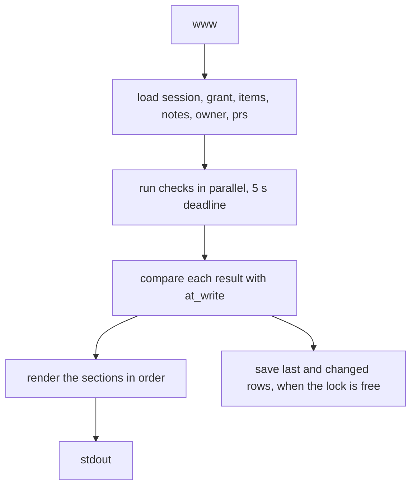

# The brief

- **Status:** agreed
- **Decision records:** [0008](../../decisions/0008-notes-the-grant-and-no-caution-steering.md), [0009](../../decisions/0009-30-open-tasks-and-a-count-of-the-rest.md), [0011](../../decisions/0011-a-grant-of-limits-and-its-lines.md), [0012](../../decisions/0012-a-capped-heading-names-its-max.md), [0016](../../decisions/0016-the-brief-limit-is-20000-tokens-or-the-host-limit.md), [0017](../../decisions/0017-a-lesson-is-a-kind-of-its-own.md), [0018](../../decisions/0018-a-promise-is-a-kind-of-its-own.md), [0019](../../decisions/0019-the-owners-words-are-a-kind-of-their-own.md)

`www` with no subcommand prints the brief: the session's state, within its limit ([The brief's limit](#the-briefs-limit)) on any day. It prints every section whole except four: `OPEN` prints the tasks that fit and a line that counts the rest, `DECISIONS` prints the 3 newest decisions in force and a line that counts the rest, and the changed claims and the open pull requests each print up to their row limit and a line that counts the rest. A brief over its limit also drops rows in [the cut order](#the-cut-order), which never drops a changed row. It opens with the goal, the owner's grant, the owner's notes and the claims whose check results have changed, so the agent reads what it may do and which claims are stale before it acts. It ends with one line that repeats the write commands. After a compaction, the `SessionStart` hook puts the goal and the grant in context, and the agent runs `www` for the rest ([sessions-and-hooks.md](sessions-and-hooks.md)). To build the brief renderer and its size test, read this doc and your slice of [build-order.md](build-order.md).

## Shape



## Contracts

### Sections, in order

| Section                      | Shows                                                                                              | When empty  |
| ---------------------------- | -------------------------------------------------------------------------------------------------- | ----------- |
| header                       | session, day, time, age of the last write, how many checks ran and how long they took             | always      |
| `GOAL`                       | the goal                                                                                           | always      |
| `GRANT`                      | where and when the owner gave the grant, the owner's scope, the owner's words in bullets under `may`, `not` and `never`, at least one bullet in any of them, and the agent's reading of what they cover and what the owner kept back | `GRANT  none. Run: www grant --may "<what the owner allows, in their words>" --where <where> --reading "<what they cover; what the owner kept back>"` |
| `OWNER SAYS`                 | each owner note, oldest first                                                                      | left out    |
| `WORDS`                      | the owner's exact words, oldest first                                                              | left out    |
| `CHANGED SINCE WRITTEN`      | each item whose check result differs from `at_write`, at most 3 rows, with the command that fixes it | left out  |
| `NOW`                        | the item in focus, its next step or why the step is hidden, then the item's note                   | `NOW  none. Run: www now <id> "<next step>"` |
| `OPEN`                       | tasks, in the order the next paragraph gives, as many rows as fit in the limit with the item in focus always among them, then `  and <m> more open tasks: www show`, with `--session <name>` when the brief ran with it | left out    |
| `WAITING`                    | waits, oldest first                                                                                | left out    |
| `PROMISED`                   | promises, oldest first                                                                             | left out    |
| `APPROVED ONCE`              | the one-time approval                                                                              | left out    |
| `RULES`                      | rules, oldest first                                                                                | left out    |
| `LESSONS`                    | lessons, oldest first                                                                              | left out    |
| `DECISIONS`                  | the 3 newest decisions in force, then a line that counts the rest                                  | left out when no decision is in force |
| `WHERE`                      | where items, oldest first                                                                          | left out    |
| `PULL REQUESTS THIS SESSION OPENED THAT NO ITEM NAMES` | open pull requests in `prs.tsv` ([store.md](store.md)) that no item's check names, at most 1 row | left out |
| footer                       | one fixed line with the write commands                                                             | always      |

The `OPEN` rows run in this order: the item in focus; then each task whose saved check result differs from its `at_write`; then each task that is blocked or has an owed note; then the rest. Within each group the newest `written` comes first, and on a tie the later row of `items.tsv`, because a new item is appended to it. `www show` with no id lists every open task in that order.

### Line templates and their widths

The day is the number of UTC calendar days from the date of `started` to today, plus 1, so the day the session starts is day 1; `--since day-<n>` and "closed on day <n>" use the same count. An age is `<n>m` under an hour, `<n>h` under 48 hours, and `<n>d` after that, so it is at most 4 characters. In a template, `<id>  ` stands for the id padded with spaces to 12 columns; an id of 12 or more characters takes two spaces after it, and pushes the rest of the line. A tag is the bracketed text at the end of an item line.

A wrapped block breaks each line at the last space that leaves the line 85 to 100 characters long, and drops that space. When no space falls in that range, the line ends at 100 characters. The goal, each grant bullet, the grant's reading and the note wrap this way.

| Line                     | Template                                                                                     | Widest |
| ------------------------ | -------------------------------------------------------------------------------------------- | ------ |
| header                   | `<name> · day <d> · <Ddd YYYY-MM-DD HH:MMZ> · last write <age> ago · <n> checks in <t>s[ · <n> unchecked: <reason>]`, or `no checks` in place of the check count when no probe runs | 133 |
| header, second line      | `  results not saved: <the store is not writable here \| another write held the lock>`        | 51     |
| goal                     | `GOAL  <goal>`, wrapped, each further line indented 6                                         | 3 lines, 218 |
| grant heading            | `GRANT  from the owner in <where>, <age> ago`, then ` · <scope>` when the owner gave one; the age is that of the words | 94     |
| grant bullet             | `  may    • <bullet>`, `  not    • <bullet>` or `  never  • <bullet>` for a group's first bullet, `         • <bullet>` for each further one; wrapped, each further line indented 11 | 19 lines across all bullets, each at most 100 characters |
| grant reading            | `  reading: <reading>`, wrapped, each further line indented 4                                 | 3 lines, 219 |
| owner note               | `  o-<n>  <text>  [<age>]`, or `[on <id> · <age>]` when it has `--on`                         | 198    |
| changed row              | `  <id>  was <at_write> (<age>) · now <result> · run: <fix command>`                          | 131    |
| changed overflow         | `  and <n> more; each shows its result below, or in the list of open tasks`                    | 72     |
| now                      | `NOW  <id> · set <age> ago`, then ` · note <age> ago` or ` · owed note <age> ago` when the item has a note | 57 |
| next step                | `  next: <next step>`, or `  next step hidden: <id> changed after it was set. Run: www now <id> "<next step>"`, or `  next step hidden: <id> reads <result>. Run: www now <id> "<next step>"` (103 characters with a 16-character id and a 15-character result) | 128 |
| note                     | `    <note>`, wrapped, every line indented 4                                                  | 5 lines, 420 |
| task                     | `  <id>  <claim>  [<tag>]`; tag is the result, `no check · <age>`, `not checked yet`, or `blocked by <id>` with ` · <result>` when it has a check; then ` · owed` when the item has an owed note | 196 |
| wait                     | `  <id>  <claim>  [<who> · <result or age>[ · owed]]`                                         | 185    |
| approval                 | `  <id>  "<quote>" · <scope>`, then `  [owed]` when it has an owed note                       | 193    |
| rule                     | `  <id>  <claim>`, then `  [owed]` when it has an owed note                                   | 148    |
| owner's words            | `  <id>  "<words>"  [<where> · <age>]`                                                          | 349    |
| promise                  | `  <id>  <what>  [to <who> · by <when>]`                                                      | 193    |
| lesson                   | `  <id>  <instruction>  [why: <why>]`                                                         | 349    |
| decision                 | `  <d-n>  <choice>`, with a choice over 200 characters, such as one imported from a hand-kept journal, cut to 199 and `…`; the heading is `DECISIONS (<n> in force)` | 212    |
| where                    | `  <id>  <claim>  [<result or no check · age>[ · owed]]`                                      | 166    |
| open count line          | `  and <m> more open tasks: www show`, or `  and <m> more open tasks: www --session <name> show`; `<m>` is at most 30, and at most 29 while a task is in focus | 69 |
| pull request             | `  <ref>  opened <age> ago  [<result>]`; a ref over 60 characters is cut to 59 and `…`        | 98     |
| pull request overflow    | `  and <n> more: www list prs`, or `  and <n> more: www --session <name> list prs`                | 62     |
| cut line                 | `  and <n> more: www list <kind>`, or `  and <n> more: www --session <name> list <kind>`; `<kind>` is `waits`, `approvals`, `rules`, `where`, `lessons`, `promises`, `words` or `decisions` | 68 |
| pull request hint        | `  name each in an item: www task <id> "<claim>" --pr <owner>/<repo>#<n>`                     | 71     |

The new headings are `WORDS (<n>, max 8)`, `PROMISED (<n>, max 5)`, `LESSONS (<n>, max 5)` and `DECISIONS (<n> in force)`, in the order of the sections table. A group with no bullets is left out. A `never` bullet joins the line before, after two spaces, when that line holds only whole `never` bullets and the joined line stays within 100 characters. `www grant` refuses a `•` in a bullet, the scope, the reading and `--where`, so each `•` starts a bullet. A `may` or `not` bullet takes a line of its own, so each permission reads alone. The brief adds only the labels `may`, `not` and `never` to the owner's words, and prints the scope in the owner's words, with each line break as one space.

A check result is at most 15 characters; the list is in [checks.md](checks.md). The fix command in a changed row is at most 64 characters with a 16-character id, the longest an id can be, and the widest changed row pairs the 6-character `CLOSED` with that 64-character fix:

| The check now reads                        | Fix command                                                     |
| ------------------------------------------ | --------------------------------------------------------------- |
| `MERGED`                                   | `www done <id> --evidence "merged, seen by check"`              |
| `CLOSED`                                   | `www drop <id> --why "closed unmerged, seen by check"`          |
| `gone` for a pid                           | `www drop <id> --why "process gone, seen by check"`             |
| `gone` for a branch                        | `www drop <id> --why "branch gone, seen by check"`              |
| `missing` for a path                       | `www drop <id> --why "path missing, seen by check"`             |
| anything else                              | `www set <id> "<what is true now>"`                             |

The footer is this line, as written:

```text
Write as you go: www set <id> "<claim>" --note "<detail>" · www decide, done or drop · www help
```

### Caps and the worst case

The day-9 example in [The brief on day 9](#the-brief-on-day-9-of-an-invented-session) shows the caps below: 8 waits, 15 rules and 8 where items.

| Kind               | Cap | Why this number                                                                 |
| ------------------ | --- | ------------------------------------------------------------------------------- |
| task               | 30  | a long session's work: the owner expects up to 20 tasks; the brief prints the rows that fit and counts the rest ([0009](../../decisions/0009-30-open-tasks-and-a-count-of-the-rest.md)) |
| wait               | 8   | a session across 3 repos waits on 2 or 3 people or teams in each                |
| one-time approval  | 1   | it is spent soon, and lasting permission lives in the grant                     |
| rule               | 15  | one rule a line; past 15, a rule belongs in the repo's AGENTS.md                |
| lesson             | 5   | each guards against one mistake that happened here; a lesson that proves general belongs in the repo's AGENTS.md |
| promise            | 5   | each is owed to someone, and `www recap` prints every one                       |
| where              | 8   | 3 repos each with a worktree and a process, and 2 places for secrets            |
| owner note         | 2   | the owner clears one before adding a third                                      |
| owner's words      | 8   | one screen of the owner's principles; past 8, they belong in AGENTS.md or a skill |
| note               | 1 per open item | a rewrite replaces it, and only the note of the item in focus prints |
| grant              | 1, of at most 700 characters across its bullets and scope | the owner's words in one place |
| grant bullet       | 12, on at most 19 lines of the brief | one permission each, a whole sentence if need be; the count bounds the `never` bullets that share a line ([0011](../../decisions/0011-a-grant-of-limits-and-its-lines.md)) |

The worst case fills every cap with every text at its limit: every item has its widest tag and an owed note, the grant has 12 bullets on 19 lines and a 40-character scope holding 700 characters of the owner's words, and a 200-character reading, the item in focus has a 400-character note, 3 changed rows and 1 pull request row each have an overflow line, those two headings each carry a two-digit count, and the header runs to two lines on a day of at most 999. It also holds 8 owner's words of 300 characters, 5 lessons, 5 promises and 3 decision rows with a count line, and its session name has 24 characters. The widths come from the line templates above, with every text ASCII, so a character is a byte, except the marks below.

A wrapped line holds at least 85 characters, so a line that carries a prefix of `p` characters carries at least `85 − p` characters of text. That gives each wrapped block its line count:

- Goal, 200 characters behind a 6-character prefix: 2 lines carry at least 2 × 79 = 158, so 3 lines.
- Grant bullets, behind an 11-character prefix: a bullet of any length wraps, and each wrapped line carries at least 75 characters of its text, 74 printed and the space the wrap drops. The bullets take at most 19 lines, which `www grant` refuses to pass. At most 1 of the 12 bullets joins a line, because 19 lines need at least 11 line starts: the wraps of one bullet carry at least 690 characters, and the other 11 bullets at least 11 more, over the 660 characters the words leave after a 40-character scope. So the bullet lines hold at most 660 + 19 × 11 + 4 = 873 characters: the words, 11 for each line, and 4 for the one joined `never` bullet. A search through the renderer over bullet counts, lengths, groups and spacing finds at most 869, for 7 bullets of 90 and 5 of 6.
- Grant reading, 200 characters behind `  reading: ` (11), then a 4-character indent: 2 lines carry at least 74 + 81 = 155, so 3 lines.
- Note, 400 characters behind a 4-character indent: 4 lines carry at least 4 × 81 = 324, so 5 lines.

A wrapped block's characters are its text plus each line's prefix; a dropped space only lowers the count. A test renders the ASCII worst case and pins each block's bytes below, with each newline and each multi-byte mark counted.

| Block | Bytes |
| --- | --- |
| header | 206 |
| goal | 219 |
| grant | 1,228 |
| owner notes | 452 |
| owner's words (8) | 2,825 |
| changed | 521 |
| now and its note | 610 |
| open (30 tasks) | 5,988 |
| waiting (8) | 1,523 |
| promised (5) | 995 |
| approved once (1) | 220 |
| rules (15) | 2,254 |
| lessons (5) | 1,769 |
| decisions (3 rows) | 683 |
| where (8) | 1,361 |
| pull requests | 256 |
| footer | 98 |
| **Total** | **21,208 bytes, 7,070 estimated tokens** |

### The brief's limit

The brief's limit is 20,000 estimated tokens or the host's shell output limit, whichever is smaller, with no host setting changed. [0016](../../decisions/0016-the-brief-limit-is-20000-tokens-or-the-host-limit.md)

An estimated token is 3 UTF-8 bytes, rounded up. The tool holds each limit in bytes, 20% under the measured limit of its host and rounded down, because the hosts cut by characters or bytes. On Claude Code the estimate undercounts: its tokenizer counted a 3,382-byte brief of the day-9 kind as about 1,530 tokens against an estimate of 1,128, and ids and commands at 2.25 bytes a token. Real Claude tokens run about 1.35 times the estimate, so 20,000 estimated tokens cost about 27,000 real tokens in a Claude Code context. On Codex the estimate is close: about 1,190 real tokens for the same brief, 5% over the estimate, and 13% under it for ids and commands. Each count includes the tool call's own few dozen tokens.

| Host          | Measured limit                                                                                           | The tool's limit                     | Why                                                                                   |
| ------------- | -------------------------------------------------------------------------------------------------------- | ------------------------------------ | ------------------------------------------------------------------------------------- |
| Claude Code   | 30,000 characters whole; at 31,000 and at 80,000, a file path and a 2,000-character preview (2.1.331)    | 24,000 bytes, 8,000 estimated tokens | a character is never fewer bytes, so 24,000 bytes stays 20% under 30,000 characters in any script |
| Codex         | 39,000 bytes whole when the call's `max_output_tokens` is 10,000 or absent; 39,500 and more cut in the middle; a smaller cap cuts lower (0.169.1) | 30,000 bytes, 10,000 estimated tokens | 20% under 39,000, rounded down; it holds when the agent passes `max_output_tokens: 10000`, which the Codex refusal asks for |
| no known host | none: no host cuts it                                                                                    | 60,000 bytes, 20,000 estimated tokens | 20,000 estimated tokens                                                               |

Codex's figure is higher than Claude Code's because Codex cuts at 39,000 bytes once the call asks for 10,000 tokens, while Claude Code shows a preview past 30,000 characters whatever the call says.

What raises each limit, and why `www install` sets neither:

- Claude Code: `bashOutputMaxChars`, in any settings file, up to 128,000 from v2.1.261. A brief of 20,000 estimated tokens is 60,000 bytes and needs at least 75,000 with the 20% margin. `www install` already edits `~/.claude/settings.json` and could write the key. It does not, because the limit changes no host setting, and the key also raises the inline output of every Bash call in every session on the machine.
- Codex: no setting raised the 39,000-byte cut. `max_output_tokens: 100000` on the call and `tool_output_token_limit = 25000` for the run each left it at 39,511 characters, and the docs name no other key.

A whole brief reaches a Codex agent when the call passes `max_output_tokens: 10000`, and the model sets that parameter itself: it passed 1,000 to 6,000 when nothing named it. So the Codex refusal's `Run:` line and the `SessionStart` line end `(pass max_output_tokens 10000, so the whole brief reaches you)`, as [sessions-and-hooks.md](sessions-and-hooks.md#the-gate) gives them. In 5 of 5 Codex runs that put this wording in the prompt, the model called `www` with `max_output_tokens: 10000`, and a 30,073-byte brief arrived whole. The wording came as the user's message in those runs, so the open question below covers a tool result. Claude Code's Bash tool has no such parameter, so its refusal keeps `Run: www`. When a Codex read is cut anyway, the hook counts it as no whole read.

The figures above are constants in the brief module, each with a comment naming the host version and the measurement behind it. The host comes from the reader's environment, never from the store: `CLAUDE_CODE_SESSION_ID` gives Claude Code, `CODEX_SESSION_ID` or `CODEX_THREAD_ID` gives Codex, and with both families set, Claude Code wins, as in [sessions-and-hooks.md](sessions-and-hooks.md). An agent variable that is empty counts as unset and names no host. A `--session` flag changes none of this. A test pins the three constants. The tool reads no host setting, so an owner who raises `bashOutputMaxChars` keeps the 8,000-token figure, and a later host version that cuts lower needs a change to its constant.

The ASCII worst case above fits each host's limit:

| Host          | The tool's limit                      | ASCII worst case                     | Room left            |
| ------------- | ------------------------------------- | ------------------------------------ | -------------------- |
| Claude Code   | 24,000 bytes, 8,000 estimated tokens  | 21,208 bytes, 7,070 estimated tokens | 2,792 bytes, 11.6%   |
| Codex         | 30,000 bytes, 10,000 estimated tokens | the same                             | 8,792 bytes, 29.3%   |
| no known host | 60,000 bytes, 20,000 estimated tokens | the same                             | 38,792 bytes, 64.7%  |

So the ASCII worst case cuts nothing on any host, and Claude Code's room is the smallest. A store whose stored texts are all in a 3-byte script takes more: the never-cut lines then take under 9,000 bytes, and with the owner's words under 17,000, so they fit the smallest limit and [the cut order](#the-cut-order) decides what else stays. The `--json` output of [lists-and-json.md](lists-and-json.md#--json) is outside this limit.

### The cut order

When the brief is over its limit, the renderer drops one row at a time, from the first rank to go that still has a row, renders again, and stops as soon as the brief fits; it reaches the next rank only when the one before has no row left. Within a rank, rows go from the end of their section's order, and a task row goes from the end of the order in which `OPEN` lists tasks, never the item in focus. `OPEN`'s fill is this rule applied to rank 9.

| Rank          | Lines                                                                                     | Why                                                                                                                                  |
| ------------- | ----------------------------------------------------------------------------------------- | ------------------------------------------------------------------------------------------------------------------------------------ |
| never cut     | the header, `GOAL`, the grant, the owner's notes, the changed rows and their overflow line, `NOW`, the next step, the note and the row of the item in focus, in whatever section it prints, each section's count or cut line, and the footer | what the agent may do, what the owner said, and which claims are now false each prevent a wrong act after a compaction; the cut line names the list command; they take under 9,000 bytes even in a 3-byte script, so they always fit |
| 2             | owner's words                                                                             | the agent cannot rebuild the owner's words from its own paraphrase, and they shape every choice; with 8 at 300 characters in a 3-byte script, the cut reaches this rank on no host |
| 3             | waits on the owner (`who=owner`)                                                          | the agent must not redo or forget a question the owner holds                                                                          |
| 4             | the one-time approval                                                                     | it is a permission, and an agent that forgets what it may do is the failure to prevent                                               |
| 5             | rules                                                                                     | each prevents a wrong way of working that no check catches                                                                            |
| 6             | lessons                                                                                   | each prevents a repeat of a mistake; a rule is how this session works, and a lesson guards one known failure                         |
| 7             | decision rows                                                                             | each saves redoing a choice, and the count line keeps the rest in view                                                                |
| 8             | waits on someone else                                                                     | a check or the person reminds the agent                                                                                               |
| 9             | task rows other than the item in focus                                                    | the count line keeps their number                                                                                                     |
| 10            | where rows                                                                                | each is a worktree, a process or a place, mostly with a check                                                                         |
| 11            | promises                                                                                  | the agent does not act on a promise mid-run, and `www recap` prints every promise whatever the brief cuts                              |
| 12, first to go | pull request rows and their hint                                                        | the hook records them                                                                                                                 |

Changed rows are never cut, because a claim that is now false leads to a wrong act. A changed task's `OPEN` row drops at rank 9 like any task row, and its `CHANGED SINCE WRITTEN` row keeps the fact. The note of the item in focus is never cut, and no other note prints in the brief. A wait, rule or where item in focus keeps its row while its rank is cut. With no task in focus, the fill can drop every task row, so `OPEN`'s count line counts at most 30. The pull request section prints its row, then its overflow line, then its hint; rank 12 drops the row and the hint together, and the overflow line stays and, like `OPEN`'s count line, counts every open pull request the section does not print.

The owner set the order of the kinds the owner ranked: the goal, the grant, the owner's notes, the item in focus and its next step are never cut; then come waits on the owner, rules and lessons; then changed or failing checks, task rows and where rows; then promises, notes and counts of history. The table keeps that order. The design placed the rest, each either more protective than the owner's order or of a kind the owner did not rank: the header, the footer, the cut lines, the changed rows and the note of the item in focus among the never-cut lines; owner's words at rank 2; the one-time approval at rank 4; decision rows at rank 7; waits on someone else at rank 8; and pull request rows last.

Each section that lost rows ends with `  and <n> more: www list <kind>`, with `--session <name>` when the brief ran with it; that command lists every row of its kind. `OPEN` keeps its count line, `  and <m> more open tasks: www show`. A section that loses every row keeps its heading and that line.

## Constraints

- The limit and the cut apply to the brief `www` prints, and to no other command. The brief fits when its bytes, the cut lines and the final newline included, are at most the limit.
- The brief is within its host's limit in bytes. Write a test that renders the ASCII worst case for each host, and one that renders every stored text in a 3-byte script.
- When a brief is over its limit, the renderer drops rows in [the cut order](#the-cut-order) and ends each section that lost rows with its cut line. The cut runs once, on the rows as the read's check results leave them, after the probes finish or the deadline passes ([checks.md](checks.md)); no earlier cut decides which rows to probe. It never drops or clips a never-cut line, and the cut line of a section is never cut. The cut line counts only the rows the cut dropped from the rows its section printed, and a section's own count line, such as `OPEN`'s count of the task rows the fill left out, counts what it did before, so a section can end with both. `DECISIONS` ends with its count line, when more than 3 are in force, then its cut line.
- When the never-cut lines alone pass the limit, the brief prints them whole, over the limit, and exits 0, and a write reply's `<t>` is then over its `<limit>`.
- A decision is in force unless a later `decide` row replaces it, by `replaces=<its id>` in its `extra`, as `www decide --replaces <its id>` writes; a `ruled-out` row never is. The 3 newest are the 3 with the latest `ts`, the higher `d-<n>` first on a tie.
- A line's width and a text's limit count code points, as the wrap does; the brief's limit counts bytes.
- The header line starts with `<name> · day`, and the footer line is fixed, because the hook's whole-read check reads both ([sessions-and-hooks.md](sessions-and-hooks.md#what-counts-as-a-whole-read)). A test pins both for every store.
- The grant prints whole on every brief, directly after `GOAL`.
- A changed item is one whose check result differs from its `at_write`. An `unchecked` result is never compared: the item's saved `last` stands in for it, so an item whose `last` differs from its `at_write` stays changed, with this read's `unchecked` as its tag. An `at_write` of `-` takes the first result without counting it as changed.
- The brief hides the next step of the item in focus when a `changed` journal row of that item comes after its last `now` row in the journal, or when this read's result for it differs from its `last`, or from its `at_write` when `last` is empty. The line reads `changed after it was set` in the first case and `reads <result>` in the second. The line prints only when a step is set. The step stays in the journal, and the note still prints.
- `CHANGED SINCE WRITTEN` rows go in `items.tsv` order. A row's tag shows this read's result, `unchecked` included, while `last` keeps the last result that was not `unchecked`.
- Only the note of the item in focus prints. Every item with an owed note shows ` · owed` in its tag, or `  [owed]` when its kind has no tag, the item in focus included.
- A changed row's fix command stays the same when the item has an owed note. Running it gets the owed-note refusal in [commands.md](commands.md), which prints the note whole.
- A tag shows `blocked by <id>` only while that id is open. Closing the blocker clears the tag on the next read.
- An item of a kind that takes a check, a task, a wait or a where item, shows its age since `written` when it has no check, so the reader sees which lines nobody verified. A rule and an approval take no check and show no age.
- Never use a heading, label, footer or tag to tell the agent to hold back, to ask, or to act only inside a limit. Make each heading say what the section holds. A section of a capped kind that the agent fills prints `(<n>, max <cap>)`, `<n>` the open items of that kind; a section that prints fewer rows than `<n>` ends with a line that counts the rest, except a section that ends with its cut line. `DECISIONS` has no cap and prints `(<n> in force)`; `WORDS`, `PROMISED` and `LESSONS` print `(<n>, max <cap>)`. Two headings keep their own form, `OWNER SAYS (<n>) · act on it; only the owner clears it`, whose cap of 2 only the owner meets, and `CHANGED SINCE WRITTEN (<n>) · these claims are no longer true`, because 0008 keeps each for stating or preventing a fact. [0008](../../decisions/0008-notes-the-grant-and-no-caution-steering.md)
- Once a session is found and its store is in format 2, the brief always exits 0 and prints, whatever the checks, the lock or the network do. Exits 4 and 5 are defined in [commands.md](commands.md).
- A write reply's last line ends with the brief's estimated tokens and its limit, `Brief: <t> of <limit> tokens.`, except the `init`, `attach`, `detach` and `import` replies; the reply table in [commands.md](commands.md) is the authority. `<t>` is the estimate of the brief rendered from the store as the write saved it, with each check's saved result and no probe, cut at the reader's host limit, with the header `<n> checks, not run yet`, or `no checks`, and with `--session <name>` in its count and cut lines when the write ran with it; `<limit>` is the reader's host's limit in estimated tokens.

## The brief on day 9 of an invented session

The session `tide-alerts` adds low-water push alerts to a sailing app across `bosunhq/bosun-api`, `bosunhq/bosun-app` and an upstream library, `tidal-org/tidekit`. Day 1 was Monday 2026-03-02. This output is 60 lines and 4,228 bytes, 1,410 estimated tokens.

```text
tide-alerts · day 9 · Tue 2026-03-10 11:43Z · last write 41m ago · 7 checks in 2.8s
GOAL  Ship tide alerts in bosun-api and bosun-app: a push alert 2 hours before low water at a saved
      harbour, behind the tide_alerts flag. Done when alerts-e2e passes on staging.
GRANT  from the owner in chat, 7d ago · in bosun-api, bosun-app and tidekit
  may    • merge the alert PRs once CI is green and every review finding is answered
         • deploy either app to staging whenever you need to
         • wipe or reseed the staging alerts table as often as you like
         • open PRs on tidal-org/tidekit from our fork
  not    • the prod database
  never  • the prod push certificate  • publishing a tidekit release
  reading: covers merges in both repos on green CI with findings answered, staging deploys, the
    staging alerts table, tidekit PRs; kept back: prod push certificate, prod database, tidekit
    releases
OWNER SAYS (2) · act on it; only the owner clears it
  o-2  The reading misses tidekit: the grant covers opening PRs there, never merging them.  [2h]
  o-3  Use the recorded tide fixtures for e2e, not the live feed  [on t-e2e · 2h]
WORDS (2, max 8)
  w-plain     "Plain words in every reply; I would rather read three short sentences than one clever one"  [chat · 6d]
  w-small-prs "Keep each PR small enough that I can review it in one sitting"  [chat · 5d]
CHANGED SINCE WRITTEN (3) · these claims are no longer true
  pr-app-61   was OPEN passing (27h) · now MERGED · run: www done pr-app-61 --evidence "merged, seen by check"
  pr-api-77   was OPEN pending (1h) · now OPEN failing · run: www set pr-api-77 "<what is true now>"
  p-sim       was alive (22h) · now gone · run: www drop p-sim --why "process gone, seen by check"
NOW  pr-api-77 · set 1h ago · note 1h ago
  next step hidden: pr-api-77 changed after it was set. Run: www now pr-api-77 "<next step>"
    The 503s come from the feed's hourly refresh, about 4 s long (d-23). Retry 3 times, 2 s apart: a
    longer backoff makes the alert miss its 2-hour window. The lint job fails on an unused import in
    the retry helper, not on the retry logic.
OPEN (5, max 30)
  pr-api-77   Alert job retries a 503 from the tide feed; pushed 3e1f0aa  [OPEN failing]
  pr-app-61   Alert settings screen: in review  [MERGED]
  t-flag      Turn on the tide_alerts flag in staging config  [blocked by w-apns · owed]
  pr-tk-19    tidekit: harmonic constants for harbours south of 60°S  [OPEN pending]
  t-e2e       Write alerts-e2e against staging  [no check · 3d]
WAITING (2, max 8)
  w-apns      upload the staging push key to the vault  [owner · 2d]
  w-tk        review tidal-org/tidekit#19  [tidekit team · OPEN pending]
PROMISED (1, max 5)
  due-cost    Cost table for the alert fan-out  [to owner · by day 10, before review]
APPROVED ONCE (1, max 1)
  ok-prod-index  "add the harbour_id index on the prod alerts table, once, after 22:00" · prod alerts table
RULES (3, max 15)
  r-api-tests Run the API tests from api/; from the repo root the queue tests are skipped
  r-tk-fork   tidekit is a fork here: pass -R tidal-org/tidekit to gh, or the PR opens on the fork
  r-sim-port  Start the app simulator with PORT=8091; 8090 belongs to another session
LESSONS (1, max 5)
  l-seed      Reseed the staging alerts table before alerts-e2e  [why: A stale row made alerts-e2e pass on day 6 while no alert fired]
DECISIONS (6 in force)
  d-23  Retry a 503 from the tide feed 3 times, 2 s apart
  d-21  Read low-water times from the feed, never compute them
  d-20  Store each saved harbour's time zone on the harbour, never on the device
  and 3 more: www list decisions
WHERE (3, max 8)
  wt-tz       bosun-api worktree for the time zone fix, branch tz-fix  [clean]
  p-sim       app simulator, pid 48211; stop it with kill 48211  [gone]
  s-staging   staging secrets live in the vault bosun-staging; never print a value  [no check · 8d]
PULL REQUESTS THIS SESSION OPENED THAT NO ITEM NAMES (1)
  bosunhq/bosun-app#64  opened 3h ago  [OPEN pending]
  name each in an item: www task <id> "<claim>" --pr <owner>/<repo>#<n>
Write as you go: www set <id> "<claim>" --note "<detail>" · www decide, done or drop · www help
```

The agent's next commands come from the brief alone: `www done pr-app-61 --evidence "merged, seen by check"`, `www drop p-sim --why "process gone, seen by check"`, then `www show pr-api-77` to read the failing job before it sets a new next step. Under the grant, the agent may merge `pr-api-77` itself once CI is green and the findings are answered.

## Decisions

- **The grant prints whole, directly after `GOAL`, and cut-to-fit never touches it.** After a compaction, the agent reads what it may do in the owner's own words before any claim. [0008](../../decisions/0008-notes-the-grant-and-no-caution-steering.md)
- **The grant prints as bullets under `may`, `not` and `never`, one permission a bullet.** The owner reads a wrapped quote of 700 characters as a wall; a bullet per permission reads at a glance. The bullets cost up to 10 lines more than a quote. [0008](../../decisions/0008-notes-the-grant-and-no-caution-steering.md)
- **Only the note of the item in focus prints.** The brief stays the same size however many items carry a note. An owed note shows as a tag on its item, and `now`, each close and `www show` print a note whole. [0008](../../decisions/0008-notes-the-grant-and-no-caution-steering.md)
- **Row limits pay for the grant and the note, and the caps rise.** The brief shows at most 3 changed rows and 1 pull request row, each section with an overflow line, and a one-line footer. The wait, rule and where caps rise to 8, 15 and 8, so no store that fits the old caps is refused, and the task cap is 30 ([0009](../../decisions/0009-30-open-tasks-and-a-count-of-the-rest.md)); the format 2 upgrade in [store.md](store.md) handles the approvals.
- **The brief prints the tasks that fit, in the order an agent needs them, and counts the rest.** The agent reads the item in focus first, then a claim that is no longer true, then work that waits on something or owes a note, then the newest. The count line ends with `www show`, which lists every open task in full. [0009](../../decisions/0009-30-open-tasks-and-a-count-of-the-rest.md)
- **The brief's limit is 20,000 estimated tokens or the host's shell output limit, whichever is smaller.** Claude Code gets 24,000 bytes, Codex 30,000 and a reader with no known host 60,000. The host comes from the reader's environment, because one session can be bound to both hosts. [0016](../../decisions/0016-the-brief-limit-is-20000-tokens-or-the-host-limit.md)
- **A claim is at most 120 characters.** A claim stays one line in the brief and in `www show`.
- **Caps count items.** The section heading shows the count (`4, max 30`), and every field's own limit bounds the characters; a grant bullet's are the grant's words and lines.
- **A heading names its limit as `max`.** `4 of 6` reads as a total, so a capped heading prints `(<n>, max <cap>)`. [0012](../../decisions/0012-a-capped-heading-names-its-max.md)
- **A grant takes any of `may`, `not` and `never`, and its bullets take at most 19 lines.** A limit alone is a grant, and the brief's size bounds the grant in place of a cap on one bullet. The 19 lines bound the `SessionStart` injection ([sessions-and-hooks.md](sessions-and-hooks.md#the-gate)) and the grant's share of the never-cut lines. [0011](../../decisions/0011-a-grant-of-limits-and-its-lines.md)
- **The brief prints no journal rows.** `www log`, `www show` and `www recap` read the journal; the brief stays the same size however long the session runs. `DECISIONS` is the one place the brief prints journal rows: the 3 newest decisions in force, read from the journal, and a count line.
- **The cut order is a rule of this doc, with no record.** A renderer change reverses it, and it changes no stored format. The kinds of the order, from never cut to first cut, are in [The cut order](#the-cut-order).
- **`www list <kind>` lists every row the brief can cut.** The command is in each cut line, so the agent sees the rest in one command. [lists-and-json.md](lists-and-json.md#www-list)
- **A lesson, a promise and the owner's words are kinds of their own.** Each prints its own section and takes its own file ([store.md](store.md)). [0017](../../decisions/0017-a-lesson-is-a-kind-of-its-own.md), [0018](../../decisions/0018-a-promise-is-a-kind-of-its-own.md), [0019](../../decisions/0019-the-owners-words-are-a-kind-of-their-own.md)

## Builder decides

- Whether the brief colours anything when stdout is a terminal. It never colours output to a pipe or a hook.

## Open questions

- **Does the Codex refusal, arriving as a tool result, make the model pass `max_output_tokens: 10000`?** As the user's message it did in 5 of 5 runs. Measure 20 gated Codex sessions at the owner's settings with a brief at Codex's limit, and count the `www` calls whose cap × 4 is under the brief's bytes. Until then, the 30,000-byte limit stands. When any call is cut, the next choice is either `SessionStart` injecting the whole brief on Codex with a raised `additionalContextLimit`, or `www --page <n>` printing the brief in pages that each fit the smallest cap seen, 1,000 tokens.
