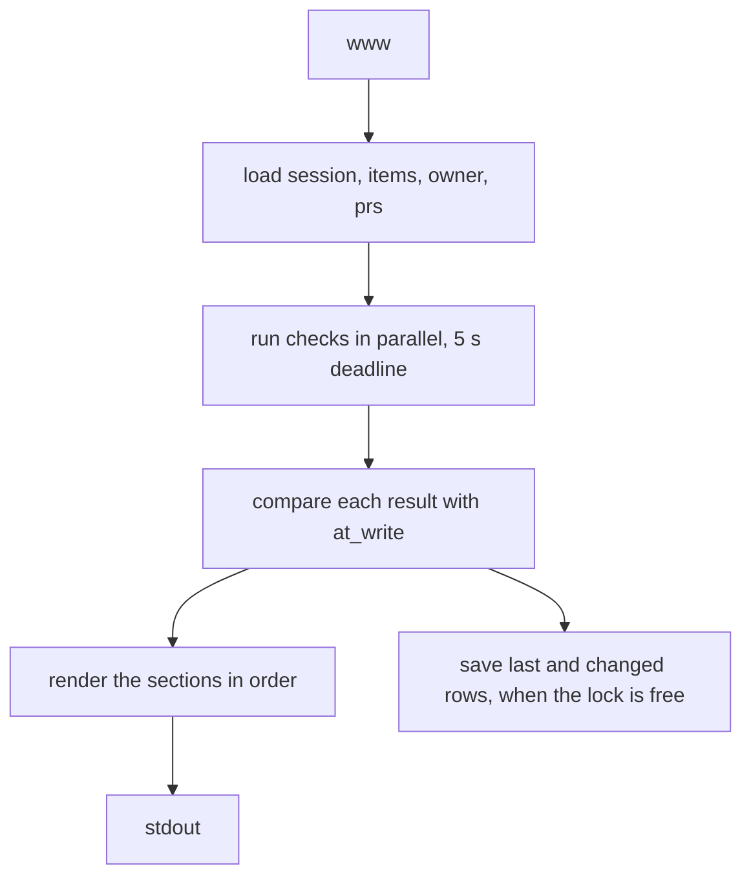

# The brief

- **Status:** agreed

`www` with no subcommand prints the brief: the whole state of the session in at most 52 lines and 6,400 characters on any day. It opens with what the owner said and what the world has overtaken, so the agent reads the stale claims before it acts on them, and it ends with three lines that teach the write commands again. The same text is what the hooks put in context after a compaction. A build agent reads this doc to build the brief renderer and its size test, in the slice [build-order.md](build-order.md) names.

## Shape



## Contracts

### Sections, in order

| Section                      | Shows                                                                                              | When empty  |
| ---------------------------- | -------------------------------------------------------------------------------------------------- | ----------- |
| header                       | session, day, time, age of the last write, how many checks ran and how long they took             | always      |
| `GOAL`                       | the goal, wrapped at 100 columns                                                                   | always      |
| `OWNER SAYS`                 | each owner note, oldest first                                                                      | left out    |
| `CHANGED SINCE WRITTEN`      | each item whose check result differs from `at_write`, at most 4 rows, with the command that fixes it | left out  |
| `NOW`                        | the item in focus and its next step, or why the step is hidden                                     | `NOW  none. Run: www now <id> "<next step>"` |
| `OPEN`                       | tasks; the item in focus first, then oldest first                                                  | left out    |
| `WAITING`                    | waits, oldest first                                                                                | left out    |
| `APPROVED`                   | approvals, oldest first                                                                            | left out    |
| `RULES`                      | rules, oldest first                                                                                | left out    |
| `WHERE`                      | where items, oldest first                                                                          | left out    |
| `PULL REQUESTS THIS SESSION OPENED THAT NO ITEM NAMES` | open pull requests in `prs.tsv` ([store.md](store.md)) that no item's check names, at most 3 rows | left out |
| footer                       | three fixed lines that teach the writes                                                            | always      |

### Line templates and their widths

The day is the number of UTC calendar days from the date of `started` to today, plus 1, so the day the session starts is day 1; `--since day-<n>` and "closed on day <n>" use the same count. An age is `<n>m` under an hour, `<n>h` under 48 hours, and `<n>d` after that, so it is at most 4 characters. An id is padded to 12 columns, and a longer id pushes the rest of the line. A tag is the bracketed text at the end of an item line.

| Line                     | Template                                                                                     | Widest |
| ------------------------ | -------------------------------------------------------------------------------------------- | ------ |
| header                   | `<name> · day <d> · <Ddd YYYY-MM-DD HH:MMZ> · last write <age> ago · <n> checks in <t>s[ · <n> unchecked: <reason>]`, or `no checks` in place of the check count when nothing has a check | 133 |
| header, second line      | `  results not saved: <the store is not writable here \| another write held the lock>`        | 51     |
| goal                     | `GOAL  <goal>`, wrapped at 100 columns, each further line indented 6                          | 3 lines, 214 |
| owner note               | `  o-<n>  <text>  [<age>]`, or `[on <id> · <age>]` when it has `--on`                         | 198    |
| changed row              | `  <id>  was <at_write> (<age>) · now <result> · run: <fix command>`                          | 140    |
| changed overflow         | `  and <n> more; each shows its result in its section below`                                   | 57     |
| now                      | `NOW  <id> · set <age> ago`                                                                   | 36     |
| next step                | `  next: <next step>`, or `  next step hidden: <id> changed after it was set. Run: www now <id> "<next step>"` | 128 |
| task                     | `  <id>  <claim>  [<tag>]`; tag is the result, `no check · <age>`, `not checked yet`, or `blocked by <id>` with ` · <result>` when it has a check | 189 |
| wait                     | `  <id>  <claim>  [<who> · <result or age>]`                                                  | 178    |
| approval                 | `  <id>  "<quote>" · <once or standing> · <scope>`                                            | 196    |
| rule                     | `  <id>  <claim>`                                                                              | 140    |
| where                    | `  <id>  <claim>  [<result or no check · age>]`                                                | 159    |
| pull request             | `  <ref>  opened <age> ago  [<result>]`; a ref over 60 characters is cut to 59 and `…`        | 98     |
| pull request overflow    | `  and <n> more: www log --op pr`                                                             | 30     |
| pull request hint        | `  name each in an item: www task <id> "<claim>" --pr <owner>/<repo>#<n>`                     | 71     |

A check result is at most 15 characters; [checks.md](checks.md) lists them. The fix command in a changed row is at most 64 characters:

| The check now reads                        | Fix command                                                     |
| ------------------------------------------ | --------------------------------------------------------------- |
| `MERGED`                                   | `www done <id> --evidence "merged, seen by check"`              |
| `CLOSED`                                   | `www drop <id> --why "closed unmerged, seen by check"`          |
| `gone` for a pid                           | `www drop <id> --why "process gone, seen by check"`             |
| `gone` for a branch                        | `www drop <id> --why "branch gone, seen by check"`              |
| `missing` for a path                       | `www drop <id> --why "path missing, seen by check"`             |
| anything else                              | `www set <id> "<what is true now>"`                             |

The footer is these three lines, as written:

```text
Write as you go: one id holds one claim, and www set <id> "<claim>" replaces it.
Close with www done <id> --evidence "<PR, commit or test run>" or www drop <id> --why "<reason>".
More: www help · www show <id> · www log --since 24h · www decide "<choice>" --why "<reason>"
```

### Caps and the worst case

| Kind        | Cap | Why this number                                                     |
| ----------- | --- | ------------------------------------------------------------------- |
| task        | 6   | the work a session can hold in mind at once                         |
| wait        | 4   | each wait is a question someone else must answer                    |
| approval    | 3   | a fourth standing approval is a sign the owner should write a rule  |
| rule        | 5   | rules beyond 5 belong in the repo's AGENTS.md                       |
| where       | 4   | worktrees, processes and secret locations in use at once            |
| owner note  | 2   | the owner clears one before adding a third                          |

The worst case fills every cap, every text to its limit, every item with its widest tag, 4 changed rows with an overflow line, 3 pull request rows with an overflow line, and a two-line header. These numbers come from rendering that case from the templates above and counting it:

| Block          | Lines  | Characters                          |
| -------------- | ------ | ----------------------------------- |
| header         | 2      | 133 + 51 = 184                      |
| goal           | 3      | 99 + 99 + 16 = 214                  |
| owner notes    | 3      | 52 + 2 × 198 = 448                  |
| changed        | 6      | 59 + 4 × 140 + 57 = 676             |
| now            | 2      | 36 + 128 = 164                      |
| open (6 tasks) | 7      | 13 + 6 × 189 = 1,147                |
| waiting (4)    | 5      | 16 + 4 × 178 = 728                  |
| approved (3)   | 4      | 56 + 3 × 196 = 644                  |
| rules (5)      | 6      | 14 + 5 × 140 = 714                  |
| where (4)      | 5      | 14 + 4 × 159 = 650                  |
| pull requests  | 6      | 57 + 3 × 98 + 30 + 71 = 452         |
| footer         | 3      | 80 + 97 + 93 = 270                  |
| newlines       |        | 52                                  |
| **Total**      | **52** | **6,343**                           |

Codex puts at most about 2,500 tokens of hook output into context. Ids, paths and hashes tokenize at about 3 characters per token, and plain English at about 4, so 6,343 characters is about 2,115 tokens at the pessimistic rate, 15% under Codex's limit. Claude Code's limit is 10,000 characters.

## Constraints

- The brief is at most 6,400 characters and 52 lines. A test renders the worst case above and checks both numbers.
- When a bug makes the brief longer than 6,400 characters, the renderer drops item lines from the bottom up, starting with pull request rows, then where, then rules, and ends the last kept section with `  (<n> lines cut to fit; run www show <id>)`. It never drops the header, goal, owner notes, changed rows, now, or footer.
- A changed item is one whose check result differs from its `at_write`. A result of `unchecked` never counts as changed, and an `at_write` of `-` takes the first result without counting it as changed.
- When the item in focus changed after `now_set`, or its check reads `MERGED`, `CLOSED`, `gone` or `missing`, the brief hides the next step and prints the `next step hidden` line. The step stays in the journal.
- A tag shows `blocked by <id>` only while that id is open. Closing the blocker clears the tag on the next read.
- An item with no check shows its age since `written`, so the reader sees which lines nobody verified.
- Once a session is found and its store's format is known, the brief always exits 0 and prints, whatever the checks, the lock or the network do. [commands.md](commands.md) owns exits 4 and 5.
- Every write reply ends with the brief's line count, from the same renderer with check results taken from `last`, without running the checks.

## The brief on day 9 of an invented session

The session `tide-alerts` adds low-water push alerts to a sailing app across `bosunhq/bosun-api`, `bosunhq/bosun-app` and an upstream library, `tidal-org/tidekit`. Day 1 was Monday 2026-03-02. This output is 37 lines and 2,686 characters.

```text
tide-alerts · day 9 · Tue 2026-03-10 11:43Z · last write 41m ago · 7 checks in 2.8s
GOAL  Ship tide alerts in bosun-api and bosun-app: a push alert 2 hours before low water at a saved
      harbour, behind the tide_alerts flag. Done when alerts-e2e passes on staging.
OWNER SAYS (1) · act on it; only the owner clears it
  o-2  Don't touch the prod push certificate, even with ok-merge. Ask me first.  [2h]
CHANGED SINCE WRITTEN (3) · these claims are no longer true
  pr-app-61   was OPEN passing (27h) · now MERGED · run: www done pr-app-61 --evidence "merged, seen by check"
  pr-api-77   was OPEN pending (1h) · now OPEN failing · run: www set pr-api-77 "<what is true now>"
  p-sim       was alive (22h) · now gone · run: www drop p-sim --why "process gone, seen by check"
NOW  pr-api-77 · set 1h ago
  next step hidden: pr-api-77 changed after it was set. Run: www now pr-api-77 "<next step>"
OPEN (5 of 6)
  pr-api-77   Alert job retries a 503 from the tide feed; pushed 3e1f0aa  [OPEN failing]
  pr-app-61   Alert settings screen: in review  [MERGED]
  pr-tk-19    tidekit: harmonic constants for harbours south of 60°S  [OPEN pending]
  t-flag      Turn on the tide_alerts flag in staging config  [blocked by w-apns]
  t-e2e       Write alerts-e2e against staging  [no check · 3d]
WAITING (2 of 4)
  w-apns      upload the staging push key to the vault  [owner · 2d]
  w-tk        review tidal-org/tidekit#19  [tidekit team · OPEN pending]
APPROVED (2 of 3) · act only inside each quote and scope
  ok-merge    "merge the alert PRs yourself once CI is green" · standing · bosun-api, bosun-app
  ok-wipe     "you can wipe the staging alerts table once" · once · staging alerts table
RULES (3 of 5)
  r-api-tests Run the API tests from api/; from the repo root the queue tests are skipped
  r-tk-fork   tidekit is a fork here: pass -R tidal-org/tidekit to gh, or the PR opens on the fork
  r-sim-port  Start the app simulator with PORT=8091; 8090 belongs to another session
WHERE (3 of 4)
  wt-tz       bosun-api worktree for the time zone fix, branch tz-fix  [clean]
  p-sim       app simulator, pid 48211; stop it with kill 48211  [gone]
  s-staging   staging secrets live in the vault bosun-staging; never print a value
PULL REQUESTS THIS SESSION OPENED THAT NO ITEM NAMES (1)
  bosunhq/bosun-app#64  opened 3h ago  [OPEN pending]
  name each in an item: www task <id> "<claim>" --pr <owner>/<repo>#<n>
Write as you go: one id holds one claim, and www set <id> "<claim>" replaces it.
Close with www done <id> --evidence "<PR, commit or test run>" or www drop <id> --why "<reason>".
More: www help · www show <id> · www log --since 24h · www decide "<choice>" --why "<reason>"
```

The agent's next three commands come from the brief alone: `www done pr-app-61 --evidence "merged as 51aa0e2, seen by check"`, `www drop p-sim --why "process gone, seen by check"`, then `www show pr-api-77` to read the failing job before it sets a new next step.

## Decisions

- **A claim is at most 120 characters.** At 160, the worst case passes 7,000 characters, which leaves no room under Codex's limit at 3 characters per token.
- **Caps count items, not characters.** A count is easy to see in the section heading (`4 of 6`), and every field's own limit bounds the characters.
- **The brief prints no journal rows.** `www log` and `www show` read the journal; the brief stays the same size however long the session runs.

## Builder decides

- How the goal wraps at a word boundary.
- Whether the brief colours anything when stdout is a terminal. It never colours output to a pipe or a hook.

## Open questions

- **Does Codex put the worst-case brief into context whole?** A measurement settles it: the hooks slice renders the worst case through a Codex `SessionStart` hook and looks for the temp-file preview. Until then, the 6,400-character cap stands.
