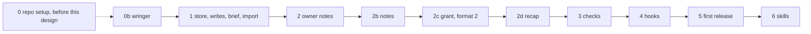

# Build order

- **Status:** agreed

Slice 0 is the repo setup, done before this design, and is not one of the slices this doc builds. After it, the tool is built in ten slices: 0b, 1, 2, 2b, 2c, 2d, and 3 to 6. Each slice is one pull request, or several when it is too large to build and review in one run, and each pull request leaves the tool working. The agent that orchestrates the build keeps its own notes in the tool from the end of slice 1, so slice 1 gives a usable tool with no checks and no hooks, and each later slice adds to it. The build order lives in this doc, not only in work items, because the owner signs it off together with the design, in one pull request, before any slice starts; each slice's work item is cut from this doc when the slice starts and links its section here. Each slice names what it delivers, what it needs first, and acceptance lines that each name their evidence. From slice 0b on, each slice in this repo also adds a wringer feature, whose journey drives the real `www` through `bun verify`, and its pull request carries the wringer report. A build agent reads this doc first, takes the next slice whose dependencies are met, reads the part docs that slice names, and builds it.

## Shape

## Slice 0: the repo

Done before this design, and not one of its ten slices: the repo-standard skill creates `zgeoff/wherewerewe` as a public Bun workspace with `packages/cli`, CI and release wiring, and nothing published. Every later slice needs it.

## Slice 0b: wringer

**Delivers.** The repo adopts wringer, following `bunx wringer-gunshi guide create` at the installed version:

- `@wringer/core`, `@wringer/gunshi` and `zod` as exact dev dependencies in the root catalog, and each `@wringer/*` package by its full name in `minimumReleaseAgeExcludes` in `bunfig.toml`;
- `.wringer/` in `.gitignore`;
- the verify CLI in `scripts/verify/`, run as `bun verify`, with the scripts `verify` and `verify:lint`;
- the registry, named `wherewerewe-verify`, with one `local` target, a repo command that runs `www` as a process and compares its output, a doctor check that runs `www help`, `.shared()` for `scripts/verify/**`, `package.json` and `bun.lock`, and `.ignore()` for docs, Markdown, tests and agent folders;
- the `verify` skill in `.agents/skills/verify/`, from the template, with one `references/feature-<name>.md` per feature;
- the workflow `.github/workflows/verify.yml`, whose job is named `verify / gate`, on every pull request event including `edited`, with no path filter;
- a "Verify before you hand off" section in AGENTS.md;
- the feature `help`, whose journey runs `www help` and compares its first line.

The trial journey also settles how a target behaves for a CLI with no server: an `attach` target with no endpoints, or a `launch` target whose process prints a ready line. The slice records the shape that passes `bun verify doctor` in the registry and in the `verify` skill's targets block.

**Depends on.** Slice 0.

**Acceptance.**

- [ ] `bun verify lint` passes with `data.commands` above 0. Evidence: its output in the pull request.
- [ ] The `help` journey reaches its end state. Evidence: the wringer report block in the pull request, with a claim for `help`, and a green `verify / gate`.
- [ ] A change to a tracked file that maps to no feature, shared glob or ignore glob fails the gate. Evidence: a red `verify / gate` on a throwaway commit in the pull request, reverted before merge.
- [ ] `verify / gate` is a required check on `main`, added after the workflow has run once. Evidence: the ruleset lists the check.

## Slice 1: store, writes, brief and import

**Delivers.** The store in format 1 ([store.md](store.md)); every command in [commands.md](commands.md) except `say`, `ack`, `install`, `doctor`, `hook`, `grant` and `recap`, with no notes and in format 1; the brief ([brief.md](brief.md)) with no checks run, so each check tag reads `not checked yet`, no `CHANGED` section, and no pull request section; session finding by flag, variable and binding ([sessions-and-hooks.md](sessions-and-hooks.md), "How a command finds its session"); `www import`; the package and its bins ([shipping.md](shipping.md)). Two wringer features: `notes`, whose journey runs `www init`, `task`, `set`, `done` and `www`, and checks the brief and one refusal's `Run:` line; and `import`, whose journey imports a hand-kept fixture and reads its brief.

**Depends on.** Slice 0b.

**Acceptance.**

- [ ] Each write in commands.md changes only the files it names, and a refused write changes none. Evidence: a store test per command.
- [ ] Each refusal in commands.md prints its text and its `Run:` line, and the `Run:` line, with its placeholders filled in, passes. Evidence: one test per refusal row.
- [ ] A store with every cap full and every text at its limit renders within the line and character caps in brief.md. Evidence: the worst-case render test.
- [ ] Two sessions bound to two agent session ids never read or write each other's store. Evidence: a test with two `CLAUDE_CODE_SESSION_ID` values.
- [ ] `www import` converts a fixture laid out like the hand-kept store, with invented content, as the table in store.md says, keeps the originals in `import-backup/`, and refuses with one line per bad row when a row breaks a rule. Evidence: import tests for both cases.
- [ ] Ten writes started at once all land, and none corrupts a file. Evidence: a concurrency test.
- [ ] A copy installed from a packed tarball runs as `www` and as `wherewerewe` after the worktree is removed. Evidence: a CI step that packs, installs with `bun add -g`, deletes the source folder, and runs `www help`.
- [ ] The `notes` and `import` journeys reach their end states. Evidence: the wringer report block in the pull request, with a claim for each, and a green `verify / gate`.
- [ ] The orchestrating agent's hand-kept store converts. Evidence: after the agent fixes the rows import names, `www import build` exits 0, and `www --session build` prints its brief.

**Pull requests.** Build slice 1 as three pull requests, and start each one after the one before it merges:

- 1a, [#11](https://github.com/zgeoff/wherewerewe/issues/11): the store in format 1, session finding, the brief, and `www`, `help`, `sessions`, `init`, `attach`, `detach`, `goal`, `now`, `task`, `wait`, `rule`, `where`, `set`, `done` and `drop`, with the `notes` feature. It carries the evidence for the worst-case, two-session, concurrency, packed-tarball and `notes` journey lines, and for the write and refusal lines of its commands.
- 1b, [#12](https://github.com/zgeoff/wherewerewe/issues/12): `ok`, `use`, `decide`, `show` and `log`. It carries the evidence for the write and refusal lines of its commands.
- 1c, [#13](https://github.com/zgeoff/wherewerewe/issues/13): `www import`, with the `import` feature. It carries the evidence for the import, `import` journey and hand-kept store lines, and for the hand-kept refusal's `Run:` line.

## Slice 2: owner notes

**Delivers.** `www say` and `www ack`, `owner.tsv`, and the `OWNER SAYS` section ([owner-notes.md](owner-notes.md)). The wringer feature `owner-notes`, with a journey that runs `www say` and `www ack` through the terminal driver, which gives the program a terminal, and reads the brief between them. The slice adds `@wringer/terminal`, pinned and excluded as in slice 0b, and the program's environment carries none of the five agent variables.

**Depends on.** Slice 1.

**Acceptance.**

- [ ] The `owner-notes` journey reaches its end state. Evidence: the wringer report block in the pull request, with a claim for `owner-notes`, and a green `verify / gate`.
- [ ] `say` and `ack` refuse when stdin or stdout is not a terminal, and when any of the five agent variables is set. Evidence: tests that run each case, using `script` to give a terminal.
- [ ] A note shows first after the goal until `ack`, and a third note is refused. Evidence: brief tests.
- [ ] No agent command opens `owner.tsv` for writing. Evidence: a test that makes `owner.tsv` read-only and runs every agent write.

## Slice 2b: notes

**Delivers.** Notes as [commands.md](commands.md) and [store.md](store.md) define them: `notes.tsv` in format 1, where a missing file reads as no notes; `--note` and `--owed` on `now` and on every item write; `set` with no claim; `--no-note`; the 400-character limit and the credential test on a note; the note lines in the `now` and close replies; the older-note line; the owed-note refusal on `done`, `drop` and `use`; the note in `www show`; and the `note` rows in `www log`. In the brief ([brief.md](brief.md)): the note under `NOW`, the owed tags, the wrap rule for the goal and the note, at most 3 changed rows and 1 pull request row, and the one-line footer. The slice also removes the caution wording that names no grant: the `APPROVED` heading's text after its count, the last sentence of the refusal of `use` on a standing approval, and the `--replaces` refusal's text, as decision record [0008](../../decisions/0008-notes-the-grant-and-no-caution-steering.md) lists them. The wringer feature `item-notes`, with a journey that writes a task with `--note` and `--owed`, runs `www now` on it, reads the brief, runs `done` and gets the owed-note refusal, runs the refusal's `--no-note` `Run:` line, and closes the task.

**Depends on.** Slice 2.

**Acceptance.**

- [ ] The `item-notes` journey reaches its end state. Evidence: the wringer report block in the pull request, with a claim for `item-notes`, and a green `verify / gate`.
- [ ] A store with every cap full, three standing approvals, every text at its limit, a 400-character note on the item in focus and an owed note on every other item renders in at most 52 lines and 6,400 characters. Evidence: the worst-case render test, at 6,372 characters by the arithmetic in brief.md with the 3 standing approval lines in place of the grant and the one-time approval.
- [ ] The note of the item in focus prints whole under `NOW`, also when the next step is hidden, and every other item with an owed note shows the owed tag. Evidence: brief tests.
- [ ] A 400-character note of words that end at column 85 wraps to 5 lines, and a 200-character goal of 49-character words wraps to 3. Evidence: wrap tests.
- [ ] `done`, `drop` and `use` refuse while an owed note stands, print the note, and each `Run:` line in the refusal runs. Evidence: one refusal test per command.
- [ ] `set <id> --note` keeps the claim, its check, `at_write` and `written`, and a close removes the item's `notes.tsv` row while its `note` rows stay in the journal. Evidence: store tests.
- [ ] A rewrite of a claim that keeps an older note prints the older-note line, and each command in that line runs. Evidence: reply tests.
- [ ] The build session's store, which has no `notes.tsv`, reads with no notes. Evidence: `www --session build` output after the install.

## Slice 2c: the grant and store format 2

**Delivers.** Store format 2 ([store.md](store.md)): the four `grant` keys in `session`, no `use` key, and one `ok` item at most. `www grant` and `www grant --reading`, with their limits, replies and refusals; the `GRANT` section of the brief, whole after `GOAL` and never cut; `www show grant`; the `grant` rows in `www log`; the `ok --standing` refusal and the one-time approval cap of 1; the `APPROVED ONCE` section; the format 2 upgrade through `www import`, with `--quote`, `--where`, `--reading` and `--drop`, its refusals and `format-1-backup/`; the hand-kept import to format 2; exit 5 for a format 1 store; the reserved id `grant`; the `say` replies' "It shows in every brief" wording from [owner-notes.md](owner-notes.md), and the rest of the wording changes in [0008](../../decisions/0008-notes-the-grant-and-no-caution-steering.md). The wringer feature `grant`, with a journey that seeds a format 1 store holding two standing approvals, runs `www import` and gets the refusal, runs the refusal's `Run:` line with the placeholders filled, reads the brief's `GRANT` section, replaces the reading with `www grant --reading`, and reads `www show grant`.

**Depends on.** Slice 2b. The owner's sign-off of this design authorises the build agent to upgrade the build session's store, as [README.md](README.md) lists.

**Acceptance.**

- [ ] The `grant` journey reaches its end state. Evidence: the wringer report block in the pull request, with a claim for `grant`, and a green `verify / gate`.
- [ ] The worst case in brief.md renders in at most 63 lines and 7,000 characters. Evidence: the worst-case render test, which seeds every row of the worst-case table in brief.md.
- [ ] The grant prints whole after `GOAL`, and a store whose item lines pass the cap keeps the whole grant while cut-to-fit drops item lines. Evidence: brief tests.
- [ ] A format 1 store with two standing approvals and two one-time approvals makes the upgrade refuse with both problems and one `Run:` line, and leaves every file and the folder listing unchanged. With the `Run:` line's placeholders filled, the upgrade converts it as the table in store.md says, and `format-1-backup/` holds the original files. Evidence: import tests that hash the folder before and after.
- [ ] Every command except `import`, `sessions` and `help` exits 5 on a format 1 store, with the text in commands.md. Evidence: one test per command.
- [ ] The grant's words take 700 characters after each line break becomes a space, and the limits on the reading and `--where` and the credential test refuse with the texts in commands.md. Evidence: write and refusal tests.
- [ ] The build session's store upgrades to format 2, with the owner's words that authorise the build as its grant. Evidence: the output of `www import build` and of `www --session build`, which shows the `GRANT` section.

## Slice 2d: recap

**Delivers.** `www recap [--since <t>]` with its sections, row limits and overflow lines ([commands.md](commands.md)). The wringer feature `recap`, with a journey that writes notes, decisions and closes in an invented session, runs `www recap`, and runs one overflow line's command.

**Depends on.** Slice 2c, so the recap prints the grant.

**Acceptance.**

- [ ] The `recap` journey reaches its end state. Evidence: the wringer report block in the pull request, with a claim for `recap`, and a green `verify / gate`.
- [ ] A store with a 700-character grant, 20 open items with 400-character notes, 9 decisions and 9 closes since `<t>`, and a 24-character session name renders a recap of at most 44 lines, each at most 100 characters. Evidence: the recap worst-case test.
- [ ] The recap runs no probe and takes no lock. Evidence: a test with the lock held and a stub `gh` on `PATH` that fails when called.
- [ ] Each overflow line's command runs and prints the rows the recap left out. Evidence: tests that run the printed commands.

## Slice 3: checks

**Delivers.** The four probes, `at_write` on each write, `last` and `changed` rows on each read, the `CHANGED SINCE WRITTEN` section, the hidden next step, the `unchecked` header, and the pull request section's probing ([checks.md](checks.md)). The wringer feature `checks`, with a journey that writes an item with a `--path` check, removes the path, reads the `CHANGED` row, and runs the fix command it prints. It uses no network: the `pr` probe stays with the tests.

**Depends on.** Slice 2d, so the day-9 snapshot can show an owner note, the grant and a note.

**Acceptance.**

- [ ] The `checks` journey reaches its end state. Evidence: the wringer report block in the pull request, with a claim for `checks`, and a green `verify / gate`.
- [ ] Each probe returns each result in its table. Evidence: tests against a stub `gh` on `PATH`, temporary git repos, and a child process the test starts and kills.
- [ ] A merged pull request, a gone process and a missing path each show under `CHANGED` with the fix command from brief.md, and that command runs as printed on an item with no owed note. Evidence: brief tests that run the printed commands.
- [ ] The next step hides when the item in focus changes after `now_set`. Evidence: a brief test.
- [ ] The day-9 example in brief.md renders as printed, from a store seeded to match it and a stub `gh`. Evidence: a snapshot test.
- [ ] With `gh` missing, with `gh` failing authentication, and with a probe that never returns, the brief prints within 6 s, tags each probe `unchecked`, and names the reason in the header. Evidence: tests for the three cases.
- [ ] A read with the store folder read-only prints the brief and the `results not saved` line. Evidence: a test.
- [ ] No probe writes: the git repos' index files and refs are unchanged after a read. Evidence: a test that hashes `.git` before and after.

## Slice 4: hooks

**Delivers.** `www hook claude` and `www hook codex`, `www install`, `www doctor`, the pull request record, binding from the hook, the nudge, and the `SubagentStart` line ([sessions-and-hooks.md](sessions-and-hooks.md)). The wringer feature `hooks`, with a journey that pipes an invented `SessionStart` payload and an invented `PostToolUse` payload into `www hook claude` and `www hook codex`, for a bound and an unbound id, and runs `www install` against settings files under the run's home folder.

**Depends on.** Slice 3. The owner's sign-off of this design authorises the build agent to run `www install` and to add the two Codex config lines, as [README.md](README.md) lists. Trusting the hooks in Codex is a step only the owner can do, by hand, after `www install`.

**Acceptance.**

- [ ] The `hooks` journey reaches its end state. Evidence: the wringer report block in the pull request, with a claim for `hooks`, and a green `verify / gate`.
- [ ] For each event and each harness, a recorded stdin payload gives the output in sessions-and-hooks.md, and an unbound session id gives no output. Evidence: hook tests with invented payloads in each agent's documented shape.
- [ ] An unbound hook returns in under 150 ms, and a bound `PostToolUse` in under 300 ms. Evidence: a timing test of 20 runs, median.
- [ ] `install` keeps every other hook in both files, and a second run changes nothing. Evidence: install tests on fixture settings files.
- [ ] After a compaction in a bound Claude Code session, the brief is in the agent's context. Evidence: the orchestrating session's transcript shows the `SessionStart` hook output after `/compact`.
- [ ] After a compaction in a bound Codex session, the brief is in context whole, with no temp-file preview, for the worst-case store. Evidence: a Codex session started for the test, with its transcript. This settles the open question in brief.md.
- [ ] A Codex subagent's shell either finds the parent's session or gets the refusal with the `--session` hint. Evidence: the same Codex test session; the result settles the open question in sessions-and-hooks.md.
- [ ] For a bound session with a hand-kept or format 1 store, `SessionStart` prints the exit 5 text and its `Run:` line. Evidence: hook tests for both harnesses.
- [ ] `www doctor` exits 0 on the owner's machine. Evidence: its output, after the owner steps.

## Slice 5: first release

**Delivers.** `@wherewerewe/cli` on npm, with bins `www` and `wherewerewe`. The wringer feature `package`, with a journey that installs the published version into a temporary global folder with `bun add -g` and runs `www help` and `wherewerewe help`.

**Depends on.** Slice 4, and the owner's first publish by hand, a step only the owner can do, through the npm-publish skill, which hands the owner one command. Later releases go through release-please and OIDC.

**Acceptance.**

- [ ] The `package` journey reaches its end state. Evidence: the wringer report block in the pull request, with a claim for `package`, and a green `verify / gate`.
- [ ] `bun add -g @wherewerewe/cli` on a machine with only Bun installs both bins. Evidence: `www help` output in a clean container.
- [ ] The second release publishes from CI with provenance. Evidence: the npm page's provenance badge for that version.

## Slice 6: skills

**Delivers.** The handoff, where-were-we and pickup changes in [skills.md](skills.md), as one pull request in `zgeoff/skills`. Each of the three skills teaches notes, with `--note`, `--owed` and the rule that a note holds what the agent needs on its next turn to the item, and the grant, with `www grant`, the `GRANT` section and the owner's words copied whole.

**Depends on.** Slice 5, so a skill names a command any machine can install. `zgeoff/skills` has no wringer, so this slice has no wringer feature: that repo's own checks are its evidence.

**Acceptance.**

- [ ] Each skill passes the skill-writing checks of `zgeoff/skills`. Evidence: the pull request's `## Checks` section and green CI.
- [ ] A handoff doc written from a bound session fills each section from the store as the table in skills.md says, with the grant's words whole and each open item's note. Evidence: a handoff doc from an invented session, attached to the pull request.
- [ ] A pickup from that handoff doc into a store with no grant records the doc's grant with `www grant`. Evidence: the brief's `GRANT` section in the invented session after the pickup.

## Constraints

- Each slice from 0b on is one pull request into `main` of its repo, or several that each leave the tool working, with green CI, and leaves every earlier acceptance line true. Slice 2c is the one exception: format 2 replaces format 1, so the acceptance lines of slice 1 that name format 1 hold for format 2 from then on.
- Each slice is built with the build-feature workflow, with a Codex review as its only review.
- From slice 0b on, each pull request in this repo publishes the wringer report with `bun verify publish` after its last push, and every feature whose files it changed has a claim at the current fingerprint.
- The registry is named `wherewerewe-verify`, never `www` or `wherewerewe`: gunshi reads a command group named like the program as the program itself, so the registry's name and its `www` command group must differ.
- A journey runs `www` with `XDG_STATE_HOME` and `HOME` pointed at folders under `.wringer/`, so it never reads or writes the owner's stores or agent settings.
- From the end of slice 1, the orchestrating agent writes its own notes only through `www`, and installs each merged slice with the commands in shipping.md.
- A slice changes no contract in another part's doc without changing that doc in the same pull request.

## Builder decides

- How each slice splits into commits.
- Test names and fixture layout.
