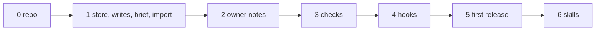

# Build order

- **Status:** draft

The tool is built in six slices, each one pull request that leaves the tool working. The agent that orchestrates the build keeps its own notes in the tool from the end of slice 1, so slice 1 gives a usable tool with no checks and no hooks, and each later slice adds to it. Each slice is filed as one work item that links its section here. Each slice names what it delivers, what it needs first, and acceptance lines that each name their evidence. A build agent reads this doc first, takes the next slice whose dependencies are met, reads the part docs that slice names, and builds it.

## Shape

## Slice 0: the repo

Outside this design: the repo-standard skill creates `zgeoff/wherewerewe` as a public Bun workspace with `packages/cli`, CI and release wiring, and nothing published. Every later slice needs it.

## Slice 1: store, writes, brief and import

**Delivers.** The store in format 1 ([store.md](store.md)); every command in [commands.md](commands.md) except `say`, `ack`, `install`, `doctor` and `hook`; the brief ([brief.md](brief.md)) with no checks run, so each check tag reads `not checked yet`, no `CHANGED` section, and no pull request section; session finding by flag, variable and binding ([sessions-and-hooks.md](sessions-and-hooks.md), "How a command finds its session"); `www import`; the package and its bins ([shipping.md](shipping.md)).

**Depends on.** Slice 0.

**Acceptance.**

- [ ] Each write in commands.md changes only the files it names, and a refused write changes none. Evidence: a store test per command.
- [ ] Each refusal in commands.md prints its text and its `Run:` line, and the `Run:` line, with its placeholders filled in, passes. Evidence: one test per refusal row.
- [ ] A store with every cap full and every text at its limit renders in at most 52 lines and 6,400 characters. Evidence: the worst-case render test.
- [ ] Two sessions bound to two agent session ids never read or write each other's store. Evidence: a test with two `CLAUDE_CODE_SESSION_ID` values.
- [ ] `www import` converts a fixture laid out like the hand-kept store, with invented content, as the table in store.md says, keeps the originals in `import-backup/`, and refuses with one line per bad row when a row breaks a rule. Evidence: import tests for both cases.
- [ ] Ten writes started at once all land, and none corrupts a file. Evidence: a concurrency test.
- [ ] A copy installed from a packed tarball runs as `www` and as `wherewerewe` after the worktree is removed. Evidence: a CI step that packs, installs with `bun add -g`, deletes the source folder, and runs `www help`.
- [ ] The orchestrating agent's hand-kept store converts. Evidence: after the agent fixes the rows import names, `www import build` exits 0, and `www --session build` prints its brief.

## Slice 2: owner notes

**Delivers.** `www say` and `www ack`, `owner.tsv`, and the `OWNER SAYS` section ([owner-notes.md](owner-notes.md)).

**Depends on.** Slice 1.

**Acceptance.**

- [ ] `say` and `ack` refuse when stdin or stdout is not a terminal, and when any of the five agent variables is set. Evidence: tests that run each case, using `script` to give a terminal.
- [ ] A note shows first after the goal until `ack`, and a third note is refused. Evidence: brief tests.
- [ ] No agent command opens `owner.tsv` for writing. Evidence: a test that makes `owner.tsv` read-only and runs every agent write.

## Slice 3: checks

**Delivers.** The four probes, `at_write` on each write, `last` and `changed` rows on each read, the `CHANGED SINCE WRITTEN` section, the hidden next step, the `unchecked` header, and the pull request section's probing ([checks.md](checks.md)).

**Depends on.** Slice 2, so the day-9 snapshot can show an owner note.

**Acceptance.**

- [ ] Each probe returns each result in its table. Evidence: tests against a stub `gh` on `PATH`, temporary git repos, and a child process the test starts and kills.
- [ ] A merged pull request, a gone process and a missing path each show under `CHANGED` with the fix command from brief.md, and that command runs as printed. Evidence: brief tests that run the printed commands.
- [ ] The next step hides when the item in focus changes after `now_set`. Evidence: a brief test.
- [ ] The day-9 example in brief.md renders as printed, from a store seeded to match it and a stub `gh`. Evidence: a snapshot test.
- [ ] With `gh` missing, with `gh` failing authentication, and with a probe that never returns, the brief prints within 6 s, tags each probe `unchecked`, and names the reason in the header. Evidence: tests for the three cases.
- [ ] A read with the store folder read-only prints the brief and the `results not saved` line. Evidence: a test.
- [ ] No probe writes: the git repos' index files and refs are unchanged after a read. Evidence: a test that hashes `.git` before and after.

## Slice 4: hooks

**Delivers.** `www hook claude` and `www hook codex`, `www install`, `www doctor`, the pull request record, binding from the hook, the nudge, and the `SubagentStart` line ([sessions-and-hooks.md](sessions-and-hooks.md)).

**Depends on.** Slice 3. The owner's sign-off of this design authorises the build agent to run `www install` and to add the two Codex config lines, as [README.md](README.md) lists. Trusting the hooks in Codex is a step only the owner can do, by hand, after `www install`.

**Acceptance.**

- [ ] For each event and each harness, a recorded stdin payload gives the output in sessions-and-hooks.md, and an unbound session id gives no output. Evidence: hook tests with invented payloads in each agent's documented shape.
- [ ] An unbound hook returns in under 150 ms, and a bound `PostToolUse` in under 300 ms. Evidence: a timing test of 20 runs, median.
- [ ] `install` keeps every other hook in both files, and a second run changes nothing. Evidence: install tests on fixture settings files.
- [ ] After a compaction in a bound Claude Code session, the brief is in the agent's context. Evidence: the orchestrating session's transcript shows the `SessionStart` hook output after `/compact`.
- [ ] After a compaction in a bound Codex session, the brief is in context whole, with no temp-file preview, for the worst-case store. Evidence: a Codex session started for the test, with its transcript. This settles the open question in brief.md.
- [ ] A Codex subagent's shell either finds the parent's session or gets the refusal with the `--session` hint. Evidence: the same Codex test session; the result settles the open question in sessions-and-hooks.md.
- [ ] `www doctor` exits 0 on the owner's machine. Evidence: its output, after the owner steps.

## Slice 5: first release

**Delivers.** `@wherewerewe/cli` on npm, with bins `www` and `wherewerewe`.

**Depends on.** Slice 4, and the owner's first publish by hand, a step only the owner can do, through the npm-publish skill, which hands the owner one command. Later releases go through release-please and OIDC.

**Acceptance.**

- [ ] `bun add -g @wherewerewe/cli` on a machine with only Bun installs both bins. Evidence: `www help` output in a clean container.
- [ ] The second release publishes from CI with provenance. Evidence: the npm page's provenance badge for that version.

## Slice 6: skills

**Delivers.** The handoff, where-were-we and pickup changes in [skills.md](skills.md), as one pull request in `zgeoff/skills`.

**Depends on.** Slice 5, so a skill names a command any machine can install.

**Acceptance.**

- [ ] Each skill passes the skill-writing checks of `zgeoff/skills`. Evidence: the pull request's `## Checks` section and green CI.
- [ ] A handoff doc written from a bound session fills each section from the store as the table in skills.md says. Evidence: a handoff doc from an invented session, attached to the pull request.

## Constraints

- Each slice is one pull request into `main`, with green CI, and leaves every earlier acceptance line true.
- From slice 1 on, the orchestrating agent writes its own notes only through `www`, and installs each merged slice with the commands in shipping.md.
- A slice changes no contract in another part's doc without changing that doc in the same pull request.

## Builder decides

- How each slice splits into commits.
- Test names and fixture layout.
