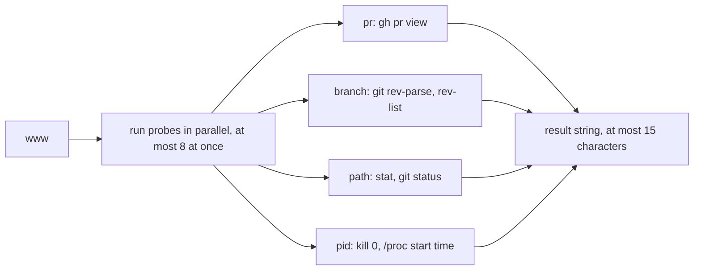

# The checks

- **Status:** agreed
- **Decision records:** [0003](../../decisions/0003-checks-are-built-in-read-only-probes.md)

An item can name one thing in the world: a pull request, a branch, a path or a process. Every read of the brief ([brief.md](brief.md)) probes each named thing that can still change, compares the result with `at_write`, the result stored when the claim was written, and marks the claim as changed when they differ. A probe only reads. The read records each result in the store ([store.md](store.md)), never changes an item's claim, kind or state, and never stops the brief from printing. A build agent reads this doc to build the probes and how a read uses their results, in the slice [build-order.md](build-order.md) names.

## Shape



## Contracts

```ts
// checks module
const results = await runChecks(items, prs, { deadlineMs: 5000 });
// → Map { 'pr-api-77' => 'OPEN failing', 'p-sim' => 'gone', 'bosunhq/bosun-app#64' => 'OPEN pending' }
//   plus { ran: 7, unchecked: 0, reason: null, elapsedMs: 2810 }

type CheckResult = string; // one of the values in the table below; at most 15 characters. `show` also gets the names of the failing checks beside an `OPEN failing` result

interface CheckRun {
  results: Map<string, CheckResult>; // keyed by item id, or by pull request ref for prs.tsv rows
  ran: number;
  unchecked: number;
  reason: 'offline' | 'gh missing' | 'gh not logged in' | 'git missing' | 'timeout' | 'mixed' | null; // why any probe read unchecked; 'git missing' is the reason of a branch probe with no git
  elapsedMs: number;
}
```

| Probe    | Reference                    | Command it runs                                                                                           | Results                                                                                         | Timeout |
| -------- | ---------------------------- | --------------------------------------------------------------------------------------------------------- | ----------------------------------------------------------------------------------------------- | ------- |
| `pr`     | `pr:<owner>/<repo>#<n>`      | `gh pr view <n> -R <owner>/<repo> --json state,statusCheckRollup`                                         | `OPEN passing`, `OPEN failing`, `OPEN pending`, `OPEN no checks`, `MERGED`, `CLOSED`, `not found` | 4 s     |
| `branch` | `branch:<repo path>@<name>`  | `git -C <repo path> rev-parse --verify --quiet refs/heads/<name>`, then `git -C <repo path> rev-list --left-right --count <name>...<name>@{upstream}` | `pushed`, `ahead <n>`, `behind <n>`, `diverged`, `no upstream`, `gone`                          | 2 s     |
| `path`   | `path:<absolute path>`       | a stat; inside a git work tree, `git --no-optional-locks -C <folder> status --porcelain -- <path in it>`                     | `clean`, `dirty`, `exists`, `missing`                                                           | 2 s     |
| `pid`    | `pid:<n>`                    | `kill(<n>, 0)`; on Linux, the start time from `/proc/<n>/stat`                                            | `alive`, `gone`                                                                                 | 1 s     |

Any probe can also read `unchecked`. The `pr` probe rolls `statusCheckRollup` up this way: any failed, cancelled or timed-out check is `failing`; otherwise any check still queued or running is `pending`; otherwise `passing`; with no checks, `no checks`.

## Constraints

- All probes of one read run in parallel, at most 8 at once, and the read stops waiting at 5 s. A probe still running then reads `unchecked`, and its process is killed. The read starts them in the order the brief prints rows: the item in focus, the task rows that fit, the waits, the where items and the pull request rows, then the tasks the brief leaves out. A probe the deadline stops before it starts reads `unchecked`, as one still running does.
- Each probe runs with `GH_PROMPT_DISABLED=1`, `GIT_TERMINAL_PROMPT=0` and stdin closed, so it can never wait for input.
- A probe never writes: no `git fetch`, no index refresh (`--no-optional-locks`), no `gh` call other than `pr view`, and no write to a repo or to GitHub.
- A probe never runs a command stored in the store. The reference is parsed into its parts, and each part is passed as one argument, never through a shell.
- A check never changes an item's claim, kind or state. It sets `last`, adds a `changed` journal row when `last` changes, and sets `state` and `seen` in `prs.tsv`. A probed `prs.tsv` row takes `OPEN` for any `OPEN …` result and `MERGED` or `CLOSED` for those, and keeps its state for `not found` and `unchecked`. A read that saves results writes the first result into an `at_write` of `-`, with no `changed` row.
- A probe finds `gh` and `git` through the `PATH` the command was given.
- `unchecked` never counts as changed and never overwrites `last`. An item whose saved `last` differs from `at_write` counts as changed on every read until its claim is rewritten, whether or not this read probed it.
- A pid whose start time differs from `pid_start` reads `gone`: the number now belongs to another process. Where `/proc` is missing, the probe checks only that the pid is alive.
- When `gh` is not on `PATH`, every `pr` probe reads `unchecked`, and the header names `gh missing`. When `gh` exits with an authentication error, the header names `gh not logged in`. When a network error is seen, the header names `offline`.
- A `prs.tsv` row whose `state` is `MERGED` or `CLOSED` is never probed again.
- A write with a check runs that one probe, with the same timeout, before it replies, and stores the result in `at_write`. An `unchecked` result is stored as `-`, so the next read takes its first result without counting a change.

### What the brief prints when probes fail

```text
tide-alerts · day 9 · Tue 2026-03-10 11:43Z · last write 41m ago · 7 checks in 5.0s · 5 unchecked: offline
...
  pr-api-77   Alert job retries a 503 from the tide feed; pushed 3e1f0aa  [unchecked]
```

When the store cannot be saved, the header's second line says so:

```text
  results not saved: the store is not writable here
```

## Decisions

- **Four probes, all built in.** A stored shell command would run, unread, on every read, after the store had been edited by anyone. [0003](../../decisions/0003-checks-are-built-in-read-only-probes.md)
- **No review-state probe.** A wait on a review takes a `pr` check, and its claim says what the agent waits for.
- **The agent closes an item, never the check.** The changed row prints the closing command with its evidence filled in, and the agent runs it.

## Builder decides

- How a probe's process is spawned and killed.
- How a network error is told apart from other `gh` failures, from its exit code and stderr.
- The cache, if any, of `gh` results within one read.
