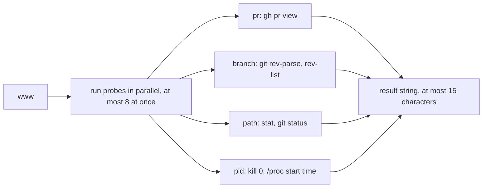

# The checks

- **Status:** agreed
- **Decision records:** [0003](../../decisions/0003-checks-are-built-in-read-only-probes.md)

An item can name one thing in the world: a pull request, a branch, a path or a process. Every read of the brief ([brief.md](brief.md)) probes each named thing that can still change, compares the result with `at_write`, the result stored when the claim was written, and marks the claim as changed when they differ. A probe only reads. The read records each result in the store ([store.md](store.md)), never changes an item's claim, kind or state, and never stops the brief from printing. A build agent reads this doc to build the probes and how a read uses their results, in the slice [build-order.md](build-order.md) names.

## Shape



## Contracts

```ts
// checks module
// order: the item ids in the order the brief prints them; env: the PATH that finds gh and git
const run = await runChecks(order, items, prs, { deadlineMs: checkLimits.deadlineMs, env, now });
// → { results: Map { 'pr-api-77' => 'OPEN failing', 'p-sim' => 'gone', 'bosunhq/bosun-app#64' => 'OPEN pending', … },
//     ran: 7, unchecked: 0, reason: null, elapsedMs: 2810 }

type CheckResult = string; // one of the values in the table below; at most 15 characters. `show` also gets the names of the failing checks beside an `OPEN failing` result

interface CheckRun {
  results: Map<string, CheckResult>; // keyed by item id, or by pull request ref for prs.tsv rows
  ran: number;
  unchecked: number;
  reason: 'offline' | 'gh missing' | 'gh not logged in' | 'git missing' | 'repo config' | 'timeout' | 'mixed' | null; // why any probe read unchecked; 'git missing' is the reason of a branch probe with no git
  elapsedMs: number;
}
```

| Probe    | Reference                    | Command it runs                                                                                           | Results                                                                                         | Timeout |
| -------- | ---------------------------- | --------------------------------------------------------------------------------------------------------- | ----------------------------------------------------------------------------------------------- | ------- |
| `pr`     | `pr:<owner>/<repo>#<n>`      | `gh pr view <n> -R <owner>/<repo> --json state,statusCheckRollup`                                         | `OPEN passing`, `OPEN failing`, `OPEN pending`, `OPEN no checks`, `MERGED`, `CLOSED`, `not found` | 4 s     |
| `branch` | `branch:<repo path>@<name>`  | `git -C <repo path> rev-parse --verify --quiet refs/heads/<name>`, then `git -C <repo path> rev-list --left-right --count refs/heads/<name>...<name>@{upstream}` | `pushed`, `ahead <n>`, `behind <n>`, `diverged`, `no upstream`, `gone`                          | 2 s     |
| `path`   | `path:<absolute path>`       | a stat; `git -C <folder> config --show-scope --name-only --get-regexp '^filter\..*\.(clean\|smudge\|process)$'`; inside a git work tree, `git --no-optional-locks --literal-pathspecs -c core.fsmonitor=false -c filter.<driver>.clean= -c filter.<driver>.smudge= -c filter.<driver>.process= -C <folder> status --porcelain --ignore-submodules=all -- <path in it>`, with the three `-c` for each repo-level driver; then the `config` command again | `clean`, `dirty`, `exists`, `missing`                                                           | 2 s     |
| `pid`    | `pid:<n>`                    | `kill(<n>, 0)`; on Linux, the start time from `/proc/<n>/stat`                                            | `alive`, `gone`                                                                                 | 1 s     |

Any probe can also read `unchecked`. The `pr` probe rolls `statusCheckRollup` up this way: any failed, cancelled or timed-out check is `failing`; otherwise any check still queued or running is `pending`; otherwise `passing`; with no checks, `no checks`.

## Constraints

- All probes of one read run in parallel, at most 8 at once, and the read stops waiting at 5 s. A probe still running then reads `unchecked`, and its process is killed. The read starts them in the order of the ranks in the cut order of [brief.md](brief.md#the-cut-order), from the rows it cuts last to the rows it cuts first: the item in focus, the waits on the owner, the waits on someone else, the task rows in the brief's order, the where rows, then the pull request rows. The cut runs once, after the probes finish or the deadline passes, because a probe's result changes a tag's width, the changed rows and the next step. So the start order cannot depend on which rows the cut keeps. A probe the deadline stops before it starts reads `unchecked`, as one still running does. After the deadline no probe starts a command, even a `path` probe whose stat returns late.
- Each probe runs with `GH_PROMPT_DISABLED=1`, `GIT_TERMINAL_PROMPT=0` and stdin closed, so it can never wait for input.
- A probe never writes: no `git fetch`, no lazy fetch (`GIT_ALLOW_PROTOCOL=none`), no index refresh (`--no-optional-locks`), no fsmonitor helper (`core.fsmonitor=false`), no `gh` call other than `pr view`, and no write to a repo or to GitHub. A probe also runs no program that a repo's own config names, except in the race under [Known limits of the probes](#known-limits-of-the-probes): the path probe disables every filter driver that a repo-level config defines, with an empty `clean`, `smudge` and `process`, skips submodules, and gives `unchecked` with the reason `repo config` when it cannot read the drivers or they change while it runs; the owner's global drivers stay on. [0003](../../decisions/0003-checks-are-built-in-read-only-probes.md)
- A `branch` probe reads `no upstream` only when git says the branch has none. Any other failure of the comparison reads `unchecked`.
- A pid outside the range of the OS reads `gone`, and a probe stops at its limit even when the stat of a path stalls. A `path` probe's stat and its git command share one limit.
- An interrupt or an exit of the process kills each probe still running, and its children.
- A probe never runs a command stored in the store. The reference is parsed into its parts, and each part is passed as one argument, never through a shell.
- A check never changes an item's claim, kind or state. It sets `last`, adds a `changed` journal row when `last` changes, and sets `state` and `seen` in `prs.tsv`. A probed `prs.tsv` row takes `OPEN` for any `OPEN …` result and `MERGED` or `CLOSED` for those, and keeps its state for `not found` and `unchecked`. A read that saves results writes the first result into an `at_write` of `-`, with no `changed` row.
- A probe finds `gh` and `git` through the `PATH` the command was given, without its empty and relative entries and without each entry whose real path is inside a guarded folder, and skips a `git` or `gh` whose own real path is inside one, so a program that an agent writes into its workspace, or links to, never runs. The guarded folders are the folder the command runs in, the work tree that holds it, and the work tree of the repo the probe targets, each work tree found by walking up to the highest folder that holds an entry named `.git`, with no `git` run, so a `.git` an agent makes in a subfolder cannot shrink it. A `GIT_CONFIG_GLOBAL` or `GIT_CONFIG_SYSTEM` that names a file inside that folder reaches `git` as `/dev/null`, and so does the global config when `GIT_CONFIG_GLOBAL` is unset and `HOME` or `XDG_CONFIG_HOME` names a folder inside it. The probe hands that same `PATH` to `git` and `gh`, with the prompt and fetch settings above and only the variables that locate the owner's config and credentials, the proxy and the certificates. Every other variable, such as `GIT_CONFIG_PARAMETERS` or `LD_PRELOAD`, stays out, because it could make `git` or `gh` read other config or start a program. The list is in [read-probe-env.ts](../../../packages/cli/src/checks/read-probe-env.ts).
- `unchecked` never counts as changed and never overwrites `last`. An item whose saved `last` differs from `at_write` counts as changed on every read until its claim is rewritten, whether or not this read probed it.
- A pid whose start time differs from `pid_start` reads `gone`: the number now belongs to another process. Where `/proc` is missing, the probe checks only that the pid is alive.
- When `gh` is not on `PATH`, every `pr` probe reads `unchecked`, and the header's reason is `gh missing`. When `gh` exits with an authentication error, the reason is `gh not logged in`. When a network error is seen, the reason is `offline`.
- A `prs.tsv` row whose `state` is `MERGED` or `CLOSED` is never probed again.
- A write with a check runs that one probe, with the same timeout, before it replies, and stores the result in `at_write`. An `unchecked` result is stored as `-`, so the next read takes its first result without counting a change.

### Known limits of the probes

- The path probe reads the filter drivers, runs `git status`, then reads them again. A process that adds a driver and removes it again between those reads can still run a program.
- A repo that defines a filter in its own config, such as a Git LFS driver, reads `dirty` for each file that filter would have made clean.
- `www` run from a home folder, or from a work tree that holds the home folder, such as a dotfiles repo, skips each `PATH` entry inside it, such as `~/.local/bin`. A `git` or `gh` found only there reads as missing.
- A probe runs a `git` or `gh` from any `PATH` entry outside the guarded folders, even one the agent can write, such as a sibling workspace or `~/.local/bin`. `www install` prints each such entry it sees.
- A probe reads config from the folder a `HOME`, `XDG_CONFIG_HOME` or `GH_CONFIG_DIR` names, even when the agent can write it, because that is the owner's own config.
- Git before 2.45 does not read `GIT_NO_LAZY_FETCH`, so a check leans on `GIT_ALLOW_PROTOCOL=none` alone to stop a lazy fetch.
- Git before 2.36 reads `core.fsmonitor=false` as the name of a helper program.
- A repo whose git folder sits outside its work tree, named by a `.git` file or by `GIT_DIR`, is guarded only as far as its work tree.
- `www doctor` runs `codex` and `gh`, and each may write its own state, such as Codex's helper files.

`www install` runs `git --version`, then prints each of these that applies on the machine, before it writes anything: the filter race whenever a `git` is found, the git version limits (all of them when the version cannot be read), each `PATH` entry the owner can write, each `PATH` entry inside the folder install ran in, and each of `HOME`, `XDG_CONFIG_HOME` and `GH_CONFIG_DIR` that names a folder the owner can write. It prints the list with `--print` too.

### What the brief prints when probes fail

```text
tide-alerts · day 9 · Tue 2026-03-10 11:43Z · last write 41m ago · 7 checks in 5.0s · 5 unchecked: offline
...
  pr-api-77   Alert job retries a 503 from the tide feed; pushed 3e1f0aa  [unchecked]
```

When the store cannot be saved, the header's second line says so:

```text
  results not saved: the store is not writable here
```

## Decisions

- **Four probes, all built in.** A stored shell command would run, unread, on every read, after the store had been edited by anyone. [0003](../../decisions/0003-checks-are-built-in-read-only-probes.md)
- **No review-state probe.** A wait on a review takes a `pr` check, and its claim says what the agent waits for.
- **The agent closes an item, never the check.** The changed row prints the closing command with its evidence filled in, and the agent runs it.

## Builder decides

- How a probe's process is spawned and killed.
- How a network error is told apart from other `gh` failures, from its exit code and stderr.
- The cache, if any, of `gh` results within one read.
