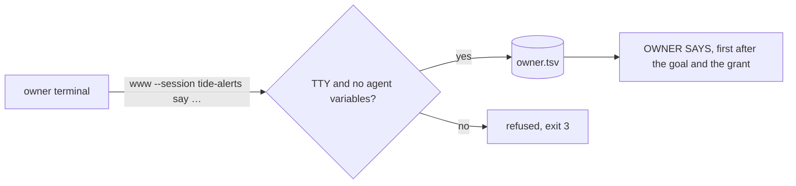

# Owner notes

- **Status:** agreed
- **Decision records:** [0005](../../decisions/0005-owner-notes-need-a-terminal-outside-any-agent.md), [0008](../../decisions/0008-notes-the-grant-and-no-caution-steering.md)

The owner reads what the session kept with `www recap`, and corrects the agent by writing a note straight into the store from a terminal. The note shows in every brief, ahead of everything but the goal and the grant, until the owner clears it, so the agent's next read cannot miss it. The tool refuses `say` and `ack` from an agent's shell, which stops an agent that writes an owner note by mistake. It does not stop an agent that sets out to fake one, and this doc says what is left open. A build agent reads this doc to build `www say`, `www ack`, the terminal test and how the owner corrects the grant, in the slice [build-order.md](build-order.md) names.

## Shape



## Contracts

```text
$ www --session tide-alerts say "The reading misses tidekit: the grant covers opening PRs there, never merging them."
o-2  owner note. It tops the brief until you run: www --session tide-alerts ack o-2. Brief: <n> lines.

$ www --session tide-alerts say "Use the recorded tide fixtures for e2e, not the live feed" --on t-e2e
o-3  owner note on t-e2e. It tops the brief until you run: www --session tide-alerts ack o-3. Brief: <n> lines.

$ www --session tide-alerts ack o-2
o-2  cleared. Kept in the journal. Brief: <n> lines.
```

- `say` and `ack` run only when both hold: stdin and stdout are terminals, and none of `CLAUDECODE`, `CLAUDE_CODE_SESSION_ID`, `CODEX_SESSION_ID`, `CODEX_THREAD_ID` or `CODEX_CI` is set.
- `say` writes `owner.tsv` and a `say` journal row with `by=owner`. `ack` removes the note from `owner.tsv` and adds an `ack` row with `by=owner`.
- No agent command reads `owner.tsv` for writing. Only `say` and `ack` do.
- The brief prints owner notes before every other section after the goal and the grant. [brief.md](brief.md) owns the line format.
- The owner corrects the grant's reading with a plain `say`, as in `o-2` above: `--on` takes an item id, and the grant is no item. The agent then rewrites the reading with `www grant --reading`, and the owner clears the note with `ack` once the brief shows the new reading.
- The owner reads what the session kept with `www --session <name> recap`: the grant, the notes on open items, the decisions and the closes since a time, in at most 44 lines. [commands.md](commands.md) owns its sections.
- At most 2 notes show; a third `say` is refused until the owner clears one.
- An agent's `Run:` line in a refusal never suggests `say` or `ack`.

## What this does not protect against

The agent runs as the same Unix user as the owner, so the tool cannot tell them apart. The checks above stop an agent that calls `www say` from its shell tool. They do not stop these:

- An agent that unsets the agent variables and fakes a terminal, such as with `script`.
- An agent that edits `owner.tsv`, `items.tsv` or `journal.tsv` with its file-editing tool. The journal is append-only by convention; nothing enforces it.
- An agent that records `--who owner` on a `decide` or `ok` that the owner never gave, or quotes words the owner never said in an `ok` or in `www grant`.
- A note the owner wrote in a terminal that an agent can type into, such as a shared tmux pane.

The owner's check is to read `www --session <name> recap` now and then, and `www --session <name> log --op say,ack,ok,decide,grant` when a line looks wrong, and to compare them with what they said. Any of the attacks above is deliberate misbehaviour, which an agent's own rules already forbid; the tool makes the honest path the easy one and leaves a trail.

## Decisions

- **A terminal outside any agent, and no signing.** Signing would need a key the agent cannot read, on a machine where the agent reads every file the owner can. [0005](../../decisions/0005-owner-notes-need-a-terminal-outside-any-agent.md)
- **Only the owner clears a note.** A note the agent could clear would stop the agent's next read from seeing it.
- **What the owner says in chat is the agent's to record.** The agent writes it as a rule, a wait, a decision with `--who owner`, a one-time approval with the owner's quote, or the grant in the owner's words; it never becomes an owner note.

## Builder decides

- How the TTY test reads stdin and stdout, such as `isatty` on file descriptors 0 and 1.
