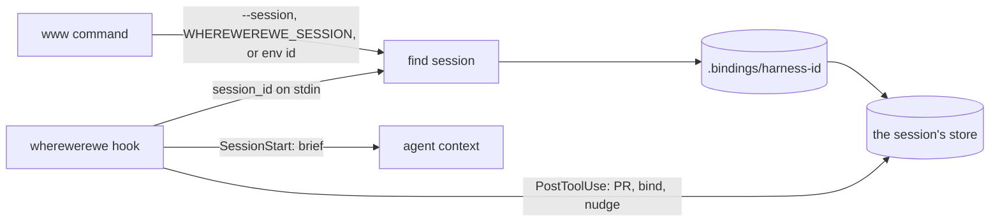

# Sessions and hooks

- **Status:** agreed
- **Decision records:** [0002](../../decisions/0002-sessions-bind-by-agent-session-id.md), [0004](../../decisions/0004-hooks-install-once-per-machine.md), [0007](../../decisions/0007-hooks-do-not-build-on-agent-hooks.md)

The owner runs several agent sessions on one machine, and each can keep its own wherewerewe session. A binding file maps an agent session's id to the wherewerewe session it writes to. A command finds the id in its environment, and a hook finds it in its stdin. See [store.md](store.md) for the file formats, [brief.md](brief.md) for the brief a hook prints, and [commands.md](commands.md) for the commands and refusal texts named here. The hooks are installed once for the machine and print nothing for an agent session with no binding. Build session finding, the bindings, the hooks, `www install` and `www doctor` from this doc, in the slice [build-order.md](build-order.md) names.

## Shape



## Contracts

### How a command finds its session

```ts
// sessions module
const session = findSession({ flag: argv.session, env: process.env });
// → { name: 'tide-alerts', via: 'binding', agent: { harness: 'claude', id: '4f1c…' } }
//   or { error: 'no-session', sessions: ['tide-alerts', 'docs-move'] }
```

The first rule that gives a name wins:

1. `--session <name>`.
2. `WHEREWEREWE_SESSION=<name>`.
3. `CLAUDE_CODE_SESSION_ID`, looked up as `.bindings/claude-<id>`.
4. `CODEX_SESSION_ID`, or `CODEX_THREAD_ID` when that is unset, looked up as `.bindings/codex-<id>`.

With no name, the command exits 4 with the no-session text in [commands.md](commands.md). The tool never falls back to a default or to the only session on the machine.

A binding file holds one line, `name=<session>`, and its file name is `<harness>-<agent session id>`, with the id restricted to `[A-Za-z0-9-]`. One agent session binds to one wherewerewe session, and one wherewerewe session can have many bindings.

| Command                       | Binding                                                                                  |
| ----------------------------- | ---------------------------------------------------------------------------------------- |
| `www init <name> --goal "…"`  | creates the store, then binds the agent session id from the environment, when there is one |
| `www import <name>`           | converts the store, then binds, as `init` does                                           |
| `www attach <name>`           | binds this agent session id to an existing store, replacing any binding it had            |
| `www detach`                  | removes this agent session id's binding; the store stays                                  |

Each bind and detach adds a `bind` journal row with the harness and id in `extra`.

### What each agent gives

| Fact                                                                 | Claude Code                                   | Codex CLI                                     |
| -------------------------------------------------------------------- | --------------------------------------------- | --------------------------------------------- |
| Session id in a shell command's environment                         | `CLAUDE_CODE_SESSION_ID`, equal to the hook's `session_id` (docs) | `CODEX_SESSION_ID` and `CODEX_THREAD_ID` (seen in Codex 0.169.1) |
| Session id on hook stdin                                             | `session_id`                                  | `session_id`                                  |
| A subagent's shell sees the parent's id                              | yes: a subagent of this design's own session saw the parent's `CLAUDE_CODE_SESSION_ID` | the docs say subagents report the parent's id; not tested |
| The id changes                                                       | on `/clear` (docs); resume and fork not documented | not documented                           |

The design works whichever way the unknowns fall:

- The `PostToolUse` hook binds the `session_id` from its own stdin whenever it sees a successful `www init`, `www attach` or `www import` command. So when a Codex shell's id differs from its hook's id, both ids get a binding.
- A subagent whose shell has no bound id gets the no-session refusal. In Claude Code, the `SubagentStart` hook gives it the name first, by adding `This session keeps its notes in wherewerewe session <name>. When a www command says there is no session, add --session <name>.`
- After `/clear`, or a resume or fork that changes the id, the new id has no binding, and the hooks stay silent. The agent, or the owner with `! www attach <name>` in Claude Code, binds it again. The no-session text names `www attach`.

### The hooks

One command handles every event, so the hook entries never change between versions and Codex never asks for trust again: `<bun> <bin> hook claude` or `<bun> <bin> hook codex`. `<bun>` and `<bin>` are the absolute paths that `command -v bun` and `command -v wherewerewe` printed at install: stable links that upgrades keep, and that work when a hook's `PATH` lacks Bun.

| Event           | Claude Code entry                          | Codex entry                                | What a bound session gets                                                                                       |
| --------------- | ------------------------------------------ | ------------------------------------------ | --------------------------------------------------------------------------------------------------------------- |
| `SessionStart`  | no matcher, timeout 10                     | no matcher, timeout 10                     | the brief on plain stdout, which both agents add to context; on every source: startup, resume, clear, compact, fork |
| `PostToolUse`   | matcher `Bash`, timeout 5                  | matcher `Bash`, timeout 5                  | a pull request record, a binding, or one nudge line, as below                                                   |
| `SubagentStart` | no matcher, timeout 5                      | no matcher, timeout 5                      | the one line naming the session, as `additionalContext`                                                          |

For a bound session whose store needs `www import`, a hand-kept or a format 1 store, `SessionStart` prints the exit 5 text from [commands.md](commands.md) and its `Run:` line in place of the brief, so the agent's next command is the import that lets the next compaction print the brief again.

`PostToolUse` does these, in order, and prints at most one JSON object, `{"hookSpecificOutput":{"hookEventName":"PostToolUse","additionalContext":"<line>"}}`:

1. When the command runs `www` or `wherewerewe` with `init`, `attach` or `import` and a session name, and that session's store exists, it binds its stdin `session_id`. This is the only step that runs for an unbound id.
2. When `tool_input.command` runs `gh pr create`, it finds the first `https://github.com/<owner>/<repo>/pull/<n>` in `tool_response`, read as text whatever its shape, and appends `<owner>/<repo>#<n>` to the bound session's `prs.tsv` with a `pr` journal row, unless the ref is there already.
3. When the command runs `git push`, `gh pr create` or `gh pr merge`, the last write was more than 20 minutes ago, and the last nudge was more than 20 minutes ago, it prints the nudge and sets `last_nudge`:

```text
wherewerewe: you pushed or merged, and the last write to tide-alerts was 47m ago. Record it: www set <id> "<claim>" or www done <id> --evidence "<PR or commit>"
```

```ts
// hooks module: one parser per harness, one handler per event
type HookInput =
  | { event: 'SessionStart'; harness: Harness; sessionID: string; source: string | null }
  | { event: 'PostToolUse'; harness: Harness; sessionID: string; command: string; response: string }
  | { event: 'SubagentStart'; harness: Harness; sessionID: string };

type Harness = 'claude' | 'codex';
```

### Install and doctor

`www install` merges the three entries into `~/.claude/settings.json` and `~/.codex/hooks.json`, keeps every other hook, replaces an older entry whose command ends in `wherewerewe hook claude` or `wherewerewe hook codex`, and prints what it changed. `www install --print` changes nothing and prints both JSON blocks, for an owner who keeps those files in dotfiles. Neither ever edits `~/.codex/config.toml`; both print the lines it needs:

```toml
[features]
hooks = true

[sandbox_workspace_write]
writable_roots = ["/home/sam/.local/state/wherewerewe"]   # the store root, as an absolute path
```

`www doctor` checks each of these and prints one line per check, `ok` or the exact fix: `wherewerewe` on `PATH`; the entries in both hook files, and the Bun and bin paths each entry names; `hooks = true` and the store root in `writable_roots` in the Codex config; that the store root is writable from this shell, by writing and removing a probe file; and `gh auth status`. It exits 0 when every check passes, and 3 otherwise.

## Constraints

- A hook always exits 0, never blocks a tool call, and writes any error to `hook-errors.log`, never to stdout or stderr.
- For an agent session id with no binding, a hook prints nothing, writes nothing except the binding in `PostToolUse` step 1 and any error line in `hook-errors.log`, and returns in under 150 ms. A test measures the median of 20 runs.
- A `PostToolUse` hook for a bound session never runs a probe and never touches the network, and returns in under 300 ms.
- A `SessionStart` hook returns within 6 s: the 5 s check deadline and the render.
- A hook reads only `session_id`, `hook_event_name`, `source`, `tool_input.command` and `tool_response` from its stdin, and ignores any other field.
- `install` is idempotent: a second run changes nothing and says so.
- A hook never creates a session or a store. Only `init` and `import` do.

## Owner steps

[README.md](README.md) lists each owner step for the whole build. The ones in this part:

1. The build agent runs `www install`, which writes the hook entries into `~/.claude/settings.json` and `~/.codex/hooks.json`. The owner's sign-off of the design authorises it. When the owner keeps those files in dotfiles, the agent applies `www install --print` there instead.
2. The build agent adds the two lines above to `~/.codex/config.toml`, under the same sign-off. Without them, a Codex write fails, and a Codex read still prints the brief without saving results.
3. The owner opens `/hooks` in Codex and trusts the three new entries, by hand. Codex skips an untrusted hook.

## Decisions

- **Bind by agent session id.** Both agents put the id in every shell command's environment, so a command needs no flag and two sessions on one machine never write to each other's store. [0002](../../decisions/0002-sessions-bind-by-agent-session-id.md)
- **Install once, in user settings.** A session opts in with `init`; an agent session that never does is untouched. [0004](../../decisions/0004-hooks-install-once-per-machine.md)
- **The hooks have their own parser, not `@zgeoff/agent-hooks`.** [0007](../../decisions/0007-hooks-do-not-build-on-agent-hooks.md)

## Builder decides

- The regular expressions that spot `gh pr create`, `git push`, `gh pr merge` and the `www` commands in a command line.
- How `install` writes JSON: key order and indentation, as long as every other hook survives.

## Open questions

- **Does a Codex subagent's shell carry the parent's `CODEX_SESSION_ID`, do `SessionStart` and `SubagentStart` fire inside a Codex subagent, and does Codex add a `SubagentStart` hook's `additionalContext`?** Run a live test in the hooks slice to settle all three. Until then, a Codex subagent passes `--session`.
