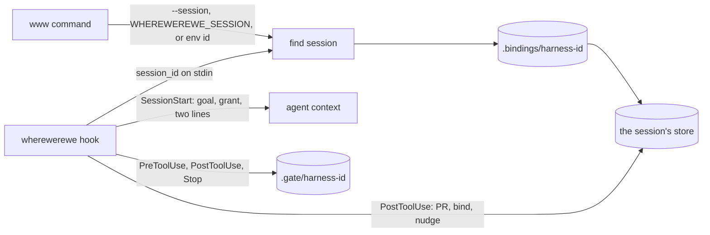

# Sessions and hooks

- **Status:** agreed
- **Decision records:** [0002](../../decisions/0002-sessions-bind-by-agent-session-id.md), [0004](../../decisions/0004-hooks-install-once-per-machine.md), [0007](../../decisions/0007-hooks-do-not-build-on-agent-hooks.md), [0013](../../decisions/0013-the-hooks-gate-until-the-agent-reads-the-brief.md), [0014](../../decisions/0014-the-gate-fails-open.md), [0015](../../decisions/0015-a-post-tool-hook-marks-the-brief-read.md), [0020](../../decisions/0020-authority-comes-from-the-owners-own-acts.md), [0022](../../decisions/0022-ship-compiled-binaries-through-the-tap-and-an-install-script.md), [0023](../../decisions/0023-the-cli-ships-its-own-www-skill.md)

The owner runs several agent sessions on one machine, and each can keep its own wherewerewe session. A binding file maps an agent session's id to the wherewerewe session it writes to. A command finds the id in its environment, and a hook finds it in its stdin. See [store.md](store.md) for the file formats, [brief.md](brief.md) for the brief `www` prints, and [commands.md](commands.md) for the commands and refusal texts named here. After each start, resume and compaction of a bound session, the hooks put the goal and the grant in context and refuse the agent's tool calls, other than `www` commands, until it reads the brief whole with `www` or the gate fails open, as [The gate's states](#the-gates-states) says. The hooks are installed once for the machine and print nothing for an agent session with no binding. Build session finding, the bindings, the hooks, `www install` and `www doctor` from this doc, in the slice given in [build-order.md](build-order.md).

## Shape



## Contracts

### How a command finds its session

```ts
// sessions module
const session = findSession({ flag: argv.session, env: process.env });
// → { name: 'tide-alerts', via: 'binding', agent: { harness: 'claude', id: '4f1c…' } }
//   or { error: 'no-session', sessions: ['tide-alerts', 'docs-move'] }
```

The first rule that gives a name wins:

1. `--session <name>`.
2. `WHEREWEREWE_SESSION=<name>`.
3. `CLAUDE_CODE_SESSION_ID`, looked up as `.bindings/claude-<id>`.
4. `CODEX_SESSION_ID`, or `CODEX_THREAD_ID` when that is unset, looked up as `.bindings/codex-<id>`.

The agent variable that gives the session also gives the brief's limit, and a command with no agent variable takes the limit of no known host ([brief.md](brief.md#the-briefs-limit)).

With no name, the command exits 4 with the no-session text in [commands.md](commands.md). The tool never falls back to a default or to the only session on the machine.

A binding file holds one line, `name=<session>`, and its file name is `<harness>-<agent session id>`, with the id restricted to `[A-Za-z0-9-]`. One agent session binds to one wherewerewe session, and one wherewerewe session can have many bindings.

| Command                       | Binding                                                                                  |
| ----------------------------- | ---------------------------------------------------------------------------------------- |
| `www init <name> --goal "…"`  | creates the store, then binds the agent session id from the environment, when there is one |
| `www import <name>`           | converts the store, then binds, as `init` does                                           |
| `www attach <name>`           | binds this agent session id to an existing store, replacing any binding it had            |
| `www detach`                  | removes this agent session id's binding; the store stays                                  |

Each bind and detach adds a `bind` journal row with the harness and id in `extra`.

### What each agent gives

| Fact                                                                 | Claude Code                                   | Codex CLI                                     |
| -------------------------------------------------------------------- | --------------------------------------------- | --------------------------------------------- |
| Session id in a shell command's environment                         | `CLAUDE_CODE_SESSION_ID`, equal to the hook's `session_id` (docs) | `CODEX_SESSION_ID` and `CODEX_THREAD_ID`, both equal to the thread id, which a compaction keeps (seen in Codex 0.169.1) |
| Session id on hook stdin                                             | `session_id`                                  | `session_id`                                  |
| A subagent's shell sees the parent's id                              | yes: a subagent of this design's own session saw the parent's `CLAUDE_CODE_SESSION_ID`, and its tool calls carry `agent_id` | the docs say subagents report the parent's id, and document `agent_id` on no tool event, so a subagent's payload is taken as the main agent's; not tested |
| The id changes                                                       | on `/clear` (docs); resume and fork not documented | not documented                           |
| Hook output put into context                                         | 10,000 characters of plain stdout; past that, a 2,000-character preview ([hooks](https://code.claude.com/docs/en/hooks)) | about 2,500 tokens, which a handler's `additionalContextLimit` raises (docs) |
| Shell output that reaches the model whole                            | 30,000 characters; past that, a file path and a 2,000-character preview (measured on 2.1.331) | 39,000 bytes with `max_output_tokens` at 10,000 or absent, and the model sets that parameter itself, at 1,000 to 6,000 when nothing names it; past 39,000 the middle is cut (measured on 0.169.1) |

The design works whichever way the unknowns fall:

- The `PostToolUse` hook binds the `session_id` from its own stdin whenever it sees a successful `www init`, `www attach` or `www import` command. So when a Codex shell's id differs from its hook's id, both ids get a binding.
- A subagent whose shell has no bound id gets the no-session refusal. In Claude Code, the `SubagentStart` hook gives it the name first, by adding `This session keeps its notes in wherewerewe session <name>. When a www command says there is no session, add --session <name>.`
- After `/clear`, or a resume or fork that changes the id, the new id has no binding, and the hooks stay silent. The agent, or the owner with `! www attach <name>` in Claude Code, binds it again. The no-session text names `www attach`.

### The hooks

One command handles every event, so the hook entries never change between versions and Codex never asks for trust again: `<bin> hook claude` or `<bin> hook codex`. `<bin>` is the path that `command -v wherewerewe` printed at install, kept as printed: Homebrew's link and the install script's file, which upgrades keep in place ([0022](../../decisions/0022-ship-compiled-binaries-through-the-tap-and-an-install-script.md)). When no `wherewerewe` is on `PATH`, `www install` refuses.

| Event           | Claude Code entry                          | Codex entry                                | What a bound session gets                                                                                       |
| --------------- | ------------------------------------------ | ------------------------------------------ | --------------------------------------------------------------------------------------------------------------- |
| `SessionStart`  | no matcher, timeout 5                      | no matcher, timeout 5                      | its column of [The gate's states](#the-gates-states), and the injection of [The `www` commands, the refusal and the injection](#the-www-commands-the-refusal-and-the-injection); on every source: startup, resume, clear, compact, fork |
| `PreToolUse`    | no matcher, timeout 3                      | no matcher, timeout 3                      | its brief command and other call columns of [The gate's states](#the-gates-states)                              |
| `PostToolUse`   | matcher `Bash`, timeout 5                  | matcher `Bash`, timeout 5                  | the read check, a pull request record, a binding, or one nudge line, as below                                   |
| `PostToolUseFailure` | matcher `Bash`, timeout 5             | none: Codex fires `PostToolUse` after a failed shell call too (docs) | the failed end of a brief command, in the failed column of [The gate's states](#the-gates-states)    |
| `SubagentStart` | no matcher, timeout 5                      | no matcher, timeout 5                      | the one line naming the session, as `{"hookSpecificOutput":{"hookEventName":"SubagentStart","additionalContext":"<line>"}}` |
| `Stop`          | no matcher, timeout 3                      | no matcher, timeout 3                      | its column of [The gate's states](#the-gates-states)                                                             |

For a bound id whose store folder is missing or cannot be read, `SessionStart` prints nothing, logs the error, and writes the `wiped` gate file; the brief command then ends failed, and the gate opens on the next call. For a bound session whose store needs `www import`, a hand-kept or a format 1 store, or any store whose `session` file holds a `format` other than 2, `SessionStart` prints only the two lines of the refusal. `www` prints the exit 5 text from [commands.md](commands.md), and the next call that is not a `www` command opens the gate ([The gate's states](#the-gates-states)).

`PostToolUse` does these, in order, and prints at most one JSON object, `{"hookSpecificOutput":{"hookEventName":"PostToolUse","additionalContext":"<line>"}}`:

0. When the command is the brief command, it sorts its end as whole, cut or failed ([What counts as a whole read](#what-counts-as-a-whole-read)) and applies that column of [The gate's states](#the-gates-states) to the gate file. This step runs for a bound id with a gate file only, and steps 1 to 3 run for any bound id, a payload with `agent_id` included. Steps 1 to 3 act only on a successful command: on Codex, one whose `tool_response` holds no exit code, or 0. Each takes the store's `lock` as a write does; a step that cannot take it before the hook's timeout is skipped and logged in `hook-errors.log`, and the call runs.
1. When the command runs `www` or `wherewerewe` with `init`, `attach` or `import` and a session name, and that session's store exists, it binds its stdin `session_id`, and adds a `bind` journal row with `by` `hook` only when that changes the binding. This is the only step that runs for an unbound id.
2. When `tool_input.command` runs `gh pr create`, it finds the first `https://github.com/<owner>/<repo>/pull/<n>` in `tool_response`, read as text whatever its shape, and appends `<owner>/<repo>#<n>` to the bound session's `prs.tsv` with a `pr` journal row, whose `id` is the ref and whose `by` is `hook`, unless the ref is there already.
3. When the command runs `git push`, `gh pr create` or `gh pr merge`, the last write was more than 20 minutes ago, and the last nudge was more than 20 minutes ago, it prints the nudge and sets `last_nudge`:

```text
wherewerewe: you pushed or merged, and the last write to tide-alerts was 47m ago. Record it: www set <id> "<claim>" or www done <id> --evidence "<PR or commit>"
```

```ts
// hooks module: one parser per harness, one handler per event
type HookInput =
  | { event: 'SessionStart'; harness: Harness; sessionID: string; source: string | null }
  | { event: 'PreToolUse'; harness: Harness; sessionID: string; agentID: string | null; toolName: string; command: string | null }
  | { event: 'PostToolUse'; harness: Harness; sessionID: string; agentID: string | null; command: string; response: string; exitCode: number | null; maxOutputTokens: number | null }
  | { event: 'PostToolUseFailure'; harness: 'claude'; sessionID: string; agentID: string | null; command: string }
  | { event: 'SubagentStart'; harness: Harness; sessionID: string }
  | { event: 'Stop'; harness: Harness; sessionID: string; agentID: string | null; stopHookActive: boolean };

type Harness = 'claude' | 'codex';
```

### The gate

The gate refuses a bound agent session's tool calls, other than `www` commands, after each start, resume and compaction, until the agent reads its brief whole with `www` or the gate fails open, as [The gate's states](#the-gates-states) says. The hooks put only the goal, the grant and the two lines of the refusal into context, and the agent reads the rest by running `www`, so no host's limit on hook output bounds the brief. [0013](../../decisions/0013-the-hooks-gate-until-the-agent-reads-the-brief.md) Every Codex claim in this section rests on the Codex docs. No Codex hook has run yet, because Codex runs a project hook only after a person trusts it. Slice 4 proves each claim on a real Codex session ([build-order.md](build-order.md)).

The gate uses `SessionStart`, `PreToolUse`, `PostToolUse` and `Stop` on both hosts, and `PostToolUseFailure` on Claude Code. `SessionStart`, `PreToolUse` and `Stop` take no matcher, so `PreToolUse` reaches every tool that reaches a hook. On Codex, the docs say that covers shell calls and `exec_command`, both with the tool name `Bash`, and `apply_patch`, MCP tools and local function tools such as `spawn_agent`. Hosted tools such as web search never reach a hook, so they can run before the agent reads the brief, and a `write_stdin` poll is not gated again. `PostToolUse` keeps its matcher `Bash` and its other jobs, and adds the read check. The `SubagentStart` line is unchanged.

The gate refuses a call only for an agent session id that has a binding and a gate file. An unbound id and a bound id with no gate file pass every call without a refusal. A bound id gets its gate file at its first `SessionStart` after it is bound, so a session that runs `init`, `attach` or `import` mid-session is gated from its next resume or compaction. A missing gate file skips only the gate: `PostToolUse` still records pull requests, binds and nudges for every bound id. An agent session that never opted in is untouched, as [0004](../../decisions/0004-hooks-install-once-per-machine.md) requires.

The gate file belongs to one wherewerewe session. When a mid-session `attach` or `import` binds an agent session id that already has a gate file to another store, the file's `session` no longer matches the binding, and each hook of the main agent reads the file as a fresh `wiped` for the new session, with `spare=1` and `reads` kept, before it applies the table below, and writes the result back even when the table leaves the state as it is. So a `read` of the old store's brief never opens the gate for the new one. A payload with `agent_id` neither reads nor rewrites the file (invariant 4).

Each gated agent session has one gate file, `<root>/.gate/<harness>-<agent session id>`, beside `.bindings/`; `SessionStart` makes `.gate/` when it is missing. It holds one line, `state=<state> session=<name> reads=<n> spare=<0|1>`, and each hook replaces it through a temporary file and a rename. `session` is the wherewerewe session the state is about. A hook takes the session's name from the binding, compares it with the file's `session`, and puts it in the injection, each refusal and the fail-open line. `reads` counts the brief commands in flight, by the rule in [The gate's states](#the-gates-states), so a brief command that started before a compaction still counts. `spare` is 1 until the gate spends its one refusal after a cut read. `www` never writes the file.

Each hook reads the file, applies its event and writes the result while it holds an exclusive lock on a file of its own, `<gate file>.lock`, which no hook replaces and the operating system releases when the hook process exits. The lock is not on the gate file, because a rename gives that path a new file, and a second hook could lock the old one. So two hooks of one agent session that run at once apply their events one after the other, and neither loses the other's write. A hook that cannot take the lock before its wait ends logs it, writes nothing, exits 0 and passes the call, as for a gate file that does not parse. A gate file that does not parse or lacks a field is a hook error too: the hook logs it, writes nothing and passes the call, and the next `SessionStart` replaces the file.

```ts
// hooks module: the gate file's one line
type GateState =
  | 'wiped' // SessionStart wrote it: the brief is not in context
  | 'reading' // a brief command let through after the wipe has not ended, so reads > 0
  | 'cut' // on Codex, the last brief command's output reached the model cut
  | 'failed' // the last brief command ended failed, or a Stop came in 'reading', or in 'wiped' with stop_hook_active
  | 'read' // PostToolUse saw the main agent read this session's brief whole
  | 'open'; // the gate stopped waiting for a whole read until the next SessionStart
interface GateFile { state: GateState; session: string; reads: number; spare: 0 | 1 }
```

#### The gate's states

The gate changes state only on a hook event, and no rule reads a clock. Each event of the main agent falls in one column of the table:

- **brief command:** `PreToolUse` of the brief command, defined below.
- **other call:** `PreToolUse` of a call that is not a `www` command. A `www` command that is not the brief command passes in every state and changes nothing.
- **whole**, **cut** and **failed:** the end event of a brief command, sorted by [What counts as a whole read](#what-counts-as-a-whole-read). It is whole when every rule there holds. It is cut on Codex when the only rules it breaks are the truncation marker and `max_output_tokens`. It is failed otherwise. Claude Code fires `PostToolUseFailure` in place of `PostToolUse` for a failed shell call, and that is a failed end too. A brief cut on Claude Code is failed, because its Bash tool has no parameter that lets a retry read it whole.
- **`Stop`:** the end of a turn, when no call runs.

`reads` follows the same rule in every state: a brief command adds 1, each end event takes 1 away, never below 0, `Stop` sets it to 0, and `SessionStart` keeps it. A cell that names no state leaves the state as it is.

| State | `SessionStart` | brief command | other call | whole | cut | failed | `Stop` |
| --- | --- | --- | --- | --- | --- | --- | --- |
| `wiped` | `wiped`, `spare=1`, `reads` kept; prints the [injection](#the-www-commands-the-refusal-and-the-injection) | `reading`; passes | refused | `read` | no change | no change | blocks when `stop_hook_active` is false; when it is true, `failed`, and passes |
| `reading` | the same | passes | refused | `read` | `cut` when `reads` reaches 0 | `failed` when `reads` reaches 0 | `failed`; passes |
| `cut` | the same | `reading`; passes | with `spare=1`, refused with the cut reason and `spare=0`; with `spare=0`, `open`, and passes with the line | `read` | no change | no change | passes |
| `failed` | the same | passes | `open`; passes with the line | `read` | no change | no change | passes |
| `read`, `open` | the same | passes | passes | `read` | no change | no change | passes |

The line is the fail-open line, added once as `additionalContext`: `wherewerewe: www printed no whole brief for tide-alerts, so this session's tool calls go through until the next resume or compaction.` A refusal in `wiped` or `reading` gives the standard reason below. A payload that carries `agent_id` passes and changes nothing in every state, and the table does not apply to it.

These invariants hold for every order of events, and each follows from the table:

1. **While the gate is closed and a brief command runs, no other call of the main agent passes.** The gate is closed in `wiped`, `reading` and `cut`. `reads` counts every brief command in flight, whatever the state it started in and across a `SessionStart`, and reaches 0 only after the last end event or on `Stop`, which comes only when no call runs. While `reads` is above 0 the closed state is `wiped` or `reading`, and both refuse every other call: `cut` and `failed` are written only when `reads` reaches 0. A `www` command still passes, so the agent can always run the command a refusal names.
2. **After a cut or failed read, the agent is refused at most once more before the gate opens.** `failed` refuses nothing. `cut` refuses only while `spare` is 1, and that refusal sets it to 0. Only `SessionStart`, and a hook that reads another session's gate file as a fresh `wiped`, set `spare` to 1, so after a cut read at most one call is refused in `cut`, however many retries follow, and a failed retry opens the gate on the next call. A call refused in `reading` does not count: the agent ran another brief command, and invariant 1 refuses calls while it runs.
3. **When `www` cannot run, the gate opens by the end of the turn.** When `www` is missing, crashes or exits 4 or 5, the host reports a failed call; when it is the last brief command in flight and the state is `reading`, that failed end writes `failed`, and the next call that is not a `www` command passes. When the host refuses `www` at its permission step, it sends no end event: in a headless Claude Code run where `www` needed approval, none of `PostToolUse`, `PostToolUseFailure` and `PermissionDenied` fired, although each was hooked. The Codex docs do not say whether a call that the person rejects, or that the sandbox refuses, fires any hook, so the gate treats a refused `www` the same way on both hosts. The state then stays `reading` until the turn ends, and `Stop` writes `failed`. That is the one case where the gate waits for the end of a turn, and the allow rules below keep `www` from reaching a permission step. In `wiped`, every refusal names `www`, and the brief command always leaves `wiped`.
4. **A payload with `agent_id` never changes the state.** It passes, and the hook writes nothing to the gate file for it. Claude Code sends `agent_id` on a subagent's tool calls. Codex documents it on no tool event, so a Codex subagent's payload reads as the main agent's ([Subagents and failing open](#subagents-and-failing-open)), and slice 4 records which holds.

The timeouts in the hooks table bound one run of a hook process, and are not gate state: a hook that times out lets its call run.

Each of these orderings starts from `wiped`:

- **A call batched with the brief command whose `PreToolUse` runs before the read's end:** brief command, `reading`; `ls` refused; whole, `read`; the agent's retried `ls` passes.
- **The same call when its `PreToolUse` runs after the read's end:** brief command, `reading`; whole, `read`; `ls` passes.
- **Two batched calls, then a cut read:** brief command, `reading`; `ls` and `cat` refused; cut, `cut`; `ls` refused with the cut reason, `spare=0`; `cat` passes with the line. `ls` is refused twice, once while the read ran and once after the cut, so the gate bounds the refusals after a read ends, not the refusals of one call.
- **A retry that fails:** brief command, `reading`; cut, `cut`; `ls` refused, `spare=0`; brief command, `reading`; failed, `failed`; `ls` passes with the line. A retry sent straight from `cut` that fails reaches `failed` with no refusal. One that is cut again reaches `cut` with `spare=1` still, so one call is refused and the next passes.
- **A slow `www`:** brief command, `reading`; every other call is refused however long `www` runs, and its end event decides. A `www` that never ends is killed at the host's own shell timeout, which the host reports as a failed call.
- **`www` refused at the permission step:** brief command, `reading`; no end event; each other call is refused; `Stop`, `failed`; the next call that is not a `www` command passes with the line.
- **A brief command that runs across a compaction:** brief command A, `reading`, `reads=1`; `SessionStart`, `wiped`, `reads=1`; brief command B, `reading`, `reads=2`; A fails, `reads=1`, and the state stays `reading`; `ls` refused; B ends whole, `read`.
- **Two hooks at once:** the `PreToolUse` of two brief commands run together; each takes the lock in turn, and `reads=2`; the first read fails, `reads=1`, so the gate stays `reading` while the second runs.
- **Exit 5:** brief command, `reading`; failed, `failed`; the next call that is not a `www` command passes with the line, and `www import`, a `www` command, passes in every state.

#### The `www` commands, the refusal and the injection

A shell command passes the gate in every state when it is one `www` or `wherewerewe` command, bare or as an absolute path ending in that name, with any redirects but a heredoc, optionally piped to `head`, `tail`, `grep`, `wc` or `sort`, so the agent can run the `Run: www import <name>` line of an exit 5. A command with a separator, or a pipe to any other command, is gated like any other call, so a call chained after `www` never skips the gate. The hook reads the command as the shell does:

- The hook first removes each backslash that ends a line, with its line break, outside single quotes, as the shell does.
- `;`, `&&`, `||`, `&`, a line break and a process substitution, `<(` or `>(`, are separators, and `|` is a pipe, only outside quotes, single or double, and only when no backslash escapes them.
- A command substitution, `$(` or a backtick, is a separator outside single quotes and inside double quotes, because the shell runs it in both, unless a backslash escapes it.
- Inside single quotes nothing is special, and a backslash is a plain character. Inside double quotes, a backslash escapes only `"`, `\`, `$` and a backtick, and a backslash with a line break is removed.
- The `&` of a redirect, as in `2>&1` or `&>`, belongs to the redirect. A command that holds anything else these rules do not read, such as `|&`, a `#` comment, a heredoc, `$'…'` or an unclosed quote, is gated.

| Command | Gate |
| --- | --- |
| `www task t-a "Check logs; record the result"` | passes: the `;` is inside double quotes |
| `www task t-a 'Merge it && tag it'` | passes: the `&&` is inside single quotes |
| `www task t-a Check\;logs` | passes: a backslash escapes the `;` |
| `www task t-a "Say \"done\"; then stop"` | passes: the escaped quotes keep the `;` inside the double quotes |
| `www task t-a "Check logs"; ls` | gated: the `;` is outside the quotes |
| `www task t-a "Logs at $(date)"` | gated: the shell runs `$(date)` inside double quotes |
| `www task t-a 'Logs at $(date)'` | passes: single quotes keep `$(date)` as text |
| `www task t-a "$\` and a line break and `(date)"` | gated: the shell removes the backslash and line break, then reads `$(date)` |

A Codex command wrapped as `<shell> -lc '<command>'` or `<shell> -c '<command>'`, where `<shell>` is `bash`, `sh` or `zsh` by name or as an absolute path and `<command>` is one single-quoted word, is read inside the wrapper. Any other wrapper is read as one command, and gated.

The brief command is narrower: `www` or `wherewerewe`, bare or as an absolute path ending in that name, alone or with `--session <name>` or `--session=<name>` where `<name>` is the session bound to this id, with no redirect, no pipe and nothing else after it. A leading variable assignment makes a command neither the brief command nor a `www` command. Only the brief command moves the state to `reading`, so `www help` and `www | tail -1` never open the gate. `www --json` is a `www` command, so it passes in every state, but it is not the brief command: the gate never counts it, and `PostToolUse` never counts it as a whole read.

`PreToolUse` denies with `{"hookSpecificOutput":{"hookEventName":"PreToolUse","permissionDecision":"deny","permissionDecisionReason":"<reason>"}}`, and `Stop` blocks with `{"decision":"block","reason":"<reason>"}`, the shapes both hosts' hook docs give. A `PreToolUse` that passes with the fail-open line prints `{"hookSpecificOutput":{"hookEventName":"PreToolUse","additionalContext":"<line>"}}`. The [Claude Code hooks docs](https://code.claude.com/docs/en/hooks) list `additionalContext` on `PreToolUse`, added to the context beside the tool result. The [Codex hooks docs](https://learn.chatgpt.com/docs/hooks) give the same shape "to add model-visible context without blocking", and slice 4 proves it on a real Codex session with the other Codex claims. Both hosts give the agent this reason: one line, a line break, and the `Run:` line:

```text
wherewerewe: this session started or was compacted, and tide-alerts's brief is not in your context yet.
Run: www
```

On Codex, the `Run:` line is `Run: www   (pass max_output_tokens 10000, so the whole brief reaches you)`, and the `SessionStart` line ends the same way ([brief.md](brief.md#the-briefs-limit)). After a cut read, the Codex reason's first line is `wherewerewe: www's output reached you cut, so tide-alerts's brief is not whole in your context.`, with the same `Run:` line. The reason holds what is true and the command that fixes it, and never steers the agent to hold back or to ask ([0008](../../decisions/0008-notes-the-grant-and-no-caution-steering.md)). Claude Code shows it to the model as `PreToolUse:Bash hook error: <reason>`. On Codex, the docs say a `Stop` block's reason arrives as a new user prompt.

For a bound id, `SessionStart` prints on plain stdout the `GOAL` block and the `GRANT` block exactly as the brief prints them, whole and never cut, the brief's line for no grant included, then the two lines above. It reads only the binding, the `session` file and the gate file, runs no check, and prints nothing else of the brief. For a store that needs `www import`, it prints only the two lines, and `www` gives the exit 5 text. The worst case is 3 goal lines, 23 grant lines and the 2 refusal lines: about 1,610 UTF-8 bytes, 16% of Claude Code's 10,000 characters and about 400 tokens by Codex's own count, 16% of its default 2,500. Both hosts add plain stdout from `SessionStart` to context.

#### The injected grant authorises nothing

The goal and the grant in context keep what the owner allowed in front of the agent after a compaction. They are not a way to show Claude Code's auto mode classifier that the owner allowed anything. The classifier sees user messages, tool calls and CLAUDE.md, and tool results are stripped from its requests. The docs do not say whether it reads hook-added context, and the one documented hook channel to it, `classifierContext`, is unverified and never establishes user intent. The tool never writes `classifierContext`, and the owner keeps the grant in the injection and in the brief's never-cut lines.

The owner's own acts carry authority: an allow rule the owner installs and a `/goal` the owner pastes ([0020](../../decisions/0020-authority-comes-from-the-owners-own-acts.md)). Scripted Claude Code sessions in auto mode, each with a standing permission given in one place, then a compaction, then the permitted action, gave these counts of the classifier's allows and blocks:

| Where the permission was | Allowed | Blocked |
| --- | --- | --- |
| no permission given (control) | 0 | 6 of 6 |
| a user message before any compaction (control) | 3 of 3 | 0 |
| the compaction summary, which restated it | 2 of 2 | 0 |
| the user's original message, with a summary that left it out | 0 | 2 of 2 |
| the command text of a tool call | 0 | 4 of 4 |
| a `/goal` condition, after a compaction | 0 | 2 of 2 |
| a `/goal` condition, before any compaction | 1 of 1 | 0 |
| `SessionStart` hook context | 0 | 2 of 2 |

The classifier kept the permission across a compaction only when the compaction summary restated it. With the owner's words in front of it after every compaction, the agent can restate them accurately when it next writes a summary, and that is what the injection is for. The owner's paste of the text from [`www goal --paste`](lists-and-json.md#www-goal---paste) carries authority before a compaction, and after one only when the agent's summary restates the grant. Whether a goal's periodic re-injection counts after a compaction is untested ([open questions](#open-questions)).

#### Subagents and failing open

A `PreToolUse`, `PostToolUse` or `Stop` payload that carries `agent_id` passes, and its read never counts. That is the one rule on both hosts. Claude Code sends `agent_id` on a subagent's tool calls. Codex documents `agent_id` only on `SubagentStart`, `SubagentStop` and the model-request events, and gives a subagent's hooks the parent's `session_id`. So on Codex, as documented, a subagent's payload has no `agent_id`: its calls are gated on the parent's state, which is `read` or `open` whenever the parent could spawn it, and its whole read of the brief counts like the main agent's. That is a known gap of the rule on Codex, accepted because the subagent exists only after the parent's `spawn_agent` call passed the gate, and the brief it reads is the parent's own. It matters only when a compaction wipes the state while the subagent runs. Slice 4 records whether Codex sends `agent_id` on tool events, and when it does, the rule above covers it with no change.

The gate never stops an agent for long: after a read ends with no whole brief, it refuses at most one more call before it opens, as [The gate's states](#the-gates-states) shows ([0014](../../decisions/0014-the-gate-fails-open.md)):

- When a hook cannot start, fails, times out or returns a malformed response, both hosts run the call. `www install` never sets `onFailure: "block"`.
- When the last brief command in flight ends failed in `reading`, the state is `failed`, and the next call that is not a `www` command passes with the fail-open line. That covers `www` missing from the agent's `PATH`, a crash, exit 4, exit 5, and a brief over Claude Code's limit. The reason is in `www`'s own output, already in context. A `www` that the host refuses before it runs may send no end event, on either host, so the state stays `reading` until a `Stop` writes `failed`.
- When a Codex read is cut, the gate refuses one call with the cut reason, and no more however many retries are cut; the agent can read again with `max_output_tokens`. A failed retry opens the gate on the next call.
- `Stop` blocks only while the state is `wiped`, and never when `stop_hook_active` is true. So it blocks at most once per turn while the state stays `wiped`, on either host, below Claude Code's cap of 8 consecutive continues. A `Stop` that passes in `wiped` writes `failed`, so the next turn's first call that is not a `www` command passes with the fail-open line instead of meeting a gate the agent was already stopped on once.

#### What counts as a whole read

`PostToolUse` writes `read` when all of these hold ([0015](../../decisions/0015-a-post-tool-hook-marks-the-brief-read.md)):

- the payload has no `agent_id`, so on Claude Code a subagent's read never counts, and on Codex it can ([above](#subagents-and-failing-open));
- `tool_name` is `Bash`, the shell tool's name in both hosts' docs, and the command is the brief command, so a piped, filtered or redirected read never counts;
- the host reports the call as a success: Claude Code fires `PostToolUse` only then, and fires `PostToolUseFailure` for a failed `www`; on Codex `PostToolUse` also fires after a command that exits non-zero, and the docs name no exit code field, so the hook reads an exit code from `tool_response` only when one is there; a failed `www` prints no brief, so it fails the header and footer rules below either way;
- the output starts with the header line of the bound session, `<name> · day`, and ends with the footer line of [brief.md](brief.md), after one final line break is trimmed. On Claude Code the output is `tool_response.stdout`, beside `stderr`, `interrupted` and `isImage` in the Bash tool's output object; on Codex it is the text of `tool_response`, whose shape for a shell call slice 4 records;
- the output holds no host truncation marker: Claude Code's `<persisted-output>`, or Codex's `tokens truncated`;
- on Codex, when `tool_input` carries `max_output_tokens`, that number × 4 is at least the output's UTF-8 bytes, because the model sees no more than that. An output past Codex's own cut of 39,000 bytes carries the truncation marker, so the rule above catches it whatever the number.

A hook does this check, and `www` does not, because `www` sees neither case that breaks the rule. A piped read runs `www` whole while the agent sees one line. A subagent's shell carries the parent's session id, so a subagent's `www --session build` would open the parent's gate. The hook sees the command text, the output and `agent_id`. The footer check also catches a brief over Claude Code's limit, whose `tool_response` holds only the first 29,998 characters. The header's start and the footer line are a contract between the renderer and the hook, pinned by a test. On Codex, the shape of `tool_response` for a shell call, whether it holds the output the model saw or the whole output, and whether `tool_input` carries `max_output_tokens`, are open until slice 4 records payloads.

### Install and doctor

`www install` merges the entries of the hooks table into `~/.claude/settings.json` and `~/.codex/hooks.json`, six for Claude Code and five for Codex, keeps every other hook, replaces an older entry whose command ends in `wherewerewe hook claude` or `wherewerewe hook codex`, and prints what it changed. `$CLAUDE_CONFIG_DIR` replaces `~/.claude` when it is set, and `$CODEX_HOME` replaces `~/.codex` when it is set. It also writes the allow rules below. It writes no other permission rule, no `onFailure`, no `additionalContextLimit` and no `bashOutputMaxChars`. Each command is exactly `<bin> hook claude` or `<bin> hook codex`, with no version, flag or timestamp, and the matcher and timeout are the table's: Codex records trust against the exact hook definition, so a changed field waits for the owner's trust again. A later version changes none of them without a decision record that says so. `www install --print` changes nothing and prints both JSON blocks, both rules, the skill files and the `config.toml` lines, for an owner who keeps those files in dotfiles. Neither ever edits `~/.codex/config.toml`; both print the lines that file needs:

```toml
[features]
hooks = true

[sandbox_workspace_write]
writable_roots = ["/home/sam/.local/state/wherewerewe"]   # the store root, as an absolute path
```

A write of a settings file keeps every byte outside the entries and the one rule that it adds, the key order and the file's mode, creates a new file with mode `0600`, and keeps the old bytes in `<path>.www-backup` with that mode. It writes through a temporary file and a rename, to the target of a symbolic link, so a dotfiles link survives. It refuses, writes nothing in either home and exits 3, when a settings file is not JSON that it can edit (a comment, a trailing comma, a top level that is not an object, or a `hooks`, event list, `permissions` or `permissions.allow` of the wrong type), with `www install --print` as the fix; when `~/.codex/rules/wherewerewe.rules` holds anything but the one rule; or when a file changed between its read and its rename a second time. It never prints a value of a settings file's `env`.

`www install` also writes the `www` skill, from the text the binary carries, to `~/.claude/skills/www/SKILL.md` and `~/.agents/skills/www/SKILL.md`, with `metadata` naming the version that wrote it and a hash of its body. It replaces a skill it wrote, of any version, when nobody edited it, and refuses, writing nothing, when the file there has no such mark or an edited body; `www install --replace-skill` moves that file to `SKILL.md.replaced` and installs. Neither host asks for trust when a skill file changes, so the skill, unlike a hook entry, changes with each version. [0023](../../decisions/0023-the-cli-ships-its-own-www-skill.md)

Before it adds an allow rule, `www install` prints each known limit of the checks that applies on the machine (the [probes' known limits](checks.md#known-limits-of-the-probes)), because an allowed `www` runs `git` and `gh` with no prompt, and on Codex outside the sandbox.

`www doctor` checks each of these and prints one line per check, `ok` or the exact fix: `wherewerewe` on `PATH`; the six Claude Code entries and the five Codex entries, and the path each entry names: it exists, it is executable, and it is the path `command -v wherewerewe` prints now; that each entry's command is exactly the text `www install` writes now, so a changed command, which Codex would skip until trusted again, is reported with `Run: www install` and the note that Codex then asks for trust in `/hooks`; that no event holds a second `wherewerewe hook` command in a file it can read (below); the allow rules below; that `config.toml` does not turn hooks off (a missing `hooks` line passes, and `[features] hooks = false` fails) and holds the store root in `writable_roots`; the `www` skill of each host, equal to this binary's; that the store root is writable from this shell, by writing and removing a probe file; and `gh auth status`. It exits 0 when every check passes, and 3 otherwise. When `codex` is not on `PATH`, it prints `www doctor: codex is not on PATH, so the Codex rule is not checked.` as a failed check. It finds `codex`, `gh` and `wherewerewe` the way a probe finds `git`, so a program in a relative `PATH` entry or in the folder it runs in never runs.

A second `wherewerewe hook` command on an event counts each brief command twice, so the gate stays `reading` until `Stop`. `www doctor` reads each file that can hold one, and names each file that holds the second command. For Claude Code those are the user file and the current folder's `.claude/settings.json` and `.claude/settings.local.json`, and for Codex `hooks.json` and `config.toml` under `$CODEX_HOME` and the current folder's `.codex/hooks.json` and `.codex/config.toml`.

When the file at an entry's path starts with `#!`, `www doctor` prints `www doctor: the hooks run <path>, a script that needs its interpreter on the hook's PATH.` and `Run: www install` after a binary is first on `PATH`; it counts as a failed check.

To remove what `www install` wrote, delete each hook entry whose command ends in `wherewerewe hook claude` or `wherewerewe hook codex`, the `Bash(www *)` rule, `~/.codex/rules/wherewerewe.rules`, the two `www` skill folders and any `.www-backup` file. `www doctor` then reports each as missing. No command removes them, because that choice is the owner's.

#### The allow rules

Claude Code's rule is `Bash(www *)`, the narrowest rule that lets every `www` command run without a prompt. The permissions docs say a trailing `*` after a space also matches the bare command, so the rule matches `www`, `www --session tide-alerts` and each write command, and no other program. An exact `Bash(www)` would miss the `--session` form of the brief command and every write.

- The rule does not cover `wherewerewe`, an absolute path to `www`, `bash -c 'www'`, or `www` after a leading variable assignment outside the docs' known-safe set. The skill and every `Run:` line use `www`, so the agent's usual form is covered.
- In a compound command every subcommand must be allowed, so `www | tail -1` runs without a prompt only because `tail` is a read-only command.
- In auto mode, the docs say actions matching an allow rule resolve immediately, before the classifier. The docs list the broad rules that auto mode drops, such as blanket `Bash(*)`, wildcarded interpreters and package-manager run commands, and a rule of the form `Bash(www *)` is not among them. Slice 4 proves the rule stays in effect for `www`.
- Before it writes, `www install` prints the exact rule and the file, such as `www install: adding "Bash(www *)" to permissions.allow in ~/.claude/settings.json`. It adds the rule once to `permissions.allow` in the user settings, `~/.claude/settings.json`, or `$CLAUDE_CONFIG_DIR/settings.json` when `CLAUDE_CONFIG_DIR` is set. It keeps every other key and rule, writes through the same temporary file and rename as the hook entries, never touches a project's settings, and writes no deny or ask rule.
- When the rule is missing, `www doctor` prints `www doctor: no allow rule for www in ~/.claude/settings.json, so Claude Code asks before each www call.` and `Run: www install`. It also reports a deny or ask rule that matches `www`, because a matching ask rule prompts even when a more specific allow rule matches the same call.

Codex's rule is `prefix_rule(pattern = ["www"], decision = "allow")` in a `.rules` file under `~/.codex/rules/`. On Codex, `allow` runs the command outside the sandbox without prompting, so the rule takes every `www` call out of the sandbox, and the Codex docs mark rules experimental. `www install` prints the exact rule and the file before it writes, such as `www install: adding prefix_rule(pattern = ["www"], decision = "allow") to ~/.codex/rules/wherewerewe.rules`. It writes a file of its own and never edits `default.rules`, where the Codex TUI writes the rules a person allows. `www doctor` reports when the file or the rule is missing, and when the rule stops matching: it runs `codex execpolicy check --rules ~/.codex/rules/wherewerewe.rules -- www` and reports any decision other than `allow`, so a later Codex version that changes or drops rules shows up there. Slice 4 proves the rule on a real Codex session. [0020](../../decisions/0020-authority-comes-from-the-owners-own-acts.md)

## Constraints

- Each time bound below runs from the start of the hook process to its exit.
- A hook always exits 0, and writes any error to `hook-errors.log`, never to stdout or stderr. Only `PreToolUse` and `Stop` block, and only as [The gate](#the-gate) says.
- For an agent session id with no binding, a hook prints nothing, writes nothing except the binding and its `bind` journal row in `PostToolUse` step 1 and any error line in `hook-errors.log`, and returns in under 150 ms. A test measures the median of 20 runs. `PreToolUse` and `Stop` treat a bound id with no gate file the same way, and `PostToolUse` skips only step 0 for it.
- `PreToolUse` and `Stop` read at most the binding and the gate file, and return in under 150 ms for a bound or an unbound id, as the median of 20 runs. `PreToolUse` runs on every tool call that reaches a hook, in every session on the machine.
- A `PostToolUse` hook for a bound session never runs a probe and never touches the network, and returns in under 300 ms.
- A `SessionStart` hook reads only the binding, the `session` file and the gate file, runs no check, and returns in under 300 ms.
- A hook reads only `session_id`, `hook_event_name`, `source`, `tool_name`, `tool_input.command`, `tool_response`, `agent_id` and `stop_hook_active` from its stdin, and on Codex `tool_input.max_output_tokens`. It ignores any other field.
- The tool never writes `classifierContext`.
- A file named `hook-debug` in the store root makes each hook append one line per event to `hook-errors.log`: the time, the harness, the event, `session_id`, `agent_id`, the sorted call or end, for an end the character count of the output it read and whether it held a truncation marker, the output's kind and the gate file line it wrote. A debug line never holds the output's text. A file named `hook-fault` holding `sleep`, `exit` or `garbage` makes each hook sleep past its timeout, exit 1, or print `{` and exit 0, so a trusted entry can fail on purpose with no change to its text. With neither file, a hook behaves as every other line of this document says. An agent that can write the store root can already rewrite the gate file, so neither opens anything new.
- `install` is idempotent: a second run changes nothing and says so.
- A hook never creates a session or a store. Only `init` and `import` do.

## Owner steps

[README.md](README.md) lists each owner step for the whole build. The ones in this part:

1. The build agent runs `www install`, which writes the hook entries into `~/.claude/settings.json` and `~/.codex/hooks.json`, and the allow rules into `~/.claude/settings.json` and `~/.codex/rules/wherewerewe.rules`. The owner's sign-off of the design authorises it. When the owner keeps those files in dotfiles, the agent applies `www install --print` there instead.
2. The build agent adds the two lines above to `~/.codex/config.toml`, under the same sign-off. The Codex allow rule runs only the `www` calls it matches outside the sandbox. The lines cover the rest, such as `wherewerewe`, an absolute path to `www` or a script with a redirect, and a Codex version that drops rules. Without them, such a Codex write fails, and such a Codex read still prints the brief without saving results.
3. The owner opens `/hooks` in Codex and trusts the five new entries, by hand. Codex skips an untrusted hook.

## Decisions

- **Bind by agent session id.** Both agents put the id in every shell command's environment, so a command needs no flag and two sessions on one machine never write to each other's store. [0002](../../decisions/0002-sessions-bind-by-agent-session-id.md)
- **Install once, in user settings.** A session opts in with `init`; an agent session that never does is untouched. [0004](../../decisions/0004-hooks-install-once-per-machine.md)
- **After a compaction the hooks inject the goal and the grant, and gate until the agent reads the brief.** The agent reads its state by its own act, and a hook checks that it did. [0013](../../decisions/0013-the-hooks-gate-until-the-agent-reads-the-brief.md)
- **The gate fails open.** An agent that is stopped or looping is the failure to avoid, and a separate permission check polices actions. [0014](../../decisions/0014-the-gate-fails-open.md)
- **A `PostToolUse` hook marks the brief read, and only on a whole read by the main agent.** `www` cannot see a piped read or a subagent's read. [0015](../../decisions/0015-a-post-tool-hook-marks-the-brief-read.md)
- **Authority comes from the owner's own acts.** An allow rule that the owner installs and a `/goal` that the owner pastes carry it; injected context carries none. [0020](../../decisions/0020-authority-comes-from-the-owners-own-acts.md)
- **Hook entries name the binary's path, with no runtime.** The binary needs none, and the path survives an upgrade. [0022](../../decisions/0022-ship-compiled-binaries-through-the-tap-and-an-install-script.md)
- **The binary carries the `www` skill, and `www install` writes it.** The skill then matches the installed commands. [0023](../../decisions/0023-the-cli-ships-its-own-www-skill.md)
- **The hooks have their own parser, not `@zgeoff/agent-hooks`.** [0007](../../decisions/0007-hooks-do-not-build-on-agent-hooks.md)

## Builder decides

- The regular expressions that spot `gh pr create`, `git push`, `gh pr merge` and the `www` commands in a command line.
- How `install` writes JSON: key order and indentation, as long as every other hook survives.
- How a hook takes the gate lock and how long it waits for it, as long as the operating system releases the lock when the hook exits and the wait ends before the hook's timeout.
  - The build takes an exclusive `flock(2)` on `<gate file>.lock`, through `bun:ffi`, and polls it for at most 2 s for `PreToolUse` and `Stop` and 4 s for the other events. A hook that cannot load `flock` logs it and lets the call run.

## Open questions

- **Does a Codex subagent's shell carry the parent's `CODEX_SESSION_ID`, do `SessionStart` and `SubagentStart` fire inside a Codex subagent, and does Codex add a `SubagentStart` hook's `additionalContext`?** Run a live test in the hooks slice to settle all three. Until then, a Codex subagent passes `--session`.
- **Does Codex run the call when a command hook times out, exits non-zero or cannot start?** The Codex hooks page says only that an unsupported output field marks the hook failed and the call continues, and that exit 0 with no output is success. Its sentence that a `PreToolUse` error, timeout or malformed response can let the tool run sits under cloud MCP hooks. Prove it on a real Codex session with the `hook-fault` file.
- **Does the gate work on Codex?** Prove it in slice 4 on a real Codex session: the refusal, the whole read, the compaction source, and `tool_response`. Until then, every Codex claim in [The gate](#the-gate) rests on the docs.
- **Does each host report a `www` it kills at its shell timeout as a failed call?** Invariant 3 assumes it does. In slice 4, record the hook log of a session whose `www` passes the shell timeout, on both hosts.
- **Does a goal's periodic re-injection carry a permission across a compaction?** A `/goal` condition was blocked in 2 of 2 runs after a compaction and allowed in 1 of 1 before one, and those runs did not test the goal's re-injection. Run the scripted auto mode sessions with a pasted `www goal --paste` text, a compaction, and enough turns for the goal to re-inject, and count the classifier's allows and blocks. Until then, the paste carries authority after a compaction only when the agent's summary restates the grant.
