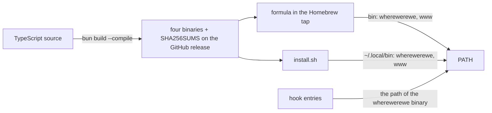

# Shipping

- **Status:** agreed
- **Decision records:** [0022](../../decisions/0022-ship-compiled-binaries-through-the-tap-and-an-install-script.md), [0007](../../decisions/0007-hooks-do-not-build-on-agent-hooks.md)

The tool ships as one compiled binary per platform, for macOS and Linux on arm64 and x64, so the machine needs no runtime. Each release attaches the four binaries and a `SHA256SUMS` file to its GitHub release, and writes the formula in the owner's Homebrew tap. A build agent reads this doc to build the binaries, the install script and the release, in the slice [build-order.md](build-order.md) names.

## Shape



## Contracts

```json
{
  "name": "@wherewerewe/cli",
  "private": true,
  "type": "module",
  "bin": { "www": "./src/cli.ts", "wherewerewe": "./src/cli.ts" }
}
```

The package is private and goes to no registry. Its `bin` serves a development install and `rig.config.ts`, and each release ships the compiled binary in its place. In a release, `www` is a link to `wherewerewe`, so both names run the same file.

```text
$ brew install zgeoff/tap/wherewerewe
$ curl -fsSL https://raw.githubusercontent.com/zgeoff/wherewerewe/main/install.sh | sh
$ wherewerewe --version
wherewerewe 0.2.0
```

`install.sh` puts the binary in `~/.local/bin`, or in the folder `WHEREWEREWE_INSTALL_DIR` names, and replaces any earlier copy in place, so the path of the binary never changes. It moves the binary into place only when its hash matches its line in the release's `SHA256SUMS`, and exits 1 with one line when the download, the checksums or the hash tool is missing or wrong.

A build agent installs a copy of the binary built from its worktree, so removing the worktree later never breaks the installed tool:

```bash
bun run build:binaries linux-x64
mkdir -p ~/.local/bin
cp dist/wherewerewe-linux-x64 ~/.local/bin/wherewerewe
[ -e ~/.local/bin/www ] || ln -s wherewerewe ~/.local/bin/www
```

The last line links `www` only when no `www` exists, so another tool's `www` stays. For the target of another machine, name it in place of `linux-x64`: `darwin-arm64`, `darwin-x64`, `linux-x64` or `linux-arm64`. To test the script itself, point it at a local build with `WHEREWEREWE_RELEASE_URL=file://<folder>`, where the folder holds `dist/`'s files, and `WHEREWEREWE_INSTALL_DIR=<folder>`.

## Constraints

- The repo is a Bun workspace with the one package in `packages/cli`, as the repo-standard skill sets up.
- `src/cli.ts` starts with `#!/usr/bin/env -S bun --no-env-file --config=/dev/null` and is executable, so a development install runs it with Bun. A release runs the compiled binary and never reads the shebang.
- The release binary is compiled with `--no-compile-autoload-dotenv` and `--no-compile-autoload-bunfig`, so it loads no `.env` and no `bunfig.toml` from the folder it starts in, as [commands.md](commands.md) requires of `www`.
- A hook entry runs `<bin> hook <harness>`, where `<bin>` is the path that `command -v wherewerewe` printed at install, kept as printed. The binary needs no runtime, so a hook whose `PATH` lacks Bun runs it. `www doctor` reports an entry whose path is gone or is no longer the first `wherewerewe` on `PATH`.
- Code that only the brief needs, such as the checks and the renderer, loads lazily, so a hook for an unbound session meets the 150 ms limit in [sessions-and-hooks.md](sessions-and-hooks.md).
- The tool needs `gh` only for `pr` checks, and `git` only for `branch` and `path` checks. Without them, those checks read `unchecked`.
- Releases go to GitHub release assets and the Homebrew tap through release-please and the release GitHub App, with no hand step after the owner merges the release pull request.

## A machine with no tool

Until the tool is installed, the agent reads the store as text:

```bash
column -t -s $'\t' ~/.local/state/wherewerewe/tide-alerts/items.tsv
```

## Decisions

- **Compiled binaries through the Homebrew tap and an install script.** The binary needs no runtime, and one path serves every hook entry. [0022](../../decisions/0022-ship-compiled-binaries-through-the-tap-and-an-install-script.md)
- **Two bin names.** `www` for typing, and `wherewerewe` for hook entries and docs, where a clash with another tool named `www` must never break anything.
- **The hooks do not build on `@zgeoff/agent-hooks`.** That package installs per repo, runs a fixed list of handlers, and parses neither `SessionStart` nor the Claude Code `session_id`. The tool keeps its own two small parsers, after the same split by harness. [0007](../../decisions/0007-hooks-do-not-build-on-agent-hooks.md)

## Builder decides

- How lazy loading is split across modules.
