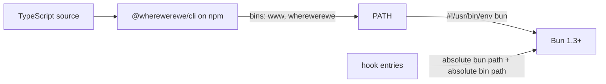

# Shipping

- **Status:** agreed
- **Decision records:** [0006](../../decisions/0006-ship-typescript-source-run-by-bun.md), [0022](../../decisions/0022-ship-compiled-binaries-through-the-tap-and-an-install-script.md), [0007](../../decisions/0007-hooks-do-not-build-on-agent-hooks.md)

The tool ships as its TypeScript source, with a Bun shebang on the command file, as the repo-standard skill sets up for a CLI that does not need Node. Bun runs it with no build step, and a small TypeScript command starts in a few milliseconds. An agent with no Bun installs it with one command, or reads the store's plain text files until then. A build agent reads this doc to build the package and its install, in the slice [build-order.md](build-order.md) names.

## Shape



## Contracts

```json
{
  "name": "@wherewerewe/cli",
  "type": "module",
  "bin": { "www": "./src/cli.ts", "wherewerewe": "./src/cli.ts" },
  "files": ["src", "!src/**/*.test.ts"],
  "engines": { "bun": ">=1.3" }
}
```

```text
$ bun add -g @wherewerewe/cli
$ www doctor
```

Until the first release, a build agent installs a copy from its worktree, so removing the worktree later never breaks the installed tool:

```bash
cd packages/cli && bun pm pack
bun add -g "$PWD/wherewerewe-cli-<version>.tgz"
```

## Constraints

- The repo is a Bun workspace with the one package in `packages/cli`, as the repo-standard skill sets up.
- `src/cli.ts` starts with `#!/usr/bin/env bun` and is executable.
- A hook entry runs `<path of the wherewerewe binary> hook <harness>`, the path taken from `command -v wherewerewe` at install and kept unresolved ([0022](../../decisions/0022-ship-compiled-binaries-through-the-tap-and-an-install-script.md)). `www doctor` reports the path when it is gone or no longer first on `PATH`.
- Code that only the brief needs, such as the checks and the renderer, loads lazily, so a hook for an unbound session meets the 150 ms limit in [sessions-and-hooks.md](sessions-and-hooks.md).
- The tool needs `gh` only for `pr` checks, and `git` only for `branch` and `path` checks. Without them, those checks read `unchecked`.
- Releases go to npm through release-please and OIDC trusted publishing, as the repo-standard skill sets up. The first publish is an owner step, through the npm-publish skill.

## An agent with no Bun

The agent installs Bun with `npm install -g bun`, or with the installer on bun.com, then installs the tool. Until then, it reads the store as text:

```bash
column -t -s $'\t' ~/.local/state/wherewerewe/tide-alerts/items.tsv
```

## Decisions

- **TypeScript source run by Bun, no build.** It is the repo-standard default, and it needs no build step, no bundle and no source map. [0006](../../decisions/0006-ship-typescript-source-run-by-bun.md)
- **Two bin names.** `www` for typing, and `wherewerewe` for hook entries and docs, where a clash with another tool named `www` must never break anything.
- **The hooks do not build on `@zgeoff/agent-hooks`.** That package installs per repo, runs a fixed list of handlers, and parses neither `SessionStart` nor the Claude Code `session_id`. The tool keeps its own two small parsers, after the same split by harness. [0007](../../decisions/0007-hooks-do-not-build-on-agent-hooks.md)

## Builder decides

- How lazy loading is split across modules.
