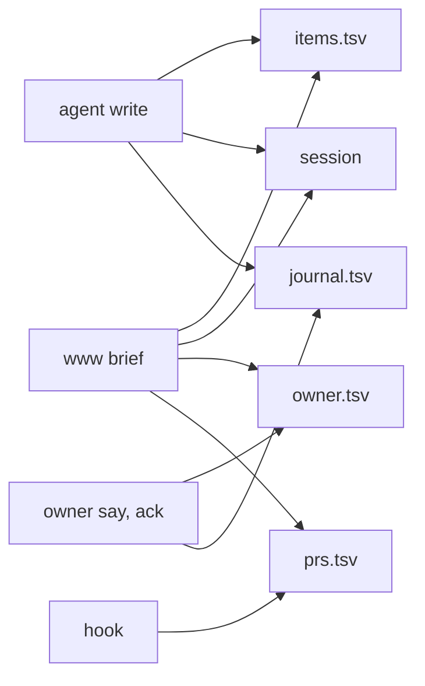

# The store

- **Status:** draft
- **Decision records:** [0001](../../decisions/0001-the-store-is-plain-tsv-files.md)

Each session keeps its state in one folder of plain UTF-8 text files that a person can read with `less` and an agent can read with `cut` when the tool is missing. `session`, `items.tsv` and `owner.tsv` are rewritten whole and capped by the limits in [brief.md](brief.md), so they stay the same size on day 14 as on day 2. `prs.tsv` gains one row per pull request the session opens, but a read probes and prints only the rows still open, and the brief shows at most 3. The journal grows, and nothing reads it whole by default. A build agent reads this doc to build the store module, `www import` and the lock, in the slice [build-order.md](build-order.md) names.

## Shape



## Contracts

### Layout

```text
${XDG_STATE_HOME:-$HOME/.local/state}/wherewerewe/       the root
  .bindings/
    claude-<agent session id>     one file per bound agent session: name=<session>
    codex-<agent session id>
  hook-errors.log                 the last 200 hook errors, newest last
  <session>/                      one folder per session, named by www init
    session                       key=value lines                      rewritten on each write
    items.tsv                     one row per open item                rewritten on each write; capped
    owner.tsv                     the owner's notes still showing      rewritten by say and ack only
    prs.tsv                       pull requests this session opened    appended by the hook; state set by reads
    journal.tsv                   every write, decision and change     append-only
    lock                          exists while a write runs: pid=<n> ts=<iso>
    import-backup/                the hand-kept files, only after www import
```

### session

```text
format=1                         # the store's format version; see "Versions"
name=tide-alerts                 # 2–24 of [a-z0-9-], starts with a letter; equals the folder name
goal=Ship tide alerts in bosun-api and bosun-app: a push alert 2 hours before low water at a saved harbour, behind the tide_alerts flag. Done when alerts-e2e passes on staging.   # 1–200 characters
started=2026-03-02T08:04:11Z     # every timestamp in the store is ISO 8601 UTC, to the second, with Z
now=pr-api-77                    # an open item's id, or empty
now_next=watch CI on 3e1f0aa, then request review    # 1–120 characters, or empty
now_set=2026-03-10T10:31:09Z
last_write=2026-03-10T11:02:40Z
last_nudge=2026-03-10T10:40:00Z  # written by the hook; empty until the first nudge
imported_from=0-by-hand          # only in a store that www import converted
```

### items.tsv

```text
id	kind	claim	check	at_write	last	written	by	extra
pr-api-77	task	Alert job retries a 503 from the tide feed; pushed 3e1f0aa	pr:bosunhq/bosun-api#77	OPEN pending	OPEN failing	2026-03-10T10:31:09Z	agent	-
w-apns	wait	upload the staging push key to the vault	-	-	-	2026-03-08T09:03:11Z	agent	who=owner
ok-merge	ok	merge the alert PRs yourself once CI is green	-	-	-	2026-03-02T08:09:47Z	agent	who=owner;where=terminal;scope=bosun-api, bosun-app;use=standing
```

```ts
// store module
type Kind = 'task' | 'wait' | 'ok' | 'rule' | 'where';

interface Item {
  id: ItemID;
  kind: Kind;
  claim: string; // 1–120 characters, one line; for an ok item, the owner's exact words
  check: CheckRef | null; // '-' on disk; a rule never has one
  atWrite: string | null; // the check's result when the claim was written; '-' means not checked yet
  last: string | null; // the check's result at the last read that could save it
  written: string; // when the claim was last written
  by: 'agent' | 'owner' | 'import'; // who ran the command; import for rows www import made
  extra: Extra; // '-' on disk when empty; otherwise key=value pairs joined by ';'
}

// An id is 2–16 of [a-z0-9-], starts with a letter, and never matches ^[do]-[0-9]+$,
// which the tool keeps for decisions (d-<n>) and owner notes (o-<n>).
type ItemID = string;

interface Extra {
  who?: string; // wait and ok: who it waits on, or who gave the approval; 1–16 characters
  where?: string; // ok: where the words were given, such as terminal, chat or a PR; 1–16 characters
  scope?: string; // ok: what the approval covers; 1–40 characters
  use?: 'once' | 'standing'; // ok only
  blocked_by?: ItemID; // task: an open task or wait
  pid_start?: string; // pid checks: the process start time read at write, on Linux only
}

// The check's grammar. checks.md owns what each probe returns.
type CheckRef =
  | `pr:${string}/${string}#${number}` // pr:bosunhq/bosun-api#77
  | `branch:${string}@${string}` // branch:/home/sam/src/bosun-api@tz-fix; the path is absolute
  | `path:${string}` // path:/home/sam/src/bosun-api/.worktrees/tz-fix; absolute
  | `pid:${number}`; // pid:48211
```

### journal.tsv

```text
ts	op	id	by	text	why	extra
2026-03-10T10:48:15Z	decide	d-23	agent	Retry a 503 from the tide feed 3 times, 2 s apart	The feed returns 503 for about 4 s during its hourly refresh	on=pr-api-77;who=agent
2026-03-10T11:43:05Z	changed	pr-app-61	agent	OPEN passing -> MERGED	-	-
```

```ts
// store module
interface JournalRow {
  ts: string;
  op: Op | string; // a row that www import carried over keeps its own op
  id: string; // the item, decision (d-<n>), owner note (o-<n>), pull request ref, or session name
  by: 'agent' | 'owner' | 'hook' | 'import';
  text: string; // the claim (for done, drop and use, the claim at close), the choice, the note, or "<old> -> <new>" for changed; '-' when none
  why: string; // the reason (decide, ruled-out, drop), the evidence (done), or what it was used for (use); '-' when none
  extra: string; // key=value pairs joined by ';' with no free text, such as on=<id>;who=owner;replaces=d-4
}

type Op =
  | 'init' | 'import' | 'bind' | 'goal' | 'now'
  | 'task' | 'wait' | 'ok' | 'rule' | 'where' | 'set'
  | 'decide' | 'ruled-out' | 'done' | 'drop' | 'use'
  | 'say' | 'ack' | 'changed' | 'pr';
```

### owner.tsv and prs.tsv

```text
id	text	said	on
o-2	Don't touch the prod push certificate, even with ok-merge. Ask me first.	2026-03-10T09:40:12Z	-
```

```text
ref	opened	state	seen
bosunhq/bosun-app#64	2026-03-10T08:41:30Z	OPEN	2026-03-10T11:43:04Z
```

- `owner.tsv`: `id` is `o-<n>`, numbered from 1 for the session; `text` is 1–160 characters; `on` is an item id or `-`.
- `prs.tsv`: `ref` is `<owner>/<repo>#<n>`; `state` is `OPEN`, `MERGED`, `CLOSED` or `-` before the first read; `seen` is the time of that state.

## Constraints

- Every file is UTF-8 with LF line endings, and every `.tsv` starts with its header row.
- A cell never holds a tab or a newline: each write refuses them, so no cell needs escaping.
- A value in `extra` never holds `;` or `=`; the tool refuses a `--who`, `--where` or `--scope` that holds one.
- `items.tsv` holds only open items. `done`, `drop` and `use` of a once approval remove the row and add a journal row.
- An id closed once is never reused in that session: a new item with a closed id is refused.
- Each write takes `lock` with an exclusive create, rewrites each changed file through a temporary file and a rename in the same folder, appends its journal rows, and removes `lock`.
- A write waits up to 2 s for `lock`, then refuses. A lock whose pid is gone, or that is older than 30 s, is stale: the next write removes it and goes on.
- A read takes `lock` only to save check results and `changed` rows. When `lock` is held or the folder is not writable, the read still prints the brief and saves nothing; [brief.md](brief.md) says what the header shows then.
- The journal is never rewritten, with one exception: `www import` rewrites the hand-kept journal into format 1 once, after it copies the original into `import-backup/`. Nothing reads the journal whole, except `www log` with no filter.
- A session folder is never deleted by the tool.

## Versions

- `format=1` is the first format the tool writes. The tool reads a store whose `format` it knows, and writes it in the same format.
- A store with `format=0-by-hand`, or with no `format` line, exits 5 and asks for `www import <session>`.
- A store with a newer format than the tool knows exits 5 and asks for an upgrade, with the command in [commands.md](commands.md).
- A later format ships with a converter that `www import` runs. A read never converts a store.

## Import of the hand-kept store

`www import <session>` converts the folder `<root>/<session>/` from `format=0-by-hand` to `format=1` in place. It reads a `session` file with no `format` line as `format=0-by-hand`. It checks every row first, writes nothing when any row breaks a rule, copies the original `session`, `items.tsv` and `journal.tsv` into `import-backup/`, then writes the new files. It binds the agent session that runs it, as `www init` does.

| In the hand-kept store                                          | In format 1                                                                                   |
| --------------------------------------------------------------- | --------------------------------------------------------------------------------------------- |
| `session`: name, goal, started, now, now_next, now_set          | the same keys; `format=1`, `imported_from=0-by-hand`, `last_write` = the newest journal `ts`  |
| `items.tsv` row of kind task, wait, ok, rule or where           | the same row, with `by` kept; each write rule applies, such as the 120-character claim       |
| `extra` token with `=`, such as `who=owner` or `blocked_by=t-repo` | the same pair                                                                              |
| `extra` bare token `once` or `standing`                         | `use=once` or `use=standing`                                                                  |
| journal `decide` row with text `<choice> \| why: <reason>`      | `decide`, `text` = the choice, `why` = the reason                                             |
| journal `open` row (an open question, such as `q-4`)            | a `wait` item with `who=owner`, unless a later `closed` row names the same id; a `wait` row  |
| journal `closed` row                                            | a `done` row with `why` = its text                                                            |
| journal `done` row for an id that is no item                    | the same row, history only                                                                    |
| journal `say` row (owner words the agent wrote down)            | the same row with `by=import`, history only; `owner.tsv` starts empty                        |
| any other journal op, such as `init` or `note`                  | the same row with `by=import`                                                                 |
| no `prs.tsv` or `owner.tsv`                                     | each created with its header row                                                              |

- Import applies every limit a write applies to items and to `session`: lengths, ids, kinds and caps. Journal rows keep their text at any length.
- Import never turns an agent-written row into an owner note: an owner note's author is the owner.
- When a row breaks a rule, import exits 3 with one line per row, in the text [commands.md](commands.md) fixes. The agent fixes those rows in the hand-kept files, for example by shortening a claim or appending a `closed` row for a question it settled, and runs import again.
- On the hand-kept store as it stands at design time, import refuses: 6 open questions against the cap of 4 waits in [brief.md](brief.md), and claims, questions and `now_next` over their limits. Those are the rows the agent fixes first.
- A row's `ts` and `written` values are kept as they are.

## Decisions

- **Plain TSV and key=value files, with a format line.** The owner reads them with `less`, and an agent with no tool reads them with `cut`. [0001](../../decisions/0001-the-store-is-plain-tsv-files.md)
- **Import converts in place and keeps a backup.** The hand-kept folder is already at the root under the session's name, and the backup is the session's only copy of what came before.
- **The owner's notes live in their own file.** An agent write never opens `owner.tsv` for writing, so a bug in a write cannot drop an owner note.

## Builder decides

- How the lock waits: polling interval and backoff.
- Whether `hook-errors.log` is trimmed on each write or when it passes 200 lines.
- The order of `extra` keys on disk.
