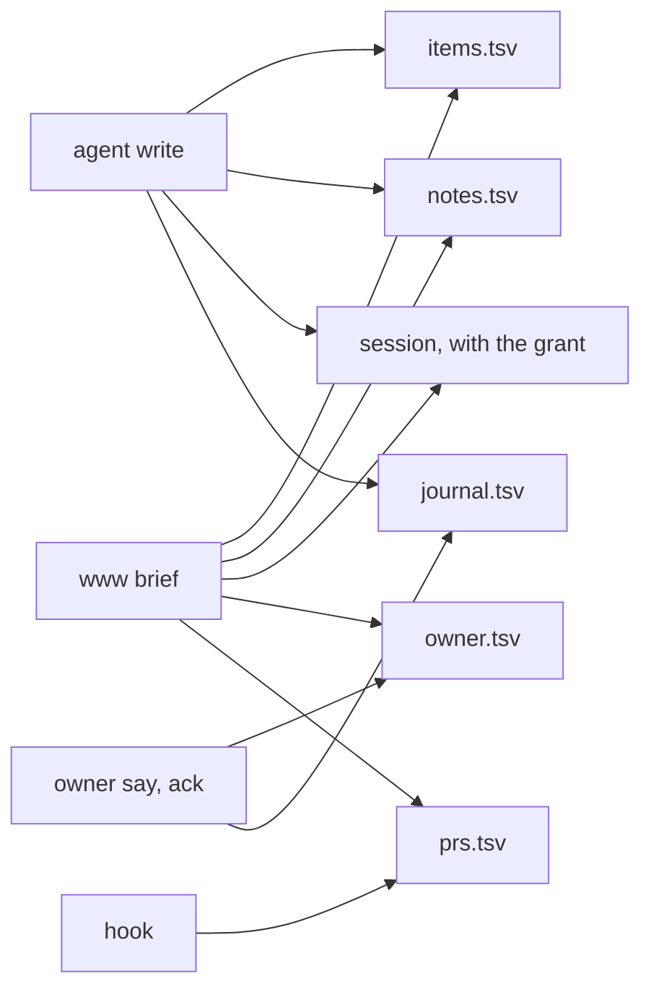

# The store

- **Status:** agreed
- **Decision records:** [0001](../../decisions/0001-the-store-is-plain-tsv-files.md), [0008](../../decisions/0008-notes-the-grant-and-no-caution-steering.md)

Each session keeps its state in one folder of plain UTF-8 text files that a person can read with `less` and an agent can read with `cut` when the tool is missing. `session`, `items.tsv`, `notes.tsv` and `owner.tsv` are rewritten whole and capped by the limits in [brief.md](brief.md), so they stay the same size on day 14 as on day 2. `prs.tsv` gains one row per pull request the session opens, but a read probes and prints only the rows still open, and the brief shows at most 1. The journal grows, and nothing reads it whole by default. A build agent reads this doc to build the store module, `www import`, the format 2 upgrade and the lock, in the slice [build-order.md](build-order.md) names.

## Shape



## Contracts

### Layout

```text
${XDG_STATE_HOME:-$HOME/.local/state}/wherewerewe/       the root
  .bindings/
    claude-<agent session id>     one file per bound agent session: name=<session>
    codex-<agent session id>
  hook-errors.log                 the last 200 hook errors, newest last
  <session>/                      one folder per session, named by www init
    session                       key=value lines, with the grant      rewritten on each write
    items.tsv                     one row per open item                rewritten on each write; capped
    notes.tsv                     one row per open item with a note    rewritten by each note write and close
    owner.tsv                     the owner's notes still showing      rewritten by say and ack only
    prs.tsv                       pull requests this session opened    appended by the hook; state set by reads
    journal.tsv                   every write, decision and change     append-only
    lock                          exists while a write runs: pid=<n> ts=<iso>
    import-backup/                the hand-kept files, only after www import of a hand-kept store
    format-1-backup/              the format 1 files, only after the format 2 upgrade
```

### session

```text
format=2                         # the store's format version; see "Versions"
name=tide-alerts                 # 2–24 of [a-z0-9-], starts with a letter; equals the folder name
goal=Ship tide alerts in bosun-api and bosun-app: a push alert 2 hours before low water at a saved harbour, behind the tide_alerts flag. Done when alerts-e2e passes on staging.   # 1–200 characters
grant=Merge the alert PRs in bosun-api and bosun-app yourself once CI is green and every review finding is answered. Deploy either app to staging whenever you need to, and wipe or reseed the staging alerts table as often as you like. Open PRs on tidal-org/tidekit from our fork. Keep away from the prod push certificate and the prod database, and don't publish a tidekit release.   # the owner's words, 1–700 characters, or empty
grant_reading=covers merges in both repos on green CI with findings answered, staging deploys, the staging alerts table, tidekit PRs; kept back: prod push certificate, prod database, tidekit releases   # 1–200 characters, or empty
grant_where=chat                 # where the owner gave the words; 1–16 characters, or empty
grant_set=2026-03-03T09:12:40Z   # when the words were last written; a new reading alone keeps it
started=2026-03-02T08:04:11Z     # every timestamp in the store is ISO 8601 UTC, to the second, with Z
now=pr-api-77                    # an open item's id, or empty
now_next=watch CI on 3e1f0aa, then request review    # 1–120 characters, or empty
now_set=2026-03-10T10:31:09Z
last_write=2026-03-10T11:02:40Z
last_nudge=2026-03-10T10:40:00Z  # written by the hook; empty until the first nudge
imported_from=0-by-hand          # only in a store that www import converted from a hand-kept store
```

The four `grant` keys are all set or all empty. A store with no grant writes them empty.

### items.tsv

```text
id	kind	claim	check	at_write	last	written	by	extra
pr-api-77	task	Alert job retries a 503 from the tide feed; pushed 3e1f0aa	pr:bosunhq/bosun-api#77	OPEN pending	OPEN failing	2026-03-10T10:31:09Z	agent	-
w-apns	wait	upload the staging push key to the vault	-	-	-	2026-03-08T09:03:11Z	agent	who=owner
ok-prod-index	ok	add the harbour_id index on the prod alerts table, once, after 22:00	-	-	-	2026-03-10T09:58:02Z	agent	who=owner;where=chat;scope=prod alerts table
```

```ts
// store module
type Kind = 'task' | 'wait' | 'ok' | 'rule' | 'where';

interface Item {
  id: ItemID;
  kind: Kind;
  claim: string; // 1–120 characters, one line; for an ok item, the owner's exact words
  check: CheckRef | null; // '-' on disk; a rule never has one
  atWrite: string | null; // the check's result when the claim was written; '-' means not checked yet
  last: string | null; // the check's result at the last read that could save it
  written: string; // when the claim was last written; a write that changes only the note keeps it
  by: 'agent' | 'owner' | 'import'; // who ran the command; import for rows www import made
  extra: Extra; // '-' on disk when empty; otherwise key=value pairs joined by ';'
}

// An id is 2–16 of [a-z0-9-], starts with a letter, is not grant, and never matches
// ^[do]-[0-9]+$, which the tool keeps for decisions (d-<n>) and owner notes (o-<n>).
type ItemID = string;

interface Extra {
  who?: string; // wait and ok: who it waits on, or who gave the approval; 1–16 characters
  where?: string; // ok: where the words were given, such as terminal, chat or a PR; 1–16 characters
  scope?: string; // ok: what the approval covers; 1–40 characters
  blocked_by?: ItemID; // task: an open task or wait
  pid_start?: string; // pid checks: the process start time read at write, on Linux only
}

// The check's grammar. checks.md owns what each probe returns.
type CheckRef =
  | `pr:${string}/${string}#${number}` // pr:bosunhq/bosun-api#77
  | `branch:${string}@${string}` // branch:/home/sam/src/bosun-api@tz-fix; the path is absolute
  | `path:${string}` // path:/home/sam/src/bosun-api/.worktrees/tz-fix; absolute
  | `pid:${number}`; // pid:48211
```

An `ok` item is a one-time approval: `use` spends it. Lasting permission lives in the grant.

### notes.tsv

```text
id	owed	written	note
pr-api-77	-	2026-03-10T10:42:18Z	The 503s come from the feed's hourly refresh, about 4 s long (d-23). Retry 3 times, 2 s apart: a longer backoff makes the alert miss its 2-hour window. The lint job fails on an unused import in the retry helper, not on the retry logic.
t-flag	owed	2026-03-08T16:20:51Z	Turn the tide_alerts flag back off in staging config before this closes: staging is shared with the harbour team, who demo on Thursday.
```

```ts
// store module
interface Note {
  id: ItemID; // an open item in items.tsv; at most one row per id
  owed: boolean; // 'owed' or '-' on disk; an owed note refuses done, drop and use of its item
  written: string; // when this note was written
  note: string; // 1–400 characters, one line; the credential test applies
}
```

### journal.tsv

```text
ts	op	id	by	text	why	extra
2026-03-03T09:12:40Z	grant	grant	agent	Merge the alert PRs in bosun-api and bosun-app yourself once CI is green and every review finding is answered. Deploy either app to staging whenever you need to, and wipe or reseed the staging alerts table as often as you like. Open PRs on tidal-org/tidekit from our fork. Keep away from the prod push certificate and the prod database, and don't publish a tidekit release.	covers merges in both repos on green CI with findings answered, staging deploys, the staging alerts table, tidekit PRs; kept back: prod push certificate, prod database, tidekit releases	where=chat
2026-03-10T10:42:18Z	note	pr-api-77	agent	The 503s come from the feed's hourly refresh, about 4 s long (d-23). Retry 3 times, 2 s apart: a longer backoff makes the alert miss its 2-hour window. The lint job fails on an unused import in the retry helper, not on the retry logic.	-	-
2026-03-10T10:48:15Z	decide	d-23	agent	Retry a 503 from the tide feed 3 times, 2 s apart	The feed returns 503 for about 4 s during its hourly refresh	on=pr-api-77;who=agent
2026-03-10T11:43:05Z	changed	pr-app-61	agent	OPEN passing -> MERGED	-	-
```

```ts
// store module
interface JournalRow {
  ts: string;
  op: Op | string; // a row that www import carried over keeps its own op
  id: string; // the item, decision (d-<n>), owner note (o-<n>), pull request ref, grant, or session name
  by: 'agent' | 'owner' | 'hook' | 'import';
  text: string; // the claim (for done, drop and use, the claim at close), the choice, the note, the grant's words, or "<old> -> <new>" for changed; '-' when none
  why: string; // the reason (decide, ruled-out, drop), the evidence (done), what it was used for (use), or the grant's reading (grant); '-' when none
  extra: string; // key=value pairs joined by ';' with no free text, such as on=<id>;who=owner;replaces=d-4, owed=1, cleared=1 or where=chat
}

type Op =
  | 'init' | 'import' | 'bind' | 'goal' | 'grant' | 'now'
  | 'task' | 'wait' | 'ok' | 'rule' | 'where' | 'set' | 'note'
  | 'decide' | 'ruled-out' | 'done' | 'drop' | 'use'
  | 'say' | 'ack' | 'changed' | 'pr';
```

- Each note write adds a `note` row: `id` is the item, `text` is the note, and `extra` is `owed=1` for an owed note. Clearing a note adds a `note` row with `text` `-` and `extra` `cleared=1`. A close adds no `note` row; its own row closes the note with the item.
- Each `www grant` adds a `grant` row with `id` `grant`, the words in `text` and the reading in `why`, both whole, so the journal keeps every version.
- A `note` row that `www import` carried from a hand-kept store keeps `by=import` and its own id, such as `n-12`, which names no item.

### owner.tsv and prs.tsv

```text
id	text	said	on
o-2	The reading misses tidekit: the grant covers opening PRs there, never merging them.	2026-03-10T09:40:12Z	-
```

```text
ref	opened	state	seen
bosunhq/bosun-app#64	2026-03-10T08:41:30Z	OPEN	2026-03-10T11:43:04Z
```

- `owner.tsv`: `id` is `o-<n>`, numbered from 1 for the session; `text` is 1–160 characters; `on` is an item id or `-`.
- `prs.tsv`: `ref` is `<owner>/<repo>#<n>`; `state` is `OPEN`, `MERGED`, `CLOSED` or `-` before the first read; `seen` is the time of that state.

## Constraints

- Every file is UTF-8 with LF line endings, and every `.tsv` starts with its header row.
- A cell or a `session` value never holds a tab or a newline: each write refuses them, so no cell needs escaping. `www grant` is the one exception: it turns each line break in the owner's words into one space before it checks the length.
- A value in `extra` never holds `;` or `=`; the tool refuses a `--who`, `--where` or `--scope` that holds one.
- `items.tsv` holds only open items. `done`, `drop` and `use` remove the item's row and its `notes.tsv` row, and add one journal row.
- `notes.tsv` holds only notes on open items, at most one per item, so it holds at most 20 rows. A missing `notes.tsv` reads as no notes.
- An id closed once is never reused in that session: a new item with a closed id is refused.
- Each write takes `lock` with an exclusive create, appends its journal rows, rewrites each changed file through a temporary file and a rename in the same folder, and removes `lock`. The journal goes first because a write reads it to refuse a closed id, so a write that stops after the append leaves the id closed and its item still open, never an item gone while its id can be reused.
- A write waits up to 2 s for `lock`, then refuses. A lock whose pid is gone, or that is older than 30 s, is stale: the next write removes it and goes on.
- A read takes `lock` only to save check results and `changed` rows. When `lock` is held or the folder is not writable, the read still prints the brief and saves nothing; [brief.md](brief.md) says what the header shows then.
- The journal is never rewritten, with one exception: `www import` rewrites a hand-kept journal into the current format once, after it copies the original into `import-backup/`. The format 2 upgrade only appends to the journal. Nothing reads the journal whole, except `www log` with no filter.
- A session folder is never deleted by the tool.

## Versions

- `format=2` is the format the tool writes. Format 2 adds the four `grant` keys to `session`, has no `use` key in `extra`, and holds at most one `ok` item. `notes.tsv` belongs to format 1 and format 2 alike.
- The tool reads and writes only a store in format 2.
- A store with `format=1` exits 5 on every command except `www import`, `www sessions` and `www help`, and asks for `www import <session>`, which upgrades it in place. [commands.md](commands.md) fixes the text.
- A store with `format=0-by-hand`, or with no `format` line, exits 5 and asks for `www import <session>`.
- A store with a newer format than the tool knows exits 5 and asks for an upgrade of the tool, with the command in [commands.md](commands.md).
- A read never converts a store. Each later format ships with an upgrade that `www import` runs.

## The format 2 upgrade

`www import <session>` on a format 1 store upgrades it to format 2 in place. It takes the store lock, checks the store first, and writes nothing when a check fails.

```text
$ www import tide-alerts --quote "Merge the alert PRs in bosun-api and bosun-app yourself once CI is green …" --where chat --reading "covers merges in both repos on green CI …; kept back: …"
Upgraded tide-alerts to format 2: grant 373 of 700 characters, 2 standing approvals folded into it, 1 one-time approval kept. Originals in /home/sam/.local/state/wherewerewe/tide-alerts/format-1-backup/.
```

| In the format 1 store                                  | In format 2                                                                                     |
| ------------------------------------------------------ | ----------------------------------------------------------------------------------------------- |
| `session` with `format=1`                              | the same keys, `format=2`, and the four `grant` keys from `--quote`, `--where` and `--reading`, or empty without them |
| an `ok` item with `use=standing`                       | removed, with its note; a `drop` row with `why` `folded into the grant by the format 2 upgrade` |
| an `ok` item with `use=once`                           | the same row without `use`, unless `--drop` names it                                           |
| an item that `--drop` names                            | removed, with its note; a `drop` row with `why` `dropped by the format 2 upgrade`              |
| every other item, note, owner note and pull request row | the same row                                                                                   |
| the journal                                            | the same rows, then the rows above, a `grant` row when `--quote` is given, and an `import` row with `text` `format 1 -> 2` |

- When the store holds a standing approval and the command has no `--quote`, the upgrade refuses. The refusal prints each standing approval's words and scope, and a `Run:` line with `--quote`, `--where` and `--reading`. The agent writes the grant in the same command that removes the standing approvals, so no brief ever shows neither.
- When the store holds more than one one-time approval, the upgrade refuses, names each with its age, and prints a `Run:` line whose `--drop` names every one except the newest.
- When the store holds an item with the id `grant`, the upgrade refuses, and its `Run:` line adds `grant` to `--drop`.
- The upgrade prints each note it removes in its reply, after the first line, so an owed note on a standing approval reaches the agent.
- Before it writes, the upgrade copies `session`, `items.tsv`, `notes.tsv` when it exists, and `journal.tsv` into `format-1-backup/`. It never overwrites a file already there, so a second run after a crash keeps the first copy.
- The upgrade writes the journal rows first, then `items.tsv` and `notes.tsv`, and `session` last, so a store that still reads `format=1` can run the upgrade again.
- The upgrade binds the agent session that runs it, as `www init` does.
- Every limit of `www grant` applies to `--quote`, `--where` and `--reading`; [commands.md](commands.md) gives them.

## Import of the hand-kept store

`www import <session>` converts the folder `<root>/<session>/` from `format=0-by-hand` to `format=2` in place. It reads a `session` file with no `format` line as `format=0-by-hand`. It checks every row first, writes nothing when any row breaks a rule, copies the original `session`, `items.tsv` and `journal.tsv` into `import-backup/`, then writes the new files. It binds the agent session that runs it, as `www init` does. It takes the same `--quote`, `--where`, `--reading` and `--drop` flags as the format 2 upgrade, with the same rules for standing approvals, one-time approvals and an item named `grant`.

| In the hand-kept store                                          | In format 2                                                                                   |
| --------------------------------------------------------------- | --------------------------------------------------------------------------------------------- |
| `session`: name, goal, started, now, now_next, now_set          | the same keys; `format=2`, `imported_from=0-by-hand`, `last_write` = the newest journal `ts`, and the `grant` keys from the flags or empty |
| `items.tsv` row of kind task, wait, rule or where               | the same row, with `by` kept; each write rule applies, such as the 120-character claim       |
| `items.tsv` row of kind ok with the bare token `once`           | the same row without the token                                                                |
| `items.tsv` row of kind ok with the bare token `standing`       | no item; a `drop` row with `why` `folded into the grant by the format 2 upgrade`              |
| `extra` token with `=`, such as `who=owner` or `blocked_by=t-repo` | the same pair                                                                              |
| journal `decide` row with text `<choice> \| why: <reason>`      | `decide`, `text` = the choice, `why` = the reason                                             |
| journal `open` row (an open question, such as `q-4`)            | a `wait` item with `who=owner`, unless a later `closed` row names the same id; a `wait` row  |
| journal `closed` row                                            | a `done` row with `why` = its text                                                            |
| journal `done` row for an id that is no item                    | the same row, history only                                                                    |
| journal `say` row (owner words the agent wrote down)            | the same row with `by=import`, history only; `owner.tsv` starts empty                        |
| any other journal op, such as `init` or `note`                  | the same row with `by=import`                                                                 |
| no `prs.tsv`, `owner.tsv` or `notes.tsv`                        | each created with its header row                                                              |

- Import applies every limit a write applies to items and to `session`: lengths, ids, kinds and caps. Journal rows keep their text at any length.
- Import never turns an agent-written row into an owner note: an owner note's author is the owner.
- When a row breaks a rule, import exits 3 with one line per row, in the text [commands.md](commands.md) fixes. The agent fixes those rows in the hand-kept files, for example by shortening a claim or appending a `closed` row for a question it settled, and runs import again.
- On the hand-kept store as it stands at design time, import refuses: 6 open questions against the cap of 4 waits in [brief.md](brief.md), and claims, questions and `now_next` over their limits. Those are the rows the agent fixes first.
- A row's `ts` and `written` values are kept as they are.

## Decisions

- **Plain TSV and key=value files, with a format line.** The owner reads them with `less`, and an agent with no tool reads them with `cut`. [0001](../../decisions/0001-the-store-is-plain-tsv-files.md)
- **The grant lives in `session`, like the goal.** There is one per session, every write already rewrites `session`, and the format line changes with it, so an older tool refuses the store instead of dropping the grant. [0008](../../decisions/0008-notes-the-grant-and-no-caution-steering.md)
- **Notes live in their own file, which a missing file leaves empty.** Notes ship before format 2, so `notes.tsv` changes no format; each row names an open item, and a close removes it.
- **The format 2 upgrade takes the grant in the same command.** A store with standing approvals never passes through a state where the brief shows neither them nor a grant, so after any compaction the agent still reads what it may do.
- **Import and the upgrade convert in place and keep a backup.** The folder is already at the root under the session's name, and the backup is the session's only copy of what came before.
- **The owner's notes live in their own file.** An agent write never opens `owner.tsv` for writing, so a bug in a write cannot drop an owner note.

## Builder decides

- How the lock waits: polling interval and backoff.
- Whether `hook-errors.log` is trimmed on each write or when it passes 200 lines.
- The order of `extra` keys on disk.
