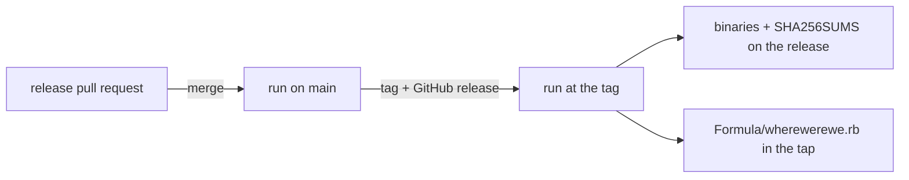

# Releasing

You cut a release by merging the release pull request by hand. release-please keeps one release pull
request open on `main`, and each releasable commit that lands updates its version bump and
changelog. Merging it starts a run on `main` that tags `@wherewerewe/cli@<version>`, and a second
run at the tag builds the four binaries, attaches them to the GitHub release with `SHA256SUMS`, and
writes the formula in the Homebrew tap. For what a release holds, read
[Shipping](../design/wherewerewe/README.md#shipping), and for how users install it, the
[install guide](../guides/install.md).



Between the two runs the release exists with no assets, so `install.sh` fails closed on its download
for those minutes.

## One-time setup

### The release App

A pull request that `GITHUB_TOKEN` creates starts no workflow, so a release pull request opened with
it gets no CI. The workflow uses a GitHub App token instead, and the same App writes to the tap.

1. Create a GitHub App, or reuse the release App of the owner's other repos, with the webhook off.
2. Give it read and write access to Contents and to Pull requests, and install it on
   `zgeoff/wherewerewe` and on the tap, `zgeoff/homebrew-tap`.
3. Generate a private key, and add these to the repo settings:
   - the Actions variable `RELEASE_APP_ID`, set to the App's client ID;
   - the Actions secret `RELEASE_APP_PRIVATE_KEY`, set to the `.pem` contents.
4. In the repo's Actions settings, allow GitHub Actions to create and approve pull requests.

### The Homebrew tap

The formula lives in a second repository, `zgeoff/homebrew-tap`, as `Formula/wherewerewe.rb`.

1. Check that the release App is installed on the tap.
2. Add the Actions variable `HOMEBREW_TAP`, set to `homebrew-tap`, the repository name alone.

With the variable set and the App missing from the tap, the ship job fails when it mints the tap
token. With the variable unset, the ship job attaches the binaries and leaves the formula alone.

### Turn the release on

Set the Actions variable `RELEASE_ENABLED` to `true` once the App and the tap are ready. Until then
workflows never open a release pull request, tag a release, or ship one.

### The required checks

Require `binaries / build` and each `binaries / smoke <target>` check in the `main` ruleset once
each has run. A smoke job skips when its build fails, and a skipped job counts as a pass, so require
the build check as well.

## Cut a release

1. Open the release pull request from the
   `release-please--branches--main--components--@wherewerewe/cli` branch, and wait for its checks to
   pass.
2. Squash-merge it. The merge starts the run on `main`, which tags the release and starts the run at
   the tag.
3. Run `gh release view '@wherewerewe/cli@<version>' -R zgeoff/wherewerewe`. Expect four binaries
   and `SHA256SUMS`.

## Recover a release

- **The release pull request has no checks.** `RELEASE_APP_ID` is unset, so the release job opened
  the pull request with `GITHUB_TOKEN`. Set up the App, then close and reopen the pull request.
- **The release is tagged, but its binaries or its formula are missing.** Run the workflow again at
  the tag, so the binaries build from the tagged commit:

  ```bash
  gh workflow run main.yml -R zgeoff/wherewerewe --ref '@wherewerewe/cli@<version>'
  ```

  The upload replaces assets of the same name, and refuses a build that lacks a platform or whose
  `SHA256SUMS` does not match its binaries. The formula push skips a formula that is already at the
  version, and leaves a tap that holds a newer version as it is.

- **A release needs a specific version.** Put `Release-As: <version>` in the footer of a commit that
  lands on `main`. A squash merge takes the footer from the squash body, so pass it there:

  ```bash
  gh pr merge <pr_number> --squash --body 'Release-As: <version>'
  ```
